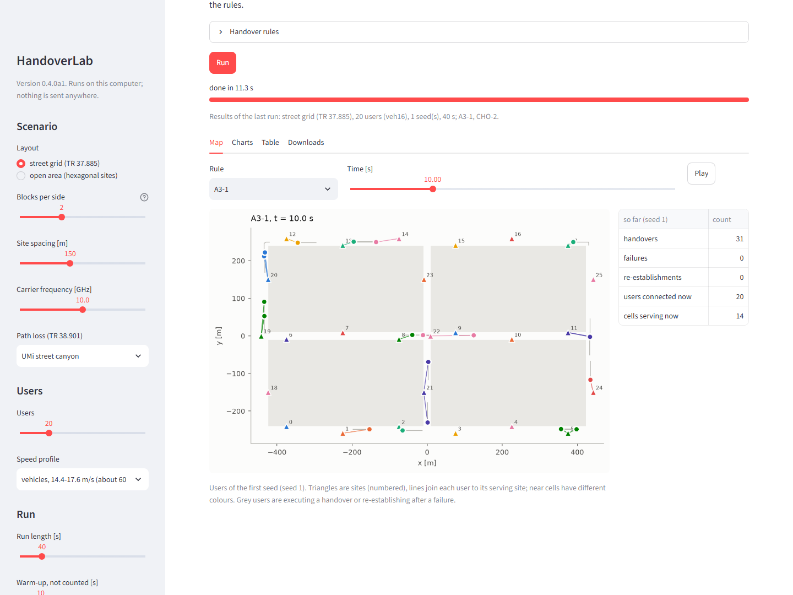

# HandoverLab

A system-level simulator for studying handover in dense 5G and beyond-5G networks, written in Python.

HandoverLab simulates 3GPP mobility procedures (baseline handover with Event A3, Release-16
conditional handover and DAPS handover, Release-18 L1/L2-triggered mobility) for many users moving through a street grid, an open area or along a highway, with a
received-power-level radio model from TR 38.901, an L3-filtered measurement chain, a radio-link
failure model, and an outcome label for every handover attempt.

> **Status: 1.0.0, the first stable release** (`python -m pip install handoverlab`). The public surface (configuration and result formats
> with a schema version, the rule interface, metric names, commands and the documented Python
> names) is frozen and follows the [stability policy](docs/stability.md): within 1.x it only grows,
> and anything removed is deprecated first.



## What 1.0.0 brings

1.0.0 is the first stable release: 1.0.0rc4 with the version and the release metadata set to
1.0.0, and HandoverLab is now installed from PyPI. Results, fingerprints, job IDs and the public
surface are as in 1.0.0rc4. The release candidates before it added the following.

## What 1.0.0rc4 changes

- **Checked 3GPP citations**: every clause, table and value cited in the scenario cards and the
  documentation was checked against the specifications; wrong clause numbers were corrected (for
  example, the highway lanes, lane width and road length are in TR 37.885 Table A-1, the
  inter-site distance of 500 m in clause 6.1.3), and the 35 m site offset is marked as an
  assumption.
- **Documentation audit**: stale statements, versions and option lists corrected; every example
  and code snippet checked.

Only text changed: results, fingerprints, job IDs and the public surface are as in 1.0.0rc3.

## What 1.0.0rc3 adds

- **A highway scenario** (`highway-10ghz`): a new layout kind `highway` (the straight multi-lane
  road of the TR 37.885 highway case, roadside sites at a configurable spacing and offset) and
  lane-keeping vehicles at 70-140 km/h (profiles `hwy`, `hwy70`, `hwy140`, or your own speed
  groups). See the how-to [a highway](docs/guides/highway.md).
- **Site lists from CSV files** (`layout.sites_file`), for every layout kind.

All of it is additive: existing defaults, results, fingerprints and study job IDs are unchanged.

## What 1.0.0rc2 adds

- **DAPS handover** (Rel-16, rule `daps`): the source keeps serving during the execution, and a
  failed execution falls back to the source instead of a re-establishment.
- **L1/L2-triggered mobility** (Rel-18, rule `ltm`): candidate cells configured in advance, cell
  switch decided on unfiltered L1 reports, a short RACH-less execution. Both come with base classes
  (`DAPSRule`, `LTMRule`) for your own rules and pass the rule contract kit.
- **A learning-based example rule** (`a3_bandit`): A3 offsets learned per cell by an
  epsilon-greedy bandit from the outcome labels.
- **An upper mid-band scenario** (`fr3-urban-15ghz`): the default grid at 15 GHz.
- How-to guides: [DAPS and LTM](docs/guides/daps-ltm.md),
  [a learning-based rule](docs/guides/learning-rule.md), [the upper mid-band](docs/guides/upper-mid-band.md).

All of it is additive: existing defaults, results and fingerprints are unchanged.

## What 1.0.0rc1 adds

- **A frozen public surface**: configuration and result files carry `schema: 1`; a newer schema is
  refused with a clear message instead of being misread. The rule interface has a version, metric
  names are stable (renamed metrics keep their old name as a warning alias), and a deprecation
  helper warns before anything goes. A test compares the surface with a stored snapshot. See
  [stability](docs/stability.md) and the [metric reference](docs/reference/metrics.md).
- **How-to guides**: [add a scenario](docs/guides/add-scenario.md),
  [run on many cores](docs/guides/many-cores.md),
  [export event logs](docs/guides/export-event-logs.md),
  [reproduce and check results](docs/guides/reproduce.md).
- **Quality gates in CI**: a lint job (ruff), a minimum test coverage, and a nightly workflow that
  runs the long verification on Linux and Windows and compares the golden fingerprints of both
  systems.
- **Release plumbing**: PyPI publishing with trusted publishing when a version tag is pushed,
  Zenodo metadata for an archived DOI, and the release steps in [RELEASING](docs/RELEASING.md).

## What stage 4 adds

- **Dashboard** (`pip install "handoverlab[gui]"`, then `handoverlab gui`): a local page in the
  browser to pick a street grid or open area, speed profile, frequency, users and up to four rules
  with their parameters; a run button with progress; a map of the users moving on the layout,
  coloured by serving cell (time slider and play); charts of handovers, failures and rate; and
  downloads of the results (CSV, JSON, event logs), the figures and an experiment file that
  `handoverlab run` repeats exactly. It runs on your computer only; the core package does not
  depend on it. See the [dashboard guide](docs/guides/dashboard.md).
- **Tutorials and reference**: [your first run](docs/tutorials/first-run.md),
  [writing your own rule](docs/tutorials/own-rule.md),
  [a fair tuning study](docs/tutorials/tuning-study.md),
  [reading the report](docs/tutorials/reading-the-report.md); an API reference generated from the
  docstrings and a command-line reference (`mkdocs build`, `pip install "handoverlab[docs]"`), and
  a workflow that builds the site and can publish it on GitHub Pages.
- **Event-log levels** `off`, `summary` and `full`: `full` adds a trace of the procedure
  (reports, preparations, configurations, executions, attachments, failures) from which the
  serving cell of every user follows at any time. The level never changes a result.
- **`handoverlab status STUDY`**: finished, failed and remaining jobs per stage, rule runs still to
  simulate and the time left, estimated from the study's own finished jobs.
- **Gate policy `extend`**: a grid whose selected value sits on its edge is widened with the same
  spacing and every method is tuned again with the same budget, up to a cap; each extension is a
  dated amendment in the study directory and the report.
- **Failure-model calibration against ns-3 / 5G-LENA, from stored ns-3 outputs only**: 96 % of the
  ns-3 failures are late handover commands. A Qout filter window of about 0.12 s (instead of 0.2 s)
  fits the mean failure rate of the 24 reference settings (0.35-0.41 against 0.43 per UE-minute,
  rank correlation 0.97) but fails every held-back set (three times too many failures in the
  second ns-3 data set, different responses to the preparation delay and the number of users).
  So no calibrated preset is offered, the default is unchanged, and failure rates stay relative
  quantities; see [docs/calibration.md](docs/calibration.md).

## What stage 3 adds

- **`handoverlab study study.yaml`**: one file describes conditions, tuning and test seeds, the
  rules with their tuning grids and the comparisons; one command runs everything.
- **Tuning on an equal budget**: every rule evaluates the same number of settings (a random round,
  then refinement around the best) on seeds that never appear in a test. Selection rule: lowest
  unnecessary-handover rate within a failure budget set by a reference rule, with fixed tie-breaks.
- **Gates that fail loudly or warn** before any test run: a selected setting on the edge of its
  grid, a failure budget that constrains nothing, unequal budgets, tuning seeds reused as test
  seeds, a flat optimum, a budget no setting meets.
- **Paired statistics** (`handoverlab.stats`): paired differences, t and bootstrap intervals,
  exact or approximate Wilcoxon signed-rank tests, Holm correction.
- **Storage and runs**: one atomic record per job, Parquet tables (CSV without pyarrow),
  content-hashed job IDs, resumption (finished jobs are skipped, stored rule runs reused), worker
  processes with `--workers` (default: leave four cores free).
- **`handoverlab report DIR`**: Markdown and HTML with tables and figures.
- **Faster engines**: the engines of all rules of a world share one step loop; with many rules per
  world (as in tuning) about half the engine time, with bit-identical results.

See the [user guide](docs/user_guide.md#10-studies), [docs/performance.md](docs/performance.md) and
the validation section of [docs/verification.md](docs/verification.md).

## What stage 2 adds

- **`handoverlab verify`**: path loss and LOS probability against hand-computed TR 38.901 values,
  radio statistics (shadowing standard deviation and correlation, LOS share, time variation, L1
  error), invariants and conservation of counts, determinism, equivalences (CHO with immediate
  execution = A3), golden event-log fingerprints; a pass/fail report and a JSON copy.
- **Debug mode** (`debug=True`, `run --debug`, `HANDOVERLAB_DEBUG=1`): invariant checks at every
  step and a read-only observation for rules; results unchanged.
- **Event-log fingerprints**: the SHA-256 of every run's event log is stored with its metrics;
  `verify --results` recomputes stored runs and compares them.
- **Event logs as tables**: Parquet (with `pyarrow`) or CSV, typed columns, read back with
  `read_events`.
- **Contract test kit** for rule plug-ins: `handoverlab.testing.check_rule`.
- **Scenario cards** for four built-in scenarios (`smoke`, `urban-grid-10ghz`, `open-area-10ghz`,
  `ns3-urban-3.5ghz`), usable by name in configuration files.
- **Wider regression** against the bh6 prototype: ten cases, 36 runs, identical metrics and event
  logs.
- **Reference comparison with ns-3 / 5G-LENA** over 24 A3 settings: handover and
  unnecessary-handover rates within the limits (median ratios 0.95 and 1.04, rank correlation 0.99);
  failure rates differ (0.13 against 0.43 per UE-minute), as documented in the validation section.
- **Faster world build**: about a third less time for the radio map, with bit-identical results.

See [docs/verification.md](docs/verification.md) and [docs/performance.md](docs/performance.md).

## What stage 1 contains

- **Scenarios**: the TR 37.885 urban street grid (configurable number of blocks, default 3 x 3, the
  minimum area of TR 37.885 Table A-1; 433 m x 250 m pitch, 20 m streets) with sites on the
  pavement, and an open area of the same size with a hexagonal site grid; explicit site lists.
- **Channel**: TR 38.901 UMi street canyon and UMa path loss (LOS/NLOS); line of sight from the
  building geometry plus the spatially consistent LOS state; spatially correlated shadowing shared by
  all users ("place-tied blockage"), optionally partly moved to a process along each user's path; a
  time-varying component; L1 measurement error; beam gain and load-coupled interference.
- **Mobility**: street-following users with turn probabilities, random waypoints in the open area,
  pedestrian and vehicular speed profiles or your own speed groups.
- **Measurements**: L1 samples, the TS 38.331 L3 filter, Event A3 with time-to-trigger, periodic
  reporting for conditional handover.
- **Handover procedures**: baseline handover (report, preparation, command, execution) and Rel-16
  conditional handover (preparation of up to 8 candidates, per-candidate execution offset and
  time-to-trigger, release, recovery into a prepared cell), behind a small rule interface.
- **Failure model**: Qout/Qin with windows, N310/N311/T310, lost commands and configurations,
  execution failures, re-establishment (TR 36.839 / TR 36.842 values by default).
- **Metrics**: outcome of every attempt (useful, unnecessary, too early, wrong cell, too late,
  censored), failures by cause, ping-pong, preparation overhead, interruption, delivered rate.
- **Reproducibility**: one world per seed shared by all compared rules (paired comparison); the
  engine draws no random numbers.

## Install

HandoverLab needs Python 3.9 or later. NumPy, SciPy and PyYAML are installed with it; matplotlib
(reports, extra `report`), pyarrow (Parquet tables, extra `parquet`), Streamlit (the dashboard,
extra `gui`) and MkDocs (the documentation site, extra `docs`) are optional.

From PyPI:

```bash
python -m pip install handoverlab                  # the core package
python -m pip install "handoverlab[report,gui]"    # with reports and the dashboard
handoverlab verify --only pathloss fingerprints    # optional: a quick check of the installation
```

From source (for development, the tests and the examples):

```bash
git clone https://github.com/mjs19971997/handoverlab.git
cd handoverlab
python -m pip install -e ".[test,report]"    # add gui for the dashboard: ".[test,report,gui]"
python -m pytest            # optional: run the tests (a few minutes)
handoverlab verify          # optional: verification report (about two minutes)
```

## Quick start

Write an example configuration and run it:

```bash
handoverlab init config.yaml
handoverlab run config.yaml -o results/metrics.csv
```

`run` writes one row per seed and rule with all metrics and the fingerprint of the event log, to
CSV or (with a `.json` output name) to JSON together with the resolved scenario and the package
versions. `handoverlab rules` lists the available rules and `handoverlab scenarios` the built-in
scenarios (`scenario: smoke` in a configuration uses one). Configurations can be YAML, TOML or JSON;
see [examples/](examples).

A whole study, with tuning, gates, paired tests and a report (a few minutes):

```bash
handoverlab study examples/study_smoke.yaml --workers 2 --report
```

The report lands in `results/study-smoke/report/` (`report.html`, `report.md`, figures);
re-running the command skips everything that is already done, and `handoverlab status
results/study-smoke` shows what is left and how long it will take.

Or explore in the browser:

```bash
python -m pip install -e ".[gui]"
handoverlab gui                      # http://localhost:8501, on your computer only
```

## Example

```python
import handoverlab as hl

scenario = hl.Scenario.from_dict({
    "layout": {"kind": "street_grid", "blocks": [3, 3], "site_spacing_m": 150.0},
    "mobility": {"users": 20, "profile": "veh16"},
    "run": {"duration_s": 60.0, "warmup_s": 10.0},
})
rules = [
    {"rule": "a3", "name": "A3", "off_db": 3.0, "ttt_s": 0.16},
    {"rule": "cho", "name": "CHO", "o_prep_db": -2.0, "o_exec_db": 3.0, "ttt_exec_s": 0.08},
]
for r in hl.simulate(scenario, rules, seeds=[1]):      # both rules run on the same world
    print(r.rule, r.metrics["handovers_pm"], r.metrics["unnecessary_pm"], r.metrics["failures_pm"])
```

The full script is [examples/compare_a3_cho.py](examples/compare_a3_cho.py). Writing your own
handover rule takes a few lines; see the [user guide](docs/user_guide.md).

## Documentation

The documentation is a MkDocs site (`python -m pip install -e ".[docs]"`, then `mkdocs serve`);
the pages are plain Markdown in [docs/](docs) and readable on GitHub as well.

- Tutorials: [your first run](docs/tutorials/first-run.md),
  [writing your own rule](docs/tutorials/own-rule.md),
  [a fair tuning study](docs/tutorials/tuning-study.md),
  [reading the report](docs/tutorials/reading-the-report.md).
- [User guide](docs/user_guide.md): concepts, scenarios, configuration keys, command line, Python
  API, rule plug-ins and their contract checks, event logs and their levels, verification, metrics,
  studies (tuning, gates, storage, workers, status, reports), paired statistics, limitations.
- How-to guides: [dashboard](docs/guides/dashboard.md), [add a scenario](docs/guides/add-scenario.md),
  [run on many cores](docs/guides/many-cores.md), [export event logs](docs/guides/export-event-logs.md),
  [reproduce and check results](docs/guides/reproduce.md), [DAPS and LTM](docs/guides/daps-ltm.md),
  [a learning-based rule](docs/guides/learning-rule.md), [the upper mid-band](docs/guides/upper-mid-band.md),
  [a highway](docs/guides/highway.md).
- Reference: [command line](docs/reference/cli.md), [metric names](docs/reference/metrics.md) and the
  API (generated from the docstrings, in the site); [stability policy](docs/stability.md).
- [Scenario cards](docs/scenarios): the built-in scenarios with the source of every parameter.
- [Verification](docs/verification.md), [failure-model calibration](docs/calibration.md) and
  [performance](docs/performance.md).
- [Changelog](CHANGELOG.md), [contribution guide](CONTRIBUTING.md) and [releasing](docs/RELEASING.md).

## Roadmap

1. Stage 1 (0.1.0a1): core simulator, configuration, rule interface, command line, tests.
2. Stage 2 (0.2.0a1): verification in depth (invariant checks, golden event-log fingerprints, radio
   statistics, rule contract test kit, wider bh6 regression, ns-3 reference case), event logs as
   tables, the `verify` command, scenario cards, a faster world build.
3. Stage 3 (0.3.0a1): studies: equal-budget tuning with automatic gates, the selection rule, paired
   statistics, job records and Parquet tables, resumable studies with reused runs, worker
   processes, `study` and `report` commands, batched engines.
4. Stage 4 (0.4.0a1): browser dashboard (extra `gui`), tutorials, API and command-line
   reference with a documentation site, event-log levels, `status` with the time left, the
   grid-edge policy `extend`, failure-model calibration against ns-3 / 5G-LENA.
5. Stage 5 (1.0.0rc1): the public interfaces frozen and documented with a
   schema version (configuration, results, rule interface, metric names) and a stability policy;
   how-to guides; a lint job and a coverage threshold in CI; a nightly comparison of fingerprints
   between Linux and Windows; release plumbing for PyPI and Zenodo.
6. Stage 6 (1.0.0rc2): DAPS handover, L1/L2-triggered mobility, a learning-based
   example rule and an upper mid-band scenario, all additive.
7. Stage 7 (1.0.0rc3): a highway layout with lane-keeping vehicular mobility and its scenario
   card, site lists from CSV files, all additive.
8. Stage 8 (1.0.0rc4): the 3GPP citations and the documentation checked and
   corrected; no change of results.
9. **1.0.0 (this release)**: the first stable release, published on PyPI.
10. Later (planned, not done): conditional LTM, optional compiled kernels for the step loop, a TR 38.901 calibration
   scenario.

## Citation

If you use HandoverLab, please cite it as described in [CITATION.cff](CITATION.cff) (GitHub shows
it under *Cite this repository*). Releases are to be archived on Zenodo with a DOI; the DOI will be added here once it is issued.

## Licence

MIT. See [LICENSE](LICENSE).

## Authors

Mostafa Jalili Sanjarani and Yasser Elmi Sola
