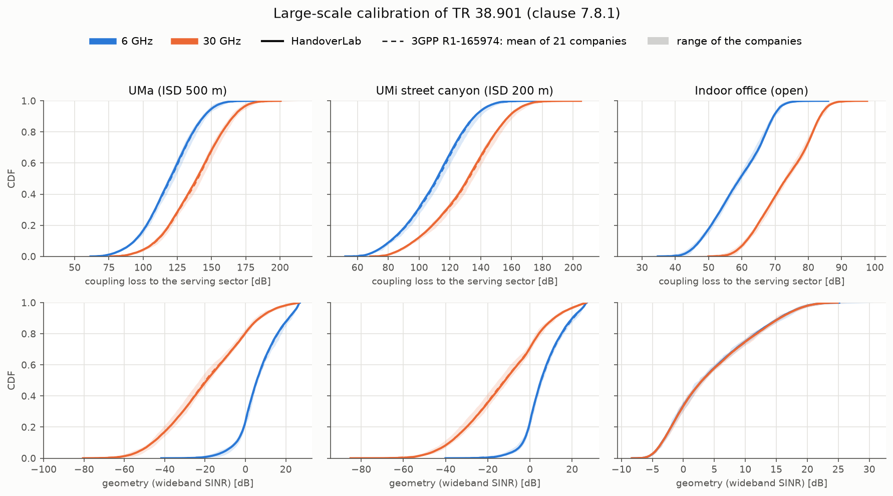

# Radio calibration against 3GPP (TR 38.901 clause 7.8.1)

**Summary (1.8.0).** The radio model of HandoverLab -- path loss, LOS probability, shadowing and
building penetration loss of TR 38.901 -- passes the large-scale calibration that 3GPP defined for
TR 38.901. In the calibration drop of clause 7.8.1, the CDFs of the coupling loss and of the
geometry (wideband SINR, with and without noise) lie inside the range of the 21 companies that
reported their results to 3GPP in R1-165974, for UMa, UMi-Street Canyon and the indoor office at
6 GHz and 30 GHz: 325 of 342 compared percentiles (5 % to 95 % in steps of 5 %) are inside the
range, and none is more than about 1 dB from the industry mean. `handoverlab verify` repeats the
check (group `calibration`). With c = 3.0e8 m/s in the breakpoint distances (2.0.0) every number of this
page is unchanged.

**Version.** The drop uses the formulas of TR 38.901 V19.5.0 with one exception: the IRR-glass loss of the
high-loss O2I model. V19.5.0 Table 7.4.3-1 gives 25.4 + 0.11 f dB (note 2: updated in the Release 19 study
on 7-24 GHz); the calibration keeps the earlier 23 + 0.3 f dB of TR 38.901 V17.0.0, because the companies of
R1-165974 worked before that change (`IRR_GLASS_R1_165974` in `handoverlab.verify.calibration`; pass
`irr_glass=IRR_GLASS_V19` to `simulate_drops` for the V19.5.0 value). With the V19.5.0 value (30 000 users,
seed 1) the 6 GHz cases stay inside the company range, but at 30 GHz the coupling loss and the SINR of UMa
and UMi leave it (coupling loss: UMa 15 of 19 percentiles inside, largest distance from the mean 3.30 dB;
UMi 11 of 19, 3.25 dB): the higher glass loss at 30 GHz is a change of the model, not an error of the
reproduction.



## The reference

TR 38.901 clause 7.8.1 fixes the large-scale calibration (Table 7.8-1) and points to the 3GPP RAN1
contribution **R1-165974**, "E-mail discussion summary of the large scale calibration" (RAN1 #85,
Nanjing, May 2016; [3GPP server](https://www.3gpp.org/ftp/tsg_ran/WG1_RL1/TSGR1_85/Docs/R1-165974.zip)).
Its workbook holds the CDFs of 21 companies (Huawei, CATT, ITRI, LGE, InterDigital, CHTTL, Samsung,
Intel, Sharp, CATR, ZTE, Ericsson, NTT DOCOMO, Nokia, Qualcomm, Xinwei, CMCC, Lenovo, KDDI, ETRI,
NEC; 20 for the indoor office) at every percentile. `src/handoverlab/verify/data/r1_165974.csv`
keeps, per case, metric and percentile, the mean over the companies, the smallest and the largest
company value and the number of companies. The companies produced the results with TR 38.900 V14.0.0;
TR 38.901 still names R1-165974 as the calibration results of clause 7.8.1.

## The calibration drop

`handoverlab.verify.calibration` reproduces the drop of Table 7.8-1 with the propagation formulas
of the simulator (a test checks that they give exactly the values of `handoverlab.channel.pathloss`):

| Item | Setting | Source |
|---|---|---|
| Layout | UMa: 19 sites, ISD 500 m, BS 25 m; UMi: 19 sites, ISD 200 m, BS 10 m; geographical wrap-around | TR 38.901 Tables 7.2-1 and 7.8-1 |
| Indoor office | 12 ceiling sites, 20 m apart, in a 120 m x 50 m hall, BS 3 m, users 1 m | Table 7.2-2, Figure 7.2-1 |
| Sectors and antenna | 3 sectors per site (30, 150, 270 deg); element pattern of Table 7.3-1 (8 dBi); 10 vertical elements, d_V = lambda / 2, DFT tilt 102 deg (UMa, UMi), 110 deg (indoor) | Tables 7.3-1, 7.8-1; Eq. 7.3-1 |
| Users | uniform; UMa and UMi 80 % indoor at height 3 (n_fl - 1) + 1.5 m, n_fl ~ uniform(1, N_fl), N_fl ~ uniform(4, 8); minimum 2D distance 35 m (UMa), 10 m (UMi), applied to d2D-out | Table 7.2-1 ("Same as 3D-UMa in TR36.873"); the formula as in ITU-R M.2412-0 Table 5b (TR 36.873 itself is not in the local sources) |
| Path loss and LOS | Table 7.4.1-1 (UMa with the random effective environment height of note 1), Table 7.4.2-1 (UMa with C'(h_UT), indoor open office) | TR 38.901 |
| Shadowing | LOS / NLOS of Table 7.4.1-1; 7 dB for indoor users of UMa and UMi; independent between sites, shared by the sectors of a site | Tables 7.4.1-1 and 7.5-6 |
| O2I loss | 50 % low loss, 50 % high loss; d2D-in = min of two uniform(0, 25 m); IRR glass 23 + 0.3 f dB (see Version above) | clause 7.4.3.1, Tables 7.4.3-1 (V17.0.0 value), 7.4.3-2 |
| Link budget | 49 dBm (UMa), 44 dBm (UMi) at 6 GHz with 20 MHz; 35 dBm at 30 GHz with 100 MHz; 24 dBm indoor; UT noise figure 9 dB; isotropic UT | Table 7.8-1 |
| Association | sector with the highest received power (handover margin 0 dB), no fast fading | Table 7.8-1 |

## Results

30 000 users per case, seed 1 (`handoverlab verify --full`):

| Case | Metric | Median: HandoverLab / 3GPP mean [dB] | Percentiles 5-95 % inside the company range | Largest distance from the mean [dB] |
|---|---|---|---|---|
| UMa-6 GHz | coupling loss | 119.6 / 120.3 | 19 / 19 | 0.76 |
| UMa-6 GHz | SINR | 5.6 / 5.8 | 19 / 19 | 0.39 |
| UMa-6 GHz | SIR | 8.0 / 8.5 | 16 / 19 | 0.79 |
| UMa-30 GHz | coupling loss | 139.2 / 140.1 | 19 / 19 | 1.02 |
| UMa-30 GHz | SINR | -19.2 / -19.8 | 19 / 19 | 0.73 |
| UMa-30 GHz | SIR | 7.8 / 8.6 | 10 / 19 | 0.80 |
| UMi-6 GHz | coupling loss | 111.5 / 112.2 | 19 / 19 | 0.90 |
| UMi-6 GHz | SINR | 5.3 / 5.5 | 19 / 19 | 0.61 |
| UMi-6 GHz | SIR | 6.8 / 7.3 | 19 / 19 | 0.76 |
| UMi-30 GHz | coupling loss | 131.7 / 132.4 | 19 / 19 | 0.83 |
| UMi-30 GHz | SINR | -11.8 / -12.2 | 19 / 19 | 0.53 |
| UMi-30 GHz | SIR | 6.9 / 7.5 | 14 / 19 | 0.77 |
| Indoor-6 GHz | coupling loss | 59.4 / 59.3 | 19 / 19 | 0.20 |
| Indoor-6 GHz | SINR | 3.0 / 3.0 | 19 / 19 | 0.16 |
| Indoor-6 GHz | SIR | 3.0 / 3.0 | 19 / 19 | 0.16 |
| Indoor-30 GHz | coupling loss | 73.3 / 73.3 | 19 / 19 | 0.20 |
| Indoor-30 GHz | SINR | 3.0 / 3.1 | 19 / 19 | 0.13 |
| Indoor-30 GHz | SIR | 3.0 / 3.1 | 19 / 19 | 0.13 |

The 17 percentiles outside the range are all SIR values of UMa and UMi in the lower half of the
distribution, at most 0.12 dB below the smallest company value: the SIR of HandoverLab is about
0.5 dB below the industry mean there, which is on the conservative side. `handoverlab verify`
passes a case when every percentile lies inside the company range widened by 0.5 dB.

## What this calibration covers, and what it does not

- It covers the **radio model**: the path-loss formulas, the LOS probabilities, the shadowing, the
  O2I loss and the frequency dependence, with the deployment and antenna that 3GPP fixed for
  calibration. These are the same formulas the handover engine uses.
- The **handover engine** uses its own antenna abstraction (one beam gain, `radio.bs_gain_db`, and
  an isolation factor for interfering beams) instead of the sectorised array of Table 7.8-1, and a
  spatially consistent, moving radio map instead of independent drops. Received powers in a
  handover scenario therefore differ from the calibration drop by the antenna model, not by the
  propagation model.
- The **failure model** (link monitoring, T310, the outcome of a handover) is not part of any 3GPP
  calibration; its comparison with ns-3 is on the page [failure-model calibration](calibration.md).
  Read failure rates relative to each other.

## Repeat it

```bash
handoverlab verify --only calibration          # 10 000 users per case, a few seconds
handoverlab verify --only calibration --full   # 30 000 users per case, the table above
python tools/make_calibration_figure.py        # docs/images/calibration_38901.png
```

```python
from handoverlab.verify import calibration as cal

case = cal.CalScenario("UMa", 6.0)
res = cal.simulate_drops(case, n_users=30000, seed=1)
for c in cal.compare(case, res):
    print(c.metric, c.inside.sum(), "of", len(c.percentiles), "inside, largest distance", c.max_dev_db)
```
