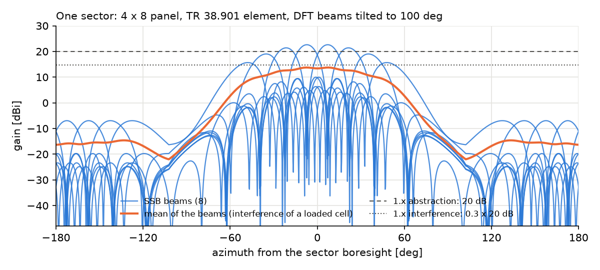

# How to simulate SSB beams, beam failure recovery and several carriers

Since 1.10.0 HandoverLab has two optional radio models for beyond-5G studies: **SSB beams** per
sector with beam management and beam failure recovery (`radio.beams`), and **several carriers**
with inter-frequency measurements in gaps (`radio.layers`). Both are off by default; without them
every result of 1.x is unchanged. The clause-by-clause status is in
[standard compliance](../standard-compliance.md).



## 1. SSB beams in FR2

```yaml
schema: 1
scenario:
  base: urban-grid-28ghz-beams       # 28 GHz, 3 sectors x 8 SSB beams per site
  mobility: {users: 20}
  run: {duration_s: 80.0, warmup_s: 20.0}
seeds: [1, 2]
rules:
  - {rule: a3}
  - {rule: cho}
  - {rule: ltm}
  - {rule: cltm}
output: results/beams.csv
```

What happens in a run:

1. Every site has `sectors` cells; each cell sends `n_ssb` SSB beams. The UE measures every beam
   (SS-RSRP per resource element with an L1 error per beam); the cell quality is the best beam or,
   with `ssb_avg` and `ssb_thresh_dbm`, the average of the best beams above the threshold
   (TS 38.331 5.5.3.3). Handover rules see these cell values, as before.
2. The gNB serves the UE on one beam (its TCI state) and moves it to a better beam after the
   periodic L1-RSRP reports (`report_s`, `switch_db`, `tci_delay_s`). In FR2 the L1-RSRP period of
   TS 38.133 includes the receive-beam sweeping factor N = 8, so the beam follows a fast user late.
3. If the serving beam's quality, averaged over the beam-failure-detection period (FR2: 800 ms at a
   20 ms SSB period), is below Qout_LR (since 2.1.0 4 dB above Qout, as TS 38.133 Tables 8.5.2.1-1 and
   8.1.2.1-1 define the two hypothetical PDCCH at 0 dB and +4 dB), the UE counts beam failure instances; `bfi_max` of them within
   the detection timer start beam failure recovery by random access on the best candidate beam.
   A recovery whose random access fails `preamble_max` times is a radio-link failure.
4. The new metrics `beam_switches_pm`, `beam_failures_pm`, `beam_recoveries_pm`,
   `beam_recovery_failures_pm` and `beam_recovery_s_pm` count all this; the event log and the
   failure metrics are those of 1.x (a failed recovery is a radio-link failure). The procedure
   trace (`--event-level full`) has the events `beam_switch`, `beam_failure`, `beam_recovered`
   and `bfr_ra_problem`.

Result of this configuration (seeds 1 and 2, 20 users at about 60 km/h, 60 s measured; mean per
UE-minute):

| Rule | Handovers | Failures | Beam switches | Beam failures | recovered | ended in RLF | Interruption [s] | SINR [dB] |
|---|---|---|---|---|---|---|---|---|
| A3 | 20.4 | 5.50 | 42.9 | 11.43 | 4.83 | 5.42 | 6.36 | 9.8 |
| CHO | 22.0 | 3.88 | 46.6 | 8.73 | 4.12 | 3.83 | 3.67 | 11.6 |
| LTM | 30.6 | 2.80 | 50.0 | 7.33 | 3.30 | 2.75 | 2.60 | 13.1 |
| CLTM | 30.6 | 2.72 | 49.6 | 7.40 | 3.60 | 2.67 | 2.55 | 13.5 |

A little less than half (42-49 %) of the detected beam failures are recovered on another beam of the
same cell; 36-47 % end in a radio-link failure because no beam of the serving cell is good enough any
more (the user needed a handover), and these make up 98-99 % of the failures; the rest (9-17 %) are
ended by a handover. Faster cell changes (LTM, conditional LTM) leave fewer beam failures to recover
(7.3-7.4 per UE-minute against 11.4 with A3).

## 2. Two carriers: a macro layer and a small-cell layer

```yaml
scenario:
  base: urban-grid-10ghz
  radio:
    carrier_ghz: 3.5
    bandwidth_mhz: 100.0
    pathloss: uma
    bs_height_m: 25.0
    beams: {sectors: 3, n_ssb: 8}
    layers:
      - {name: fr2, carrier_ghz: 28.0, bandwidth_mhz: 400.0, site_spacing_m: 100.0,
         pathloss: umi_street_canyon, bs_height_m: 10.0, beams: {sectors: 3, n_ssb: 8}}
  layout: {site_spacing_m: 300.0}
  protocol: {meas_periods: ts38133}
rules:
  - {rule: a3a5, off_db: 3.0, ttt_s: 0.16, a5_thresh1_dbm: -100.0, a5_thresh2_dbm: -105.0,
     a5_down_thresh1_dbm: -115.0, a5_down_thresh2_dbm: -108.0}
```

- Each layer has its own sites (or `cosited: true`: the sites, LOS states and shadowing of the
  first layer, TR 38.901 7.6.5; since 2.1.0 such a layer cannot set its own `pathloss`, `los_corr_m` or
  `shadow_decorr_m` unless `radio.channel_detail` is `simple`). Only cells of one carrier interfere with
  each other.
- With `meas_periods: ts38133` the UE measures the other carrier only in the measurement gaps
  (`gap_pattern`, default 6 ms every 40 ms) with the inter-frequency periods of TS 38.133 9.3.5:
  320 ms for an FR1 carrier and 1.6 s for an FR2 carrier. During a gap it receives no data
  (`gap_share`).
- The rule `a3a5` uses Event A3 within a carrier and Event A5 (serving below Thresh1 and
  neighbour above Thresh2, TS 38.331 5.5.4.6) towards the other carrier; set the thresholds per
  direction, as networks configure A5 per measurement object. A symmetric A5 with a very high
  Thresh1 makes the users alternate between the layers.
- `inter_frequency_handovers_pm` counts the handovers between carriers.

The card `dense-urban-2layer` is the two-layer dense urban environment of ITU-R M.2412
(4 GHz macro, 30 GHz micro, 690 cells); it takes a few minutes per simulated minute.

## 3. Things to keep in mind

- The evaluation periods of TS 38.133 are the longest a UE may take; HandoverLab uses them as
  averaging time constants, which makes FR2 detection slow. Real UEs may be faster.
- Data beams are the SSB beams (no CSI-RS refinement); a loaded cell interferes with the mean of
  its beams. Compare rules with each other on the same worlds rather than reading absolute rates.
- A beam failure recovery that cannot find a beam above Qout ends in a radio-link failure fast
  (`preamble_max` attempts of `ra_attempt_s`); without `bfd` the same UE would wait for T310.
