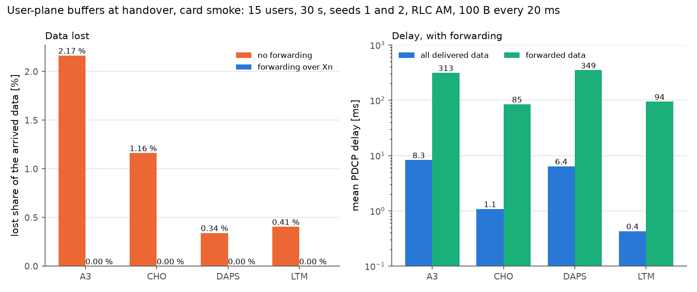

# User-plane buffers at handover

By default HandoverLab counts the time a handover interrupts the data (`interruption_s_pm`) but not
what happens to the data themselves. Since 2.3.0 the option `protocol.buffers` adds a simplified
PDCP / RLC model of the downlink: every user has one data radio bearer whose data wait in a FIFO at
the gNB that holds its PDCP entity, are forwarded to the target cell over Xn, and may be lost or
delayed by the interruption. It works with every procedure (baseline handover such as A3, CHO,
DAPS, LTM and conditional LTM). It is off by default; with it off every result of 2.2.0 is
unchanged bit for bit (the new metrics are 0).



*Without forwarding A3 loses 2.17 % of the data, CHO 1.16 %, DAPS 0.34 % and LTM 0.41 %; with forwarding nothing is lost, and the forwarded data wait 85-349 ms.*

```yaml
scenario:
  base: smoke
  traffic: {model: periodic}      # periodic, ftp3 or fixed (constant-rate arrivals); not full_buffer
  protocol:
    buffers: am                   # RLC mode of the bearer: am or um; null: off
    forwarding: true              # the source forwards its data to the target over Xn
    early_forwarding: false       # CHO and LTM: forward before the execution instead of after it
    xn_delay_s: 0.005             # one-way Xn delay [s] (assumption)
    discard_timer_s: null         # PDCP discard timer [s]: null (infinity) or a TS 38.331 value
    sdu_bytes: null               # SDU size for the SDU counts (null: packet_bytes or 1500)
```

It combines with the slot scheduler (`protocol.scheduler`, see [scheduler](scheduler.md)): the data
in the HARQ processes then take part (see section 2).

## 1. What happens at a handover

| Procedure | Source | HandoverLab |
|---|---|---|
| Baseline handover (A3, A3/A5, ...) | TS 38.300 V19.4.0 9.2.3.2.1 NOTE 2 (forwarding may start with the command), 9.2.3.2.2, 9.2.3.2.3 | when the UE leaves the source, the source forwards its FIFO and the data arriving until the completion; the target can send them `xn_delay_s` after they were forwarded and sends them before new data |
| CHO | 9.2.3.4.2 NOTE 2, 9.2.3.4.3, 9.2.3.4.4 | late forwarding: the source forwards once HANDOVER SUCCESS tells it the target, so the data are at the target 2 x `xn_delay_s` after the completion; `early_forwarding`: the data are at the target when the UE arrives |
| LTM, conditional LTM | 9.2.3.5.2 step 9a, NOTE 4, NOTE 5; 9.2.3.5.3; 9.2.3.7.1 | every cell of HandoverLab is its own gNB, so a cell switch is inter-gNB LTM: late or early forwarding as for CHO |
| DAPS | 9.2.3.2.2 (DAPS), 9.2.3.2.3 | the forwarding tunnel always exists; the source keeps sending during the execution and forwards every SN-assigned SDU as a copy; the target sends the rest at the completion, without loss or wait; a fallback keeps the data at the source |
| Failure and re-establishment | 9.2.3.3 steps 6/7 | with forwarding the data of the last gNB move to the new cell and can be sent `xn_delay_s` after the re-establishment; a recovery into a prepared cell (CHO, LTM) is forwarded as an execution of that procedure; without forwarding the data are lost in another cell and kept in the same cell |
| Discard timer | TS 38.323 V19.1.0 5.3; TS 38.331 PDCP-Config discardTimer | data older than `discard_timer_s` are discarded (lost) |

Without forwarding (`forwarding: false`) the data at the source and the data arriving there until the
completion are lost at every execution (not with DAPS, which always forwards).

## 2. AM and UM

The RLC mode matters for the data that the lower layers hold when the UE leaves: with the slot
scheduler, the data in the HARQ processes. An RRC handover needs a MAC reset and an RLC
re-establishment (TS 38.300 9.2.3.1; TS 38.322 V19.2.0 5.1.2 discards the RLC PDUs). With RLC AM
these data are not acknowledged, so they are forwarded and sent again by the target (9.2.3.2.2:
the target re-transmits all forwarded data); with RLC UM no PDCP SDU is re-transmitted in the
target, so they are lost. A transport block lost after the last HARQ transmission is sent again by
RLC ARQ with AM and lost with UM (ARQ exists only for AM, TS 38.322 4.4). Without the slot
scheduler the rate model delivers at once, there are no data in the lower layers, and AM and UM give
the same results.

## 3. Delay

The data plane keeps the measurement interval of the rate model or the scheduler (40 ms by
default), and a user executing at a measurement instant gets no data in that interval, as in 2.2.0.
Within an interval the data of a user leave the FIFO as a fluid, at the larger of its round-robin
share of the free carrier at its spectral efficiency and the rate needed to send what the interval
delivers; data arrive at the start of their interval. The PDCP delay of a byte is its delivery time
minus its arrival at the gNB; `pdcp_delay_ms` is the byte-weighted mean, `pdcp_delay_p95_ms` the
95th percentile (1 ms bins) and `pdcp_delay_forwarded_ms` the mean over the data that a target sent
after forwarding. The fluid leaves out the slot and HARQ latency of the air interface, so without a
handover small packets see delays far below 1 ms; the delay metrics mainly show what interruptions,
forwarding and links below Qout (no data in the rate model) add.

## 4. Metrics

| Metric | Unit | Meaning |
|---|---|---|
| `pdcp_delivered_kbyte_pm` | kbyte/UE-min | data delivered |
| `pdcp_lost_kbyte_pm`, `pdcp_lost_share` | kbyte/UE-min, 1 | data lost, and the lost share of what arrived |
| `pdcp_lost_handover_kbyte_pm` | kbyte/UE-min | lost at executions (no forwarding; HARQ data with UM) |
| `pdcp_lost_failure_kbyte_pm` | kbyte/UE-min | lost at failures and re-establishments |
| `pdcp_lost_discard_kbyte_pm` | kbyte/UE-min | discarded by the discard timer |
| `pdcp_lost_harq_kbyte_pm` | kbyte/UE-min | transport blocks lost after the last HARQ transmission with UM |
| `pdcp_lost_sdus_pm`, `pdcp_forwarded_sdus_pm` | 1/UE-min | lost and forwarded data in SDUs of `sdu_bytes` |
| `pdcp_forwarded_kbyte_pm` | kbyte/UE-min | data forwarded over Xn (DAPS: the copies, duplicates included) |
| `pdcp_delay_ms`, `pdcp_delay_p95_ms`, `pdcp_delay_forwarded_ms` | ms | PDCP delay |

## 5. Assumptions and limits

- Assumptions (not in the texts): the Xn delay; whether the network forwards ("may"); that the gNB
  uses the discardTimer values for its downlink data (TS 38.323 defines the timer for the
  transmitting entity); SN assignment on arrival at the source (DAPS forwards SN-assigned SDUs);
  1500-byte SDUs for the SDU counts of non-periodic traffic; copies sent by early forwarding to
  candidates that are not used are not counted.
- Downlink only, one bearer per user; no PDCP reordering or duplicates at the UE, no PDCP status
  report, no path-switch delay (the path switches at the completion), no intra-CU LTM.
- The interruption in the data plane is quantised to the measurement interval (as the rate of
  2.2.0); a DAPS source that has a radio link failure during the execution stops sending.
- This version needs the base engine (no beams, layers, NTN or TS 38.133 periods) and is not run in
  the batched engine; `full_buffer` traffic is rejected (no arrivals, no delay).

## 6. An example

`smoke` card, 15 users, 30 s, two seeds, RLC AM, periodic traffic (100-byte packets every 20 ms):

| Rule | forwarded kbyte/UE-min | lost share without forwarding | mean PDCP delay | delay of forwarded data |
|---|---|---|---|---|
| A3 | 7.4 | 2.2 % | 8.3 ms | 313 ms |
| CHO (late / early forwarding) | 3.5 | 1.2 % | 1.1 / 0.9 ms | 85 / 75 ms |
| DAPS | 6.7 (copies) | 0.3 % (all at failures) | 6.4 ms | 349 ms |
| LTM | 1.2 | 0.4 % | 0.4 ms | 94 ms |

With forwarding nothing is lost. Without it DAPS loses no data at its executions; its 0.3 % are
lost at failures and re-establishments. Late forwarding adds the 2 x 5 ms wait for CHO; for LTM the
wait ends before the next measurement instant and does not show (94 ms either way). DAPS gains
little here: most of its executions start with the source SINR already below Qout, where the rate
model sends nothing, so the data left for the target are the oldest ones, and its forwarded data
wait longest (349 ms).

## 7. Checks

`tests/test_buffers.py` holds the criteria fixed before the code: hand-computed cases for every procedure (forwarded bytes, losses,
delays with and without the late-forwarding wait, DAPS, HARQ data with AM and UM, the discard timer,
re-establishment with and without forwarding), conservation (arrived = delivered + lost + queued,
checked at the end of every run with the option) for A3, CHO, DAPS, LTM and CLTM with AM and UM,
with and without the slot scheduler, HARQ losses with UM and none with AM, a delay below one
interval without handovers, and that the option off changes no fingerprint.
