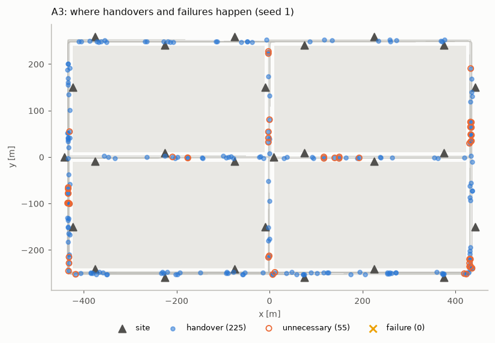
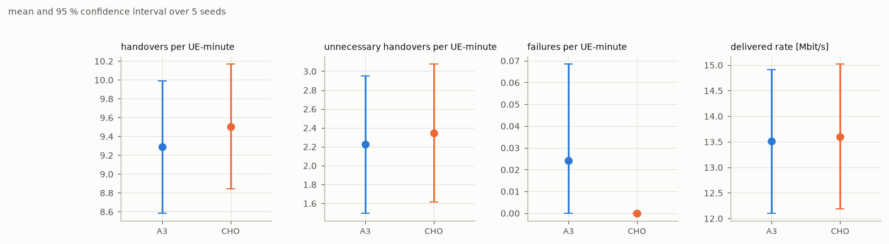
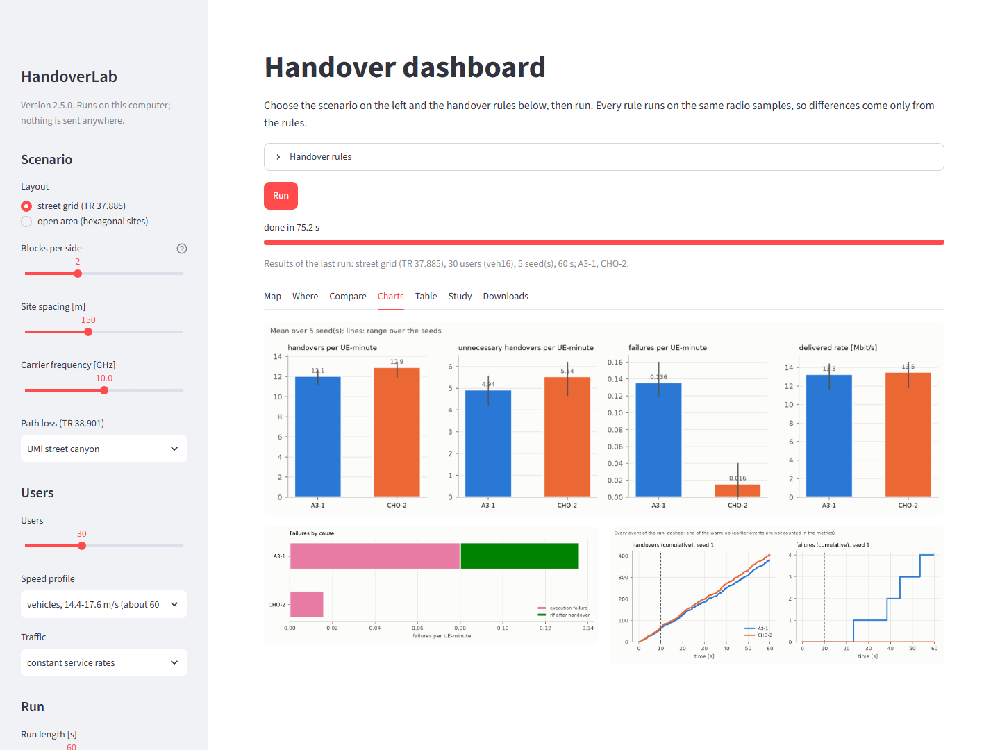

# The dashboard

The dashboard is a page in your web browser for trying scenarios and rules without writing a file.
It runs on your own computer: `handoverlab gui` starts a small local server and opens the page.
No account, server or domain is needed and nothing is sent anywhere.

```bash
python -m pip install -e ".[gui]"          # Streamlit and matplotlib; the core package needs neither
handoverlab gui                            # opens http://localhost:8501
handoverlab gui --port 8600 --headless     # another port, no browser window (open the address yourself)
```

Stop it with Ctrl+C in the terminal.


## Choosing what to run

**Scenario (left).** Street grid (the TR 37.885 urban grid with buildings) or open area (the same
rectangle with a hexagonal site grid, no buildings); blocks per side; site spacing; carrier
frequency; the TR 38.901 path-loss model; the number of users, their speed profile and their
traffic (constant rates, full buffer, periodic packets or FTP model 3); the run length and the
warm-up (not counted in the metrics); the number of seeds (three by default, so that the
comparison has confidence intervals) and the first seed.

**Handover rules.** One to four rules, each Event A3 (offset and time-to-trigger) or conditional
handover (preparation and execution offsets, execution time-to-trigger, prepared cells). Every rule
runs on the same worlds and radio samples, so the comparison is paired.

**Run** shows a progress bar per seed. The default settings run in about ten seconds.

## Results

- **Map.** The users of the first seed on the layout at the chosen time, coloured by their serving
  cell, with a line to the serving site; grey users are executing a handover or re-establishing
  after a failure. Choose the rule, move the time slider or press *Play*. The table next to the
  map counts the handovers, failures and re-establishments up to that time.
- **Where.** The paths of the users of the first seed with a mark at every handover, unnecessary
  handover and failure: where on the map the rule hands over too often or fails.

  

- **Compare.** Every rule against the first one on the same worlds: the mean of each metric with
  its 95 % confidence interval over the seeds, and the paired difference with its interval
  (`significant` when the interval excludes zero). These are the statistics of the study report.

  

- **Charts.** Handovers, unnecessary handovers, failures and delivered rate per rule (mean over
  the seeds, with their range), failures by cause, and the cumulative handovers and failures over
  time.
- **Table.** The mean of the main metrics per rule.
- **Study.** The status of a study folder written by `handoverlab study`, the same lines that
  `handoverlab status` prints, also while the study is running in another terminal.
- **Downloads.** Metrics (CSV, one row per seed and rule, as `handoverlab run` writes them),
  results (JSON with the settings, the resolved scenario and the fingerprints), event logs (CSV),
  traces of the first seed (CSV), the comparison with its intervals (CSV), the figures (PNG), and an experiment file (YAML) that repeats
  the run exactly with `handoverlab run dashboard.yaml`.



## Behind the page

All logic is in `handoverlab.gui.logic` and works without Streamlit: `Settings` and
`RuleSettings` hold the choices, `run()` runs them (with the event-log level `full` on the first
seed, so the serving cell of every user is known at every time), and `map_figure()`,
`metrics_figure()`, `causes_figure()`, `timeline_figure()`, `events_map_figure()`,
`comparison_figure()`, `comparison_rows()`, `study_status_lines()` and the download functions make the
outputs (`python tools/make_readme_images.py` rebuilds the pictures of this page). Use them in a notebook:

```python
from handoverlab.gui import logic

s = logic.Settings(layout="open_area", users=30, profile="veh30", duration_s=60, seeds=3)
out = logic.run(s, [logic.RuleSettings("a3", "A3"), logic.RuleSettings("cho", "CHO")])
logic.map_figure(out, rule=1, frame=40).savefig("map.png")
```

For studies (tuning, gates, paired tests) use the command line; the dashboard is for exploring.
