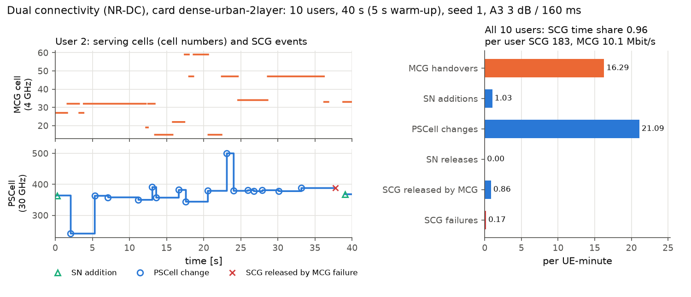

# How to study dual connectivity (NR-DC)

Since 2.3.0 a user can hold a secondary cell group (SCG) next to its master cell group (MCG): the
NR-DC case of TS 37.340 V19.3.0 clause 4.1.3.3, one gNB as master node (MN) and another as secondary
node (SN). The option `protocol.dc` is off by default; with it off every result stays as it was.



*The SCG carries data 96 % of the time; per UE-minute there are 21.1 PSCell changes and 16.3 MCG handovers, and per user the SCG carries 183 Mbit/s against 10.1 Mbit/s on the MCG.*

The model is the simplest consistent subset that a system-level simulator needs: when an SCG is
added, changed or lost, what that costs in signalling and interruption, and how much time the
user spends with a second link. The MCG behaves exactly as without dual connectivity: its handover
rule, radio-link monitoring, failures and re-establishment do not see the SCG (a test checks that the
MCG event log is the same whether an SN is ever added or not).

## 1. Turn it on

The SCG lives on the cells of one entry of `radio.layers`, on a carrier that no MCG cell uses. The
built-in `dense-urban-2layer` card has a 4 GHz macro layer and a 30 GHz micro layer, which makes
an FR1 MCG and an FR2 SCG:

```yaml
# dc.yaml
schema: 1
scenario:
  base: dense-urban-2layer
  protocol:
    dc: {scg_layer: micro-30ghz}
seeds: [1, 2, 3]
rules:
  - {rule: a3, off_db: 3.0, ttt_s: 0.16}
output: results/dc.csv
```

```bash
handoverlab run dc.yaml
```

| Key of `protocol.dc` | Default | Meaning |
|---|---|---|
| `scg_layer` | first entry of `radio.layers` | layer whose cells form the SCG |
| `add_thresh_dbm`, `add_ttt_s` | `-110`, `0.16` | SN addition: event A4, the best SCG cell's L3 SS-RSRP per RE above the threshold for the time-to-trigger |
| `change_off_db`, `change_ttt_s` | `3`, `0.16` | PSCell change: event A3 among the SCG cells |
| `release_thresh_dbm`, `release_ttt_s` | `-120`, `0.16` | SN release: the PSCell's L3 SS-RSRP below the threshold |
| `prep_s`, `exec_s` | `protocol.prep_s`, `protocol.exec_s` | preparation between the nodes; random access on the PSCell |
| `on_mcg_ho` | `keep` | at an MCG handover the target MN keeps the SN (`keep`) or releases it (`release`) |

The MCG uses the base layer and any other layer; it never hands over to an SCG cell, so
`inter_frequency_handovers_pm` counts only handovers between MCG carriers.

## 2. What is modelled (TS 37.340 V19.3.0, TS 38.331 V18.11.0)

| Procedure | Clause | In HandoverLab |
|---|---|---|
| SN addition, initiated by the MN on its measurements | 7.2, 10.2.2 | A4 held for `add_ttt_s` while the MCG is connected; `prep_s` (SN Addition Request / Acknowledge); RRC reconfiguration over the MCG; random access on the new PSCell after `exec_s`; the SCG joins when the PSCell SINR reaches Qout while T304 runs |
| SN change and PSCell change within the SN | 10.5.2, 10.6 | A3 among SCG cells, then the same steps; no SCG data from the command until the target is joined |
| SN release | 10.4.2 | PSCell below `release_thresh_dbm` for `release_ttt_s`, released after `prep_s` |
| SCG radio-link failure | 7.7; TS 38.331 5.3.10.3 | own Qout / Qin filters, N310 / N311 indications and T310 on the PSCell, with the protocol's constants |
| SCG failure handling | 7.7; TS 38.331 5.7.3 | SCG RLF and failed additions or changes are reported to the MN (SCGFailureInformation) instead of a re-establishment; the MN releases the SCG |
| MCG failure | 7.7; TS 38.331 5.3.7.2 | re-establishment, which performs the MR-DC release |
| Inter-MN handover | 10.7 | `on_mcg_ho`: the SN is kept or released |

Every SCG reconfiguration is sent over the MCG (SRB1). One that falls due while the MCG is not
connected or its T310 runs is dropped (the trigger starts again). The SCG cells' L1 samples enter
an L3 filter of their own (TS 38.331 5.5.3.2 with the reference period of the SCG carrier). The
PSCell sends on its strongest SSB beam of the current L1 instant (ideal SCG beam management), and
the other cells of the SCG carrier interfere with their load.

**SCG data.** An SCG user receives W x min(log2(1 + SINR), se_max) x (1 - background load of the
PSCell) / (SCG users of that PSCell): a full-buffer share of the PSCell, reported as
`scg_rate_mbps`. The MCG rate (`rate_mbps`) is computed as without dual connectivity; the two are
not split by a bearer model.

## 3. Metrics

`sn_additions_pm`, `sn_addition_failures_pm`, `pscell_changes_pm`, `pscell_change_failures_pm`,
`sn_releases_pm`, `scg_rlf_pm`, `scg_failures_pm` (RLF + failed additions + failed changes),
`scg_released_by_mcg_pm`, `scg_time_share`, `scg_rate_mbps`, `pscell_change_interruption_s_pm` and
`dc_rrc_messages_pm` (see [the metric reference](../reference/metrics.md)). With the event-log level
`full` the procedure trace has the SCG events `sn_add_request` (value: the time the A4 condition was
entered), `sn_add`, `sn_add_failure`, `pscell_change`, `pscell_change_failure`, `scg_rlf`,
`sn_release`, `scg_release_mcg_failure` and `scg_release_mcg_ho`.

## 4. What is left out

- Other MR-DC options (EN-DC, NGEN-DC, NE-DC) and SCells in either cell group.
- Fast MCG link recovery (T316); SCG deactivation and activation (clause 7.13).
- Conditional PSCell addition and change (CPA, CPC, subsequent CPAC; clause 10.2.3), SCG LTM, CHO with
  candidate SCGs (clauses 10.19, 10.20).
- Split SRB and SRB3 (clauses 7.5, 7.6): every SCG message goes over the MCG.
- Bearer types, PDCP duplication, data forwarding, the SN status transfer and the path switch.
- The MN's choice to keep or change the SN after an SCG failure (the model always releases it) and
  to change the SN at an inter-MN handover.
- Measurement gaps for the SCG carrier and UE capability coordination; the uplink; SCG beam management
  (the strongest beam is used).

## 5. Pre-registered checks (2.3.0)

Criteria fixed before the runs. World: `dense-urban-2layer` with `protocol.dc: {scg_layer: micro-30ghz}`
(20 users, 120 s, 100 s measured), rule A3 3 dB / 160 ms, seeds 1-3.

| Check | Result |
|---|---|
| D1: with `protocol.dc` unset every existing test and golden fingerprint is unchanged | pass |
| D2: the MCG event log is the same with an SN never added (`add_thresh_dbm: 1000`) and with `on_mcg_ho: release` | pass (4 of 4 comparisons, seeds 1 and 2; also a test) |
| D3: every started addition or change ends once as success, failure or drop | pass (test) |
| D4: addition timing = A4 entry + TTT + preparation + random access; PSCell changes happen; an MCG failure releases the SCG | pass (tests) |
| D5a: a 10 dB lower addition threshold raises the SCG time share | **fail**: no change at all (0.953 both). In this dense micro layer the best SCG cell is above -110 dBm everywhere, so the A4 threshold never binds; the time without SCG comes from MCG failures (each releases the SCG) and the addition delay. |
| D5b: more PSCell changes than MCG handovers (9 micro sites per macro site) | pass (20.2 vs 18.0 per UE-min) |
| D5c: more SCG failures at 60 km/h than at 30 km/h | pass (0.25 vs 0.03 per UE-min) |

Mean of the three seeds at 30 km/h (default thresholds, SN kept at MCG handovers): SCG time share 0.95,
20.2 PSCell changes and 1.3 SN additions per UE-min, 1.3 SCG releases per UE-min by MCG failures,
0.03 SCG failures per UE-min (all failed additions or changes, no SCG radio-link failure), SCG rate
184 Mbit/s per user next to an MCG rate of 10 Mbit/s. At 60 km/h: time share 0.91, 30 PSCell changes,
0.25 SCG failures and 2.5 releases by MCG failures per UE-min. With `on_mcg_ho: release` the SN is
re-added after every MCG handover (17-18 additions per UE-min) and the time share falls to 0.85.
