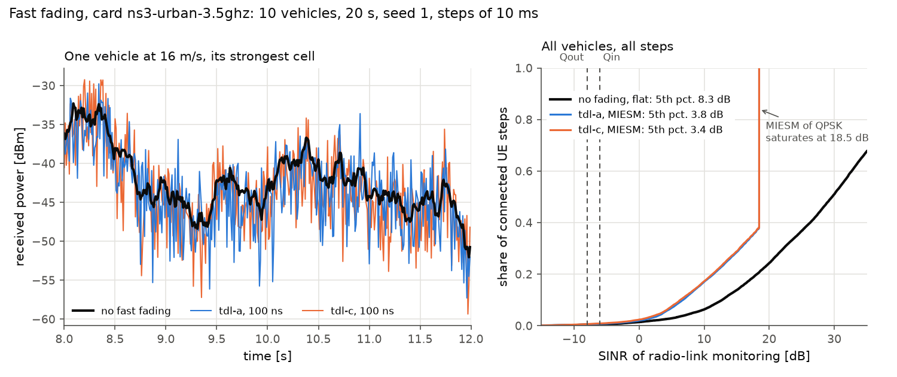

# Fast fading and effective SINR

By default HandoverLab works on the received-power level: path loss, LOS state, shadowing and a
slow time-varying component, with radio-link monitoring on the wideband SINR. Since 2.2.0 the option
`radio.fast_fading` adds the fast fading of the tapped delay line (TDL) models of TR 38.901 and maps
the SINR at several frequencies to one effective SINR. It is off by default; with it off every
result of 2.1.0 is unchanged bit for bit.



*On the ns-3 card (10 vehicles, 20 s) the 5th percentile of the link-monitoring SINR falls from 8.3 dB without fading to 3.8 dB (TDL-A) and 3.4 dB (TDL-C); the MIESM value of QPSK saturates at 18.5 dB.*

```yaml
scenario:
  base: ns3-urban-3.5ghz
  radio:
    fast_fading: tdl-c        # tdl-a, tdl-b, tdl-c (NLOS), tdl-d, tdl-e (LOS); null: off
    delay_spread_ns: 100      # RMS delay spread (TR 38.901 Table 7.7.3-1: 10, 30, 100, 300, 1000 ns)
    fading_k_db: null         # tdl-d / tdl-e only: another K-factor (TR 38.901 clause 7.7.6)
```

## 1. The channel

| Item | TR 38.901 V19.5.0 | HandoverLab |
|---|---|---|
| Tap delays and powers | Tables 7.7.2-1 to 7.7.2-5 | the five tables, the powers normalised to a unit sum (mean link gain 1) |
| Delay scaling | Eq. 7.7-1: tau_scaled = tau_model x DS | `delay_spread_ns` |
| Doppler | clause 7.7.2: Jakes spectrum per tap, f_D = \|v\| / lambda_0 | 32 sinusoids per Rayleigh tap with random arrival angles and phases, f_D from the user's speed and the carrier |
| LOS tap of TDL-D / TDL-E | Rice, K1 = 13.3 dB / 22 dB, Doppler peak at f_S = 0.7 f_D | a specular component at 0.7 f_D next to the Rayleigh part of the first tap |
| Another K-factor | clause 7.7.6, Eq. 7.7.6-1 and 7.7.6-2, delays re-normalised | `fading_k_db` (the K of Eq. 7.7.6-2: the LOS power over all Rayleigh taps; about 9 dB for the table of TDL-D) |

Every user-cell link fades independently (the TDL models are single-link models; their MIMO
extensions of clause 7.7.5 are not used). The channel is evaluated at four points spread over the
24 PRBs of the hypothetical PDCCH (TS 38.133 Tables 8.1.2.1-1/-2) and at eight points spread over
the carrier (N_RB of TS 38.101-1/-2 Table 5.3.2-1). The received power of a cell (L1 samples, the
link budget of every check) takes the mean gain over the PDCCH band, close to the 20 PRBs of an SSB.

## 2. From SINR to one effective SINR

| Use | Mapping | Why |
|---|---|---|
| Radio-link monitoring (Qout, Qin) | MIESM for QPSK over the PDCCH band: the mean bit-wise mutual information of QPSK (binary input, Gaussian channel) mapped back to the SINR with the same mutual information on a flat channel | TS 38.133 8.1 defines Qout and Qin as the BLER of a hypothetical QPSK PDCCH; the thresholds `qout_db` / `qin_db` are flat-channel SINRs, so the faded channel is compared through its flat-channel equivalent |
| Delivered rate | capacity-equivalent SINR over the carrier: 2^(mean log2(1 + SINR)) - 1 | the rate model uses log2(1 + SINR) |

Both mappings return the SINR itself on a flat channel and never more than the mean SINR. Every
interfering link has its own fading. Above about 18 dB the mutual information of QPSK is 1 to
double precision; the MIESM result is capped there, far above Qout and Qin. No BLER table of
another simulator is used; a BLER per MCS (TS 38.214 tables) follows with the slot scheduler.

## 3. Cost and limits

- The engine takes about 10 times as long (32 sinusoids per tap, every step; 10 users on the
  ns-3 card, 20 s simulated, without building the world, median of seven runs: 7.7 s with `tdl-a`
  and 7.8 s with `tdl-c` instead of 0.74 s, with the default traffic of the card; the 1.02 s of the
  [scheduler measurement](../performance.md) is another session with full-buffer traffic, and machine load
  changes such times by up to a factor of two); many
  rules on one world the same (24 rules: 53 s instead of 5.4 s), as the batched and compiled loops
  are not used with fading.
- This version needs the base engine: no beams, layers, NTN or TS 38.133 periods
  (`meas_periods: sample`, `rlm_eval: fixed`); such a configuration is refused.
- The step stays 10 ms. At 30 m/s and 3.5 GHz the coherence time is about 1 ms, so successive
  steps see nearly independent fading; the L1 sample of a measurement instant is one such snapshot.

## 4. Against ns-3 (exploratory)

On the ns-3 card (24 A3 settings, four conditions, one seed) against the stored ns-3 results, which were run
without fading: with `tdl-c` the median handover ratio is 1.01 and the unnecessary-handover ratio 1.18 (0.95 and
1.06 without fading), the rank correlations 0.98; the failure rate stays at about 0.01-0.02 per UE-minute
against 0.43 in ns-3. Fast fading therefore does not close the known gap in failures, which follows the 14 dB gap
in mean serving SINR (see [verification](../verification.md)).

Against ns-3 runs that use fading themselves (`benchmarks/ns3/run_benchmark.py --fading`, 96 runs, TR 38.901
fast fading in ns-3), with the criterion fixed before those runs existed (`tdl-c`, delay spread 100 ns, seed
500; median ratios in [0.8, 1.25], rank correlations at least 0.9): the handover ratio is 1.04 and the
unnecessary-handover ratio 1.24, close to its limit, and the rank correlations are 0.97 and 0.98, so the
criterion passes. As additional rows, `tdl-a` would miss the unnecessary-handover limit (1.27), `tdl-d` (1.00 /
1.16) and no fading (0.98 / 1.09) pass. ns-3 itself moves little with fading (mean failure rate 0.40 against
0.43 without, serving SINR 11.5 dB in both), and the failure gap stays as it was (HandoverLab 0.014 per
UE-minute with `tdl-c`).

## 5. Checks

`handoverlab verify --only fading` runs the criteria fixed before the model was written: Rayleigh
taps with unit power (KS test), the J0 time correlation, the K-factor of the first TDL-D tap, the
delay spread after scaling, and the two properties of the mappings. `tests/test_fading.py` also
checks that the option off changes no fingerprint and that a run with fading is reproducible.
