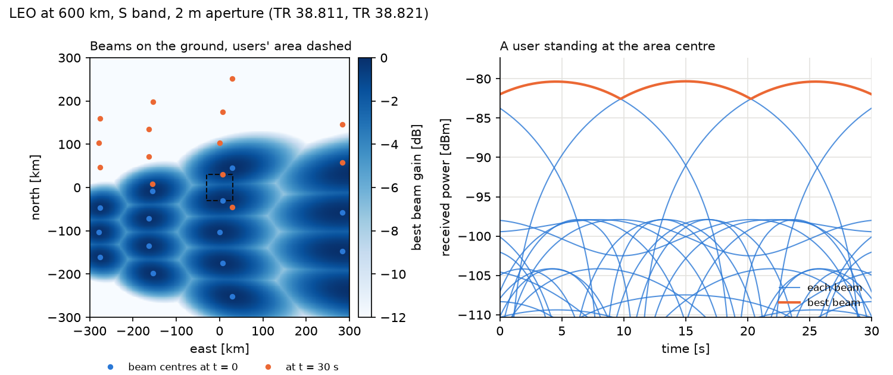

# How to study handover with a LEO satellite (NTN)



Since 2.0.0 HandoverLab simulates one LEO satellite with earth-moving beams: `layout.kind: ntn`, the
scenario card [`ntn-leo600-2ghz`](../scenarios/ntn-leo600-2ghz.md) and the rule `cho_d2` (conditional handover
with the location condition D2 of Release 18). The model follows the 3GPP NTN study:

| Part | Source |
|---|---|
| Earth as a sphere of 6371 km, satellite antenna `4 |J1(ka sin t)/(ka sin t)|^2` | TR 38.811 V15.4.0 clauses 6.3, 6.4.1 |
| LOS probability per elevation, `PLb = FSPL + SF + CL`, slant range, shadowing and clutter tables, atmospheric loss `Azenith / sin(alpha)` | TR 38.811 Table 6.6.1-1, Eqs. 6.6-2..6.6-4, Tables 6.6.2-1..3, Eq. 6.6-8 |
| LEO-600 Set-1 S band (2 m aperture, 34 dBW/MHz), handheld UE (0 dBi, NF 7 dB), 19 beams on the UV plane, reuse 1 | TR 38.821 V16.2.0 Tables 6.1.1.1-1, -3, -4, -5 |
| 7.56 km/s, round-trip delay 25.77 ms (transparent LEO, scenario C2) | TR 38.821 Table 7.1-1 |
| CondEvent D2 (moving reference locations), combined with A3 | TS 38.331 V18 5.5.4.15a and CondReconfigToAddMod |

All beams belong to one satellite, so a user sees them over one path: slant range, LOS state, shadowing,
clutter, atmospheric and scintillation loss are common, only the antenna gain differs between beams. The
beams are fixed in the satellite frame and sweep over the ground with it (scenarios C2 and D2, which RAN2
prioritised for mobility, TR 38.821 clause 7.3.2.4); a user crosses a beam every few seconds even when it
stands still.

## 1. Run it

```yaml
schema: 1
scenario: ntn-leo600-2ghz
seeds: [1, 2, 3]
rules:
  - {rule: a3, off_db: 3.0, ttt_s: 0.16}
  - {rule: cho, o_prep_db: -2.0, o_exec_db: 3.0, ttt_exec_s: 0.08}
  - {rule: cho_d2, d_thresh1_m: 25000, d_thresh2_m: 25000, hys_m: 1000}
output: results/ntn.csv
```

The `ntn` section holds the satellite (`altitude_km`, `aperture_m`, `eirp_dbw_per_mhz`, `n_beams`,
`centre_elevation_deg`, `environment`, `atm_zenith_db`, `scintillation_db`, `sf_corr_m`, `los_corr_m`); the
card names the source of every value. `ctx.cell_center(t)` gives a rule the beam centres on the ground at time
`t`, the moving reference locations of Event D2.

## 2. What `verify --only ntn` checks

The criteria were fixed before the first run:

| Check | Result |
|---|---|
| N1: slant range, free-space loss, atmospheric loss and CNR of the 8 S-band LEO cases of TR 38.821 Table 6.1.3.3-1 within 0.1 dB | passed: largest difference 0.028 dB |
| N2: 3 dB beamwidth of the Bessel pattern for the apertures 2 m and 1 m within 0.01 degree of Tables 6.1.1.1-1/-2 | **failed** for 1 m: 8.8462 against 8.8320 degrees (2 m: 4.4198 against 4.4127); both are 0.16 % wider than the table |
| N3: orbital speed at 600 km within 0.5 % of 7.56 km/s, nadir footprint within 10 % of 50 km | passed: 7562 m/s, 46.3 km |

## 3. What to expect, and what is not modelled

- With A3 (3 dB, 160 ms) a user completes about 4.7 handovers and has 1.34 link failures per minute in the
  check run (seed 1); together they match the 5.7 beam changes per minute of the sweep (beam centres 72 km
  apart along the track, passed at about 6.85 km/s on the ground).
- Frequency reuse 1 (option 1 of TR 38.821) makes the beam edges interference-limited: most link failures are
  coverage failures, where no beam is good enough. Reuse 3 or 2 (options 2 and 3) are not modelled yet.
- The default distance thresholds of `cho_d2` (25 km) are half the 50 km nadir beam diameter of TR 38.821
  Table 6.1.1.1-1; TS 38.331 gives no default. A first guess of 20/15 km was replaced after a first run had been
  seen (it gave 3.8 failures per user-minute); no further tuning was done.
- Not modelled: condEventT1, earth-fixed beams, several satellites, the feeder link, Doppler, the Ka band, the
  user's own round-trip delay (the worst case of C2 is used for every user).
