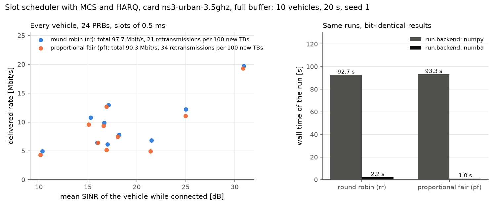

# Slot scheduler, MCS and HARQ

By default HandoverLab computes the delivered rate from the SINR with a capacity formula and shares
a cell's resources among its users in proportion to their demand. Since 2.2.0 the option
`protocol.scheduler` replaces this with a data plane that plays every slot: resource blocks per
user, an MCS of TS 38.214, transport blocks that fail with a block error probability, and HARQ
retransmissions. It is off by default; with it off every result of 2.1.0 is unchanged bit for bit.



*Totals: RR 97.7 and PF 90.3 Mbit/s, with 21 and 34 retransmissions per 100 new transport blocks; with `run.backend: numba` the runs take 2.2 s and 1.0 s instead of 92.7 s and 93.3 s, with identical fingerprints.*

```yaml
scenario:
  base: ns3-urban-3.5ghz
  traffic: {model: full_buffer}
  protocol:
    scheduler: pf          # rr (round robin) or pf (proportional fair); null: off
    harq_max_tx: 4         # transmissions of a transport block (first + retransmissions)
    harq_rtt_slots: 8      # HARQ round trip [slots]
    l2s_loss_db: 1.0       # implementation loss of the block-error model [dB]
```

It combines with fast fading (`radio.fast_fading`, see [fast fading](fading.md)): the scheduler
then uses the effective SINR over the carrier.

## 1. What a slot does

| Item | Source | HandoverLab |
|---|---|---|
| Slot length | TS 38.211 Table 4.3.2-1 (2^mu slots per 1 ms subframe) | 1 ms / 2^mu for the subcarrier spacing of the carrier |
| Resource blocks of a cell | TS 38.101-1/-2 Table 5.3.2-1 | N_RB of the carrier, less the share of the background load |
| Who gets them | gNB implementation (not specified) | `rr`: every connected user with data gets an equal share in every slot; `pf`: the whole band goes to the user with the largest instantaneous over average rate; a due retransmission comes first |
| MCS | TS 38.214 Table 5.1.3.1-1 (MCS table 1) | the highest MCS whose block-error probability at the SINR reported one measurement interval earlier is at most 10 % |
| Transport block size | TS 38.214 clause 5.1.3.2 | steps 1 to 4 with Table 5.1.3.2-1; 12 PDSCH symbols, 12 DMRS REs per PRB, no xOverhead |
| HARQ processes | TS 38.321 5.3.2; TS 38.331 PDSCH-ServingCellConfig | 8 per user (the number when nrofHARQ-ProcessesForPDSCH is absent); a new transport block needs a free process |
| Retransmission | TS 38.321 5.3.2.2 (combined with the earlier data) | after `harq_rtt_slots`, chase combining (the SINRs of the transmissions add), at most `harq_max_tx` transmissions (the number is the network's choice) |

## 2. The block-error probability

3GPP gives no curve of block errors against SINR; it is a property of the receiver. HandoverLab
uses the normal approximation of the error probability of a code of finite length (Polyanskiy,
Poor and Verdu, IEEE Trans. Inf. Theory 56(5), 2010) on the bit channel of the modulation: the
mutual information C and the dispersion V per coded bit of QPSK, 16QAM and 64QAM with Gray mapping
(computed by quadrature), and P_e = Q((n C - k + log2(n) / 2) / sqrt(n V)) for n coded bits and
k = TBS + 24 information bits, at the SINR less `l2s_loss_db` (the gap of a practical LDPC decoder,
an assumption). For 51 PRBs the 10 % points run from about -6 dB (MCS 0) to about 19 dB (MCS 28);
at each of them the spectral efficiency of the MCS lies below the Shannon capacity. No block-error
table of another simulator is used.

## 3. Cost and limits

- Every slot is played: with the NumPy loop about 91 times the time of the default rate model
  (10 users on the ns-3 card, full buffer, 20 s simulated, without building the world: 92.7 s (`rr`)
  and 93.3 s (`pf`) instead of about 1.0 s). Since 2.4.0
  `run.backend: numba` (`pip install handoverlab[fast]`) plays the slots in a compiled loop with
  bit-identical results: the same runs take 2.2 s and 1.0 s, 42 and 93 times faster (see
  [performance](../performance.md)); the NumPy loop stays the reference and is used in debug mode.
- The channel is held for the 10 ms step; mobility decisions stay on the 10 ms grid.
- This version needs the base engine (no beams, layers, NTN or TS 38.133 periods).
- Data of a user stop during a handover interruption and wait in its buffer. Forwarding between
  cells with a simplified PDCP / RLC is the separate option `protocol.buffers` (since 2.3.0, see
  [buffers at handover](buffers.md)).
- The decoding draws come from the world's stream `harq`, one number per user and slot whatever the
  decisions, so every rule compared on one seed sees the same draws.

## 4. Checks

`tests/test_scheduler.py` holds the criteria fixed before the code: the MCS and CQI tables against
the text, six transport block sizes worked out by hand from clause 5.1.3.2 (both branches of
R <= 1/4 and N'_info > 8424), the properties of the block-error model, equal round-robin shares,
equal long-run proportional-fair time shares, the loss of p^4 of the blocks after four failed
transmissions, and that the option off changes no fingerprint.
