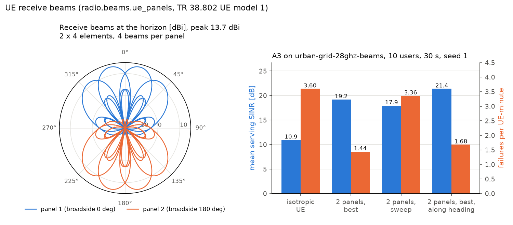

# How to give the UE receive beams

Until 2.3.0 the UE of HandoverLab was isotropic: only the base station had panels and SSB beams
(`radio.beams`, see [beams and several carriers](beams-layers.md)). Since 2.4.0 the beam model can also
give the UE directional panels with receive beams. The option is off by default (`ue_panels: 0`); without
it every result is unchanged. The clause-by-clause status is in
[standard compliance](../standard-compliance.md#ue-receive-beams-240-radiobeamsue_panels).



*Peak gain 13.7 dBi; the mean SINR rises from 10.9 dB (isotropic UE) to 19.2 dB (best beam) and failures fall from 3.60 to 1.44 per UE-minute; with a beam sweep they stay at 3.36.*

## 1. Switch it on

```yaml
schema: 1
scenario:
  base: urban-grid-28ghz-beams
  mobility: {users: 20}
  radio:
    beams: {sectors: 3, sector_az0_deg: 30.0, n_ssb: 8, panel: [4, 8], tilt_deg: 100.0,
            ue_panels: 2}               # two UE panels, 180 degrees apart (TR 38.802 Config 1)
  run: {duration_s: 60.0, warmup_s: 10.0}
seeds: [1, 2, 3]
rules:
  - {rule: a3}
output: results/ue-beams.csv
```

`radio.beams` replaces the whole beam section of the card, so repeat the BS keys you want to keep.

## 2. The keys

| Key | Default | Meaning |
|---|---|---|
| `ue_panels` | 0 | 0: isotropic UE; 1, 2 (180 deg apart) or 4 (90 deg apart) panels, TR 38.802 Table A.2.1-4 |
| `ue_panel` | [2, 4] | M x N elements per panel at half a wavelength (Config a, one polarisation); at most 32 elements over all panels |
| `ue_beams` | 4 | DFT receive beams per panel |
| `ue_beam_span_deg` | 120 | the receive beams' azimuths spread evenly over this span around the panel broadside |
| `ue_tilt_deg` | 90 | zenith angle the receive beams are steered to (90: the horizon) |
| `ue_orientation` | random | `random`: bearing of the first panel uniform in [0, 360) deg, once per UE (TR 38.802); `heading`: along the direction of travel |
| `ue_rx` | best | `best`: every SSB measured with the best beam of the best panel; `sweep`: one beam index per L1 instant on all panels, the highest of the last `ue_beams` samples reported |

The element is model 1 of TR 38.802 Table A.2.1-8 (3 dB widths 90 deg, SLA_V = A_m = 25 dB,
5 dBi; ITU-R M.2412-0 Table 11 is the same), so a receive beam steered to the panel broadside has
5 + 10 log10(2 x 4) = 14.0 dBi. Every panel is a receiver branch: TS 38.215 5.1.1 measures FR2 SS-RSRP
"based on the combined signal from antenna elements corresponding to a given receiver branch".

## 3. What happens in a run

1. At every L1 instant the UE gain towards every site is computed for every receive beam, in the
   geometric direction of the site (LOS or not; HandoverLab has no multipath angles).
2. Measurements: with `best` each SSB beam's L1 value carries the best receive gain towards its site;
   with `sweep` the UE listens with beam j mod `ue_beams` at instant j and reports the highest of the
   last `ue_beams` samples, so a new or a turning cell is seen up to `ue_beams` L1 periods late.
3. The serving link: the UE receives on the best beam towards the serving cell, chosen again at every
   L1 instant and turned to the target when a handover or a re-establishment completes. The desired
   power, radio-link monitoring, beam failure detection and recovery use this beam, and so does the
   interference: a neighbour cell behind the UE's back is attenuated by the panel pattern.

## 4. FR2 measurement times

The time a UE spends on the sweep was already in HandoverLab: with `protocol.meas_periods: ts38133` an
FR2 cell is measured over max(400 ms, 24 x T_SMTC) (TS 38.133 V19.6.0 Table 9.2.5.2-2), where
Mmeas_period_w/o_gaps = 24 for power class 3; for a UE with a reduced sweeping factor the same clause
9.2.5.1 sets it to 3 x N_reduced_Rx_BSF, which we read as 3 samples x 8 receive beams by default.
RLM, beam failure detection and L1-RSRP carry the factor N = 8 (FR2-1) as before. The option adds the
gain of the beams, not a second time scaling. Use `ue_rx: best` with `meas_periods: ts38133`;
`ue_rx: sweep` spends the sweep time itself and is therefore refused together with `ts38133`.

## 5. What it does to the results

The card `urban-grid-28ghz-beams` with 20 users, 60 s (10 s warm-up), seeds 1-3, rule `a3`, two UE
panels (means over the seeds; per UE-minute):

| UE | SINR dB | failures | too late | handovers | ping-pong | beam failures |
|---|---|---|---|---|---|---|
| isotropic (option off) | 9.8 | 5.18 | 2.14 | 20.4 | 0.26 | 12.0 |
| `best`, random bearing | 18.1 | 2.68 | 0.94 | 24.1 | 0.52 | 5.9 |
| `sweep`, random bearing | 16.7 | 4.22 | 1.70 | 22.7 | 0.46 | 8.8 |
| `best`, `heading` | 20.2 | 2.32 | 0.86 | 25.0 | 0.62 | 5.6 |

The receive gain (up to 14 dBi) and the spatial filtering of the interference raise the serving SINR
by about 8 dB and halve the failures. The handovers rise by about a fifth and the ping-pongs double:
probably because the gain towards each cell changes as the UE moves past it, so the measured cell values cross more often (not analysed further). The sweep keeps most of
the SINR gain but loses much of the failure reduction, because a cell is seen up to four L1 periods
late. With an isotropic UE the receive-beam effects are missing altogether, so absolute failure rates
of FR2 cards with and without the option are not comparable; read them relative to each other.

A run with UE beams took 1.3-2 times as long as without (the `sweep` variant longer still).

## 6. What is not modelled

Polarisation (one polarisation per panel), the handheld model of TR 38.901 Table 7.3-2 with antennas at
the device corners, hand blockage, body blockage except the option `radio.blockage: a` (TR 38.901 blockage
model A, since 2.10.0; model B is not modelled), UE rotation other than `heading`, multipath arrival angles,
UE transmit beams, failures of the receive beam itself, and UE beams together with `protocol.dc`.
Radio-map and dashboard plots do not show the UE gains.
