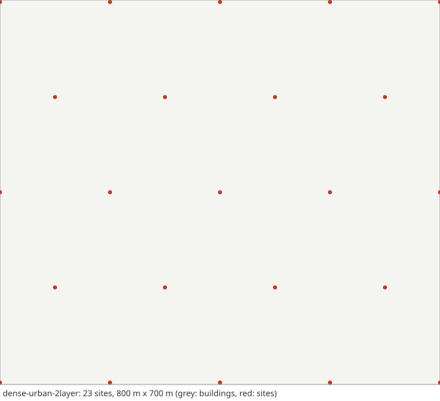

# Scenario card: `dense-urban-2layer`

*Two-layer dense urban deployment of ITU-R M.2412 (4 GHz macro + 30 GHz micro, SSB beams)*  
Available since version 1.10.0. Use it as `scenario: dense-urban-2layer` in a configuration file or `hl.builtin_scenario("dense-urban-2layer")` in Python.

## Purpose

The Dense Urban-eMBB test environment of ITU-R M.2412-0 in its two-layer form (Configuration C): a macro layer at 4 GHz on a hexagonal grid with 200 m between sites and three TRxPs (sectors) per site, and a micro layer at 30 GHz with three micro sites per macro TRxP, each with three TRxPs.  Every TRxP sends 8 SSB beams from a 4 x 8 panel with the element of TR 38.901 Table 7.3-1. Users are the outdoor in-car users of M.2412 (30 km/h).  Measurements follow the periods of TS 38.133 (inter-frequency measurements in gaps), and the rule `a3a5` hands over with Event A3 within a layer and Event A5 between layers.  Use it to study multi-layer mobility, beam failures and inter-frequency handovers.

## Layout

Open area of 800 m x 700 m (no wrap-around), 23 macro sites (ISD 200 m) and 207 micro sites (drawn once: 3 per macro TRxP, uniform by area in the TRxP's 120-degree wedge between 25 m and 115.5 m from the macro site, at least 20 m apart; numpy default_rng(2412)).

## Parameters

Values in **bold** differ from the HandoverLab defaults.

| Key | Value | Source |
|---|---|---|
| `layout.kind` | **open_area** | ITU-R M.2412-0 clause 8.3 (no topographical details; regular hexagonal macro grid) |
| `layout.blocks` | [3, 3] | TR 37.885 Table A-1 (minimum 3 x 3 blocks) |
| `layout.pitch_m` | [433, 250] | TR 37.885 Annex A (433 m x 250 m) |
| `layout.street_width_m` | 20 | TR 37.885 Annex A (20 m) |
| `layout.site_spacing_m` | **200** | ITU-R M.2412-0 Table 5b (macro layer ISD 200 m) |
| `layout.site_offset_m` | 9 | assumption (sites on the pavement) |
| `layout.sites` | **23 entries** | hexagonal macro grid with ISD 200 m in the area (ITU-R M.2412-0 clause 8.3) |
| `layout.area_m` | **[800, 700]** | assumption (800 m x 700 m, about 23 macro sites) |
| `radio.carrier_ghz` | **4** | ITU-R M.2412-0 Table 5b, Configuration C (macro layer 4 GHz) |
| `radio.bandwidth_mhz` | **20** | ITU-R M.2412-0 Table 5b (20 MHz TDD at 4 GHz) |
| `radio.tx_power_dbm` | **44** | ITU-R M.2412-0 Table 5b (macro 4 GHz: 44 dBm for 20 MHz) |
| `radio.bs_gain_db` | 20 | assumption (beam gain, no beam management) |
| `radio.ue_gain_db` | 0 | ITU-R M.2412-0 Table 5b (UE antenna element gain 0 dBi at 4 GHz) |
| `radio.noise_figure_db` | 7 | ITU-R M.2412-0 Table 5b (UE noise figure 7 dB at 4 GHz) |
| `radio.isolation` | 0.3 | assumption (mean-to-peak gain of an interfering data beam) |
| `radio.bs_height_m` | **25** | ITU-R M.2412-0 Table 5b (25 m for macro sites) |
| `radio.ue_height_m` | 1.5 | TR 38.901 Table 7.4.1-1 (1.5 m) |
| `radio.pathloss` | **uma** | TR 38.901 UMa (macro) and UMi street canyon (micro), as M.2412 Annex 1 uses for Dense Urban |
| `radio.shadow_los_db` | 4 | TR 38.901 Table 7.4.1-1 (UMi and UMa LOS: 4 dB) |
| `radio.shadow_nlos_db` | 7.82 | TR 38.901 Table 7.4.1-1 (UMi NLOS: 7.82 dB) |
| `radio.shadow_decorr_m` | 10 | TR 38.901 Table 7.5-6 (UMi: 10 m LOS, 13 m NLOS) |
| `radio.shadow_site_corr` | 0.5 | assumption (correlation between sites) |
| `radio.place_share` | 1 | assumption (blockage tied to place) |
| `radio.clutter_los` | true | TR 38.901 clause 7.6.3.3 (spatially consistent LOS state) |
| `radio.los_corr_m` | 50 | TR 38.901 Table 7.6.3.1-2 (LOS/NLOS state, UMi and UMa: 50 m) |
| `radio.time_var_db` | 1.5 | assumption (moving blockers) |
| `radio.time_var_tau_s` | 1 | assumption |
| `radio.l1_error_db` | 1 | assumption (error of one L1 RSRP sample) |
| `radio.penetration_db` | 0 | off by default; TR 38.901 clause 7.4.3.2: 9 dB in a standard car |
| `radio.penetration_sd_db` | 0 | off by default; TR 38.901 clause 7.4.3.2: 5 dB in a standard car |
| `radio.energy_p0_w` | 56 | EARTH model, micro base station (Auer et al. 2011): 56 W |
| `radio.energy_slope` | 2.6 | EARTH model, micro base station (Auer et al. 2011): 2.6 |
| `radio.map_res_m` | 1 | numerical setting |
| `radio.scs_khz` | **30** | assumption (30 kHz at 4 GHz) |
| `radio.beams.sectors` | 3 | default of the beam model (user guide) |
| `radio.beams.sector_az0_deg` | 30 | default of the beam model (user guide) |
| `radio.beams.n_ssb` | 8 | default of the beam model (user guide) |
| `radio.beams.panel` | [4, 8] | default of the beam model (user guide) |
| `radio.beams.tilt_deg` | **102** | M.2412 clause 8.3.2 (three TRxPs per macro site); element of TR 38.901 Table 7.3-1 (8 dBi, M.2412 BS element gain 8 dBi); panel size, 8 SSB beams (L_max at 4 GHz) and tilt are assumptions |
| `radio.beams.beam_span_deg` | none | default of the beam model (user guide) |
| `radio.beams.ssb_avg` | none | default of the beam model (user guide) |
| `radio.beams.ssb_thresh_dbm` | none | default of the beam model (user guide) |
| `radio.beams.report_s` | 0.04 | default of the beam model (user guide) |
| `radio.beams.switch_db` | 2 | default of the beam model (user guide) |
| `radio.beams.tci_delay_s` | 0.01 | default of the beam model (user guide) |
| `radio.beams.rx_sweep_n` | none | default of the beam model (user guide) |
| `radio.beams.bfd` | true | default of the beam model (user guide) |
| `radio.beams.bfi_max` | 3 | default of the beam model (user guide) |
| `radio.beams.bfd_timer` | 4 | default of the beam model (user guide) |
| `radio.beams.bfr_timer_s` | 0.1 | default of the beam model (user guide) |
| `radio.beams.rsrp_thresh_ssb_dbm` | -115 | default of the beam model (user guide) |
| `radio.beams.ra_attempt_s` | 0.01 | default of the beam model (user guide) |
| `radio.beams.preamble_max` | 10 | default of the beam model (user guide) |
| `radio.beams.rlm_rs` | tci | default of the beam model (user guide) |
| `radio.layers` | **1 entries** | M.2412 clause 8.3.2 and Table 5b: micro layer at 30 GHz, 80 MHz, 33 dBm, 10 m, UE noise figure 10 dB, UE element gain 5 dBi; 3 micro sites per macro TRxP (placement method and three TRxPs per micro site: assumptions, as M.2412 leaves them to the proponent) |
| `protocol.step_s` | 0.01 | numerical setting |
| `protocol.l1_period_s` | 0.04 | assumption (L1 sample period) |
| `protocol.l3_k` | 4 | TS 38.331 clause 5.5.3.2 |
| `protocol.label_period_s` | 0.2 | numerical setting |
| `protocol.report_interval_s` | 0.12 | TS 38.331 reportInterval (ms120) |
| `protocol.qout_db` | -8 | TR 36.839 (Qout -8 dB) |
| `protocol.qin_db` | -6 | TR 36.839 (Qin -6 dB) |
| `protocol.qout_window_s` | 0.2 | TS 38.133 (evaluation period, 200 ms) |
| `protocol.qin_window_s` | 0.1 | TS 38.133 (evaluation period, 100 ms) |
| `protocol.n310` | 1 | TR 36.839 |
| `protocol.n311` | 1 | TR 36.839 |
| `protocol.t310_s` | 1 | TR 36.839 (1 s) |
| `protocol.prep_s` | 0.05 | TR 36.839 (50 ms) |
| `protocol.exec_s` | 0.04 | TR 36.839 (40 ms) |
| `protocol.reest_s` | 1 | TR 36.842 (assumption: 1 s outage) |
| `protocol.cho_recovery_s` | 0.4 | TS 38.300 clause 9.2.3.4 (recovery into a prepared cell; assumption 0.4 s) |
| `protocol.pingpong_s` | 1 | TR 36.839 (minimum time of stay, 1 s) |
| `protocol.cfg_loss_as_failure` | false | check mode only |
| `protocol.lm_load` | none | off by default: link monitoring sees the load of the data channel (calibration option) |
| `protocol.lm_load_per_ue` | 0 | off by default (calibration option) |
| `protocol.exec_can_fail` | true | TR 36.839: the execution fails when the target is below Qout |
| `protocol.rlm_holdoff_s` | 0 | off by default; TS 38.133 clause 8.1: out-of-sync evaluation of 0.2 s on a new cell |
| `protocol.meas_periods` | **ts38133** | TS 38.133 Tables 9.2.5.2-1/-2 and 9.3.5-1/-2 (gap pattern 0 of Table 9.1.2-1) |
| `protocol.rlm_eval` | **ts38133** | TS 38.133 Tables 8.1.2.2-1/-2 |
| `traffic.services` | 5 entries | TS 23.501 Table 5.7.4-1 (5QI); thresholds are assumptions |
| `traffic.se_max` | 7.4 | assumption (spectral-efficiency cap) |
| `traffic.hotspot_share` | 0.25 | assumption |
| `traffic.hotspot_load` | [0.55, 0.85] | assumption |
| `traffic.normal_load` | [0.05, 0.25] | assumption |
| `traffic.load_tau_s` | 0.2 | assumption |
| `traffic.rate_scale` | 1 | assumption |
| `traffic.label_load` | 1 | assumption (all cells transmit for the label) |
| `traffic.model` | fixed | fixed: constant service rates (the model of 1.0) |
| `traffic.period_s` | 0.02 | periodic model: 20 ms, as VoIP |
| `traffic.packet_bytes` | 100 | periodic model: assumption |
| `traffic.ftp_file_bytes` | 500000 | TR 36.814 A.2.1.3 (FTP model 3: 0.5 Mbyte) |
| `traffic.ftp_rate_hz` | 0.1 | ftp3 model: assumption (file arrival rate per user) |
| `mobility.users` | **20** | assumption |
| `mobility.profile` | veh16 | TR 37.885 clause 6.1.2 (urban: 60 km/h); see the user guide |
| `mobility.groups` | **1 entries** | ITU-R M.2412-0 Table 5b: outdoor (in-car) users at 30 km/h; the 80 % indoor users are not simulated |
| `run.duration_s` | 120 | numerical setting |
| `run.warmup_s` | 20 | numerical setting |

## Known limitations

- No wrap-around: users near the edge of the area see fewer interferers than in M.2412.
- No fast fading and no UE beamforming; one hypothetical beam per SSB with fixed DFT weights.
- Only the outdoor in-car users of M.2412 are simulated (the 80 % indoor users and building penetration are not).
- The micro-site positions are one draw; other draws give other statistics.

## Reference results

- ITU-R M.2412-0 (2017) clause 8.3.2 and Table 5b (local copy std3gpp/pdf/R-REP-M.2412-2017-PDF-E.pdf).
