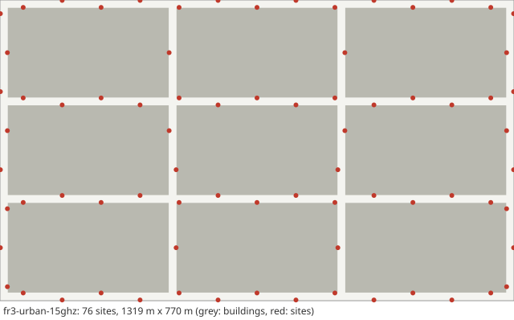

# Scenario card: `fr3-urban-15ghz`

*The TR 37.885 urban grid in the upper mid-band (FR3) at 15 GHz*  
Available since version 1.0.0rc2. Use it as `scenario: fr3-urban-15ghz` in a configuration file or `hl.builtin_scenario("fr3-urban-15ghz")` in Python.

## Purpose

The `urban-grid-10ghz` world moved to 15 GHz, the middle of the upper mid-band (FR3, 7.125 to 24.25 GHz) that 3GPP studies for 5G-Advanced and beyond: the same 3 x 3-block grid with small cells every 100 m, the TR 38.901 UMi street-canyon model with building LOS and place-tied shadowing, a 400 MHz carrier and an array of the same physical size as at 10 GHz, so that its beam gain is 20 log10(15/10) = 3.5 dB higher.  Path loss grows by about as much, the noise by 3 dB (twice the bandwidth), so the signal-to-noise ratio is about 3 dB lower.  Use it next to `urban-grid-10ghz` to see how a rule's trade-off between failures and unnecessary handovers moves with the carrier; everything else stays the same.

## Layout

Three by three blocks (433 m x 250 m between street centre lines, 20 m streets), 76 sites, as in `urban-grid-10ghz`.

## Parameters

Values in **bold** differ from the HandoverLab defaults.

| Key | Value | Source |
|---|---|---|
| `layout.kind` | street_grid | TR 37.885 Annex A (urban grid) |
| `layout.blocks` | [3, 3] | TR 37.885 Table A-1 (minimum 3 x 3 blocks) |
| `layout.pitch_m` | [433, 250] | TR 37.885 Annex A (433 m x 250 m) |
| `layout.street_width_m` | 20 | TR 37.885 Annex A (20 m) |
| `layout.site_spacing_m` | 100 | assumption (dense small cells along the streets) |
| `layout.site_offset_m` | 9 | assumption (sites on the pavement) |
| `layout.sites` | none | regular placement along the streets |
| `radio.carrier_ghz` | **15** | FR3 (7.125-24.25 GHz) of the Rel-19 7-24 GHz channel-model study (TR 38.901 V19); 15 GHz is an assumption |
| `radio.bandwidth_mhz` | **400** | assumption (400 MHz channel in the upper mid-band) |
| `radio.tx_power_dbm` | 35 | assumption (small cell) |
| `radio.bs_gain_db` | **23.5** | assumption (array of the same aperture as at 10 GHz: +20 log10(15/10) dB) |
| `radio.ue_gain_db` | 0 | assumption |
| `radio.noise_figure_db` | 7 | assumption (typical UE noise figure) |
| `radio.isolation` | 0.3 | assumption (mean-to-peak gain of an interfering data beam) |
| `radio.bs_height_m` | 10 | TR 38.901 Table 7.4.1-1 (UMi: 10 m) |
| `radio.ue_height_m` | 1.5 | TR 38.901 Table 7.4.1-1 (1.5 m) |
| `radio.pathloss` | umi_street_canyon | TR 38.901 Table 7.4.1-1 |
| `radio.shadow_los_db` | 4 | TR 38.901 Table 7.4.1-1 (UMi and UMa LOS: 4 dB) |
| `radio.shadow_nlos_db` | 7.82 | TR 38.901 Table 7.4.1-1 (UMi NLOS: 7.82 dB) |
| `radio.shadow_decorr_m` | 10 | TR 38.901 Table 7.5-6 (UMi: 10 m LOS, 13 m NLOS) |
| `radio.shadow_site_corr` | 0.5 | assumption (correlation between sites) |
| `radio.place_share` | 1 | assumption (blockage tied to place) |
| `radio.clutter_los` | true | TR 38.901 clause 7.6.3.3 (spatially consistent LOS state) |
| `radio.los_corr_m` | 50 | TR 38.901 Table 7.6.3.1-2 (LOS/NLOS state, UMi and UMa: 50 m) |
| `radio.time_var_db` | 1.5 | assumption (moving blockers) |
| `radio.time_var_tau_s` | 1 | assumption |
| `radio.l1_error_db` | 1 | assumption (error of one L1 RSRP sample) |
| `radio.penetration_db` | 0 | off by default; TR 38.901 clause 7.4.3.2: 9 dB in a standard car |
| `radio.penetration_sd_db` | 0 | off by default; TR 38.901 clause 7.4.3.2: 5 dB in a standard car |
| `radio.map_res_m` | 1 | numerical setting |
| `protocol.step_s` | 0.01 | numerical setting |
| `protocol.l1_period_s` | 0.04 | assumption (L1 sample period) |
| `protocol.l3_k` | 4 | TS 38.331 clause 5.5.3.2 |
| `protocol.label_period_s` | 0.2 | numerical setting |
| `protocol.report_interval_s` | 0.12 | TS 38.331 reportInterval (ms120) |
| `protocol.qout_db` | -8 | TR 36.839 (Qout -8 dB) |
| `protocol.qin_db` | -6 | TR 36.839 (Qin -6 dB) |
| `protocol.qout_window_s` | 0.2 | TS 38.133 (evaluation period, 200 ms) |
| `protocol.qin_window_s` | 0.1 | TS 38.133 (evaluation period, 100 ms) |
| `protocol.n310` | 1 | TR 36.839 |
| `protocol.n311` | 1 | TR 36.839 |
| `protocol.t310_s` | 1 | TR 36.839 (1 s) |
| `protocol.prep_s` | 0.05 | TR 36.839 (50 ms) |
| `protocol.exec_s` | 0.04 | TR 36.839 (40 ms) |
| `protocol.reest_s` | 1 | TR 36.842 (assumption: 1 s outage) |
| `protocol.cho_recovery_s` | 0.4 | TS 38.300 clause 9.2.3.4 (recovery into a prepared cell; assumption 0.4 s) |
| `protocol.pingpong_s` | 1 | TR 36.839 (minimum time of stay, 1 s) |
| `protocol.cfg_loss_as_failure` | false | check mode only |
| `protocol.lm_load` | none | off by default: link monitoring sees the load of the data channel (calibration option) |
| `protocol.lm_load_per_ue` | 0 | off by default (calibration option) |
| `protocol.exec_can_fail` | true | TR 36.839: the execution fails when the target is below Qout |
| `traffic.services` | 5 entries | TS 23.501 Table 5.7.4-1 (5QI); thresholds are assumptions |
| `traffic.se_max` | 7.4 | assumption (spectral-efficiency cap) |
| `traffic.hotspot_share` | 0.25 | assumption |
| `traffic.hotspot_load` | [0.55, 0.85] | assumption |
| `traffic.normal_load` | [0.05, 0.25] | assumption |
| `traffic.load_tau_s` | 0.2 | assumption |
| `traffic.rate_scale` | 1 | assumption |
| `traffic.label_load` | 1 | assumption (all cells transmit for the label) |
| `mobility.users` | 40 | assumption |
| `mobility.profile` | veh16 | TR 37.885 clause 6.1.2 (urban: 60 km/h); see the user guide |
| `mobility.groups` | none | profile |
| `run.duration_s` | 120 | numerical setting |
| `run.warmup_s` | 20 | numerical setting |

## Known limitations

- Received-power level only: no fast fading, no link-level physical layer, one beam gain and one isolation factor.
- TR 38.901 UMi parameters are used at 15 GHz; the model's validity in the 7-24 GHz range was re-examined in Rel-19, and frequency-dependent material penetration or foliage loss is not modelled.
- The failure model is not calibrated in absolute terms; read failure rates relative to each other and to `urban-grid-10ghz`.
- The radio map takes as long to build as for `urban-grid-10ghz` (once per seed).

## Reference results

- Same layout, mobility and seeds as `urban-grid-10ghz`; the path-loss formula is checked against hand values in the unit tests at all carriers.
