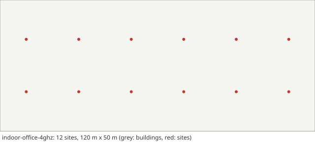

# Scenario card: `indoor-office-4ghz`

*The TR 38.901 indoor office with ceiling sites at 4 GHz*  
Available since version 1.7.0. Use it as `scenario: indoor-office-4ghz` in a configuration file or `hl.builtin_scenario("indoor-office-4ghz")` in Python.

## Purpose

An indoor counterpart of the outdoor scenarios: the indoor office of TR 38.901 (a hall of 120 m x 50 m, 12 ceiling sites 20 m apart in two rows, sites 3 m and users 1 m high) with the InH-Office path loss and the LOS probability of the mixed office, the link budget of the IMT-2020 Indoor Hotspot-eMBB evaluation at 4 GHz, and pedestrians at about 3 km/h.  Cells are small and close together, so the neighbours are almost as strong as the serving cell: handovers are slow but frequent, and ping-pong and unnecessary handovers matter more than late ones.  Use it to see how a rule copes with dense, interference-limited coverage at walking speed.

## Layout

A 120 m x 50 m hall, 12 sites on a 20 m grid (6 x 2), 10 m from the short walls and 15 m from the long walls as in TR 38.901 Figure 7.2-1.  No walls are drawn: the InH LOS probability stands for the walls and furniture of the office.

## Parameters

Values in **bold** differ from the HandoverLab defaults.

| Key | Value | Source |
|---|---|---|
| `layout.kind` | **indoor** | TR 38.901 Table 7.2-2 and Figure 7.2-1 (indoor office) |
| `layout.blocks` | [3, 3] | TR 37.885 Table A-1 (minimum 3 x 3 blocks) |
| `layout.pitch_m` | [433, 250] | TR 37.885 Annex A (433 m x 250 m) |
| `layout.street_width_m` | 20 | TR 37.885 Annex A (20 m) |
| `layout.site_spacing_m` | **20** | TR 38.901 Table 7.2-2 (ISD 20 m); 12 sites: ITU-R M.2412-0 clause 8.3.1 |
| `layout.site_offset_m` | 9 | assumption (sites on the pavement) |
| `layout.sites` | none | regular placement along the streets |
| `layout.area_m` | **[120, 50]** | TR 38.901 Table 7.2-2 (120 m x 50 m) |
| `radio.carrier_ghz` | **4** | ITU-R M.2412-0 Table 5a (Indoor Hotspot-eMBB, configuration A: 4 GHz) |
| `radio.bandwidth_mhz` | **20** | ITU-R M.2412-0 Table 5a (simulation bandwidth 20 MHz for TDD) |
| `radio.tx_power_dbm` | **24** | ITU-R M.2412-0 Table 5a (24 dBm for 20 MHz) |
| `radio.bs_gain_db` | **14** | assumption: 5 dBi element (ITU-R M.2412-0 Table 5a) plus an 8-element beam (9 dB) |
| `radio.ue_gain_db` | 0 | assumption |
| `radio.noise_figure_db` | 7 | ITU-R M.2412-0 Table 5a (UE noise figure at 4 GHz: 7 dB, the default) |
| `radio.isolation` | 0.3 | assumption (mean-to-peak gain of an interfering data beam) |
| `radio.bs_height_m` | **3** | TR 38.901 Table 7.2-2 (3 m, ceiling) |
| `radio.ue_height_m` | **1** | TR 38.901 Table 7.2-2 (1 m) |
| `radio.pathloss` | **inh_office** | TR 38.901 Table 7.4.1-1 (InH-Office); LOS probability of the mixed office, Table 7.4.2-1 |
| `radio.shadow_los_db` | **3** | TR 38.901 Table 7.4.1-1 (InH LOS: 3 dB) |
| `radio.shadow_nlos_db` | **8.03** | TR 38.901 Table 7.4.1-1 (InH NLOS: 8.03 dB) |
| `radio.shadow_decorr_m` | 10 | TR 38.901 Table 7.5-6 Part-2 (Indoor-Office LOS: 10 m) |
| `radio.shadow_site_corr` | 0.5 | assumption (correlation between sites) |
| `radio.place_share` | 1 | assumption (blockage tied to place) |
| `radio.clutter_los` | true | TR 38.901 clause 7.6.3.3 (spatially consistent LOS state) |
| `radio.los_corr_m` | **10** | TR 38.901 Table 7.6.3.1-2 (indoor LOS/NLOS state: 10 m) |
| `radio.soft_los` | **true** | TR 38.901 clause 7.6.3.3 (optional soft LOS state, meant to avoid hard LOS/NLOS transitions in mobility simulations) |
| `radio.time_var_db` | 1.5 | assumption (moving blockers) |
| `radio.time_var_tau_s` | 1 | assumption |
| `radio.l1_error_db` | 1 | assumption (error of one L1 RSRP sample) |
| `radio.penetration_db` | 0 | off by default; TR 38.901 clause 7.4.3.2: 9 dB in a standard car |
| `radio.penetration_sd_db` | 0 | off by default; TR 38.901 clause 7.4.3.2: 5 dB in a standard car |
| `radio.energy_p0_w` | 56 | EARTH model, micro base station (Auer et al. 2011): 56 W |
| `radio.energy_slope` | 2.6 | EARTH model, micro base station (Auer et al. 2011): 2.6 |
| `radio.map_res_m` | 1 | numerical setting |
| `protocol.step_s` | 0.01 | numerical setting |
| `protocol.l1_period_s` | 0.04 | assumption (L1 sample period) |
| `protocol.l3_k` | 4 | TS 38.331 clause 5.5.3.2 |
| `protocol.label_period_s` | 0.2 | numerical setting |
| `protocol.report_interval_s` | 0.12 | TS 38.331 reportInterval (ms120) |
| `protocol.qout_db` | -8 | TR 36.839 (Qout -8 dB) |
| `protocol.qin_db` | -6 | TR 36.839 (Qin -6 dB) |
| `protocol.qout_window_s` | 0.2 | TS 38.133 (evaluation period, 200 ms) |
| `protocol.qin_window_s` | 0.1 | TS 38.133 (evaluation period, 100 ms) |
| `protocol.n310` | 1 | TR 36.839 |
| `protocol.n311` | 1 | TR 36.839 |
| `protocol.t310_s` | 1 | TR 36.839 (1 s) |
| `protocol.prep_s` | 0.05 | TR 36.839 (50 ms) |
| `protocol.exec_s` | 0.04 | TR 36.839 (40 ms) |
| `protocol.reest_s` | 1 | TR 36.842 (assumption: 1 s outage) |
| `protocol.cho_recovery_s` | 0.4 | TS 38.300 clause 9.2.3.4 (recovery into a prepared cell; assumption 0.4 s) |
| `protocol.pingpong_s` | 1 | TR 36.839 (minimum time of stay, 1 s) |
| `protocol.cfg_loss_as_failure` | false | check mode only |
| `protocol.lm_load` | none | off by default: link monitoring sees the load of the data channel (calibration option) |
| `protocol.lm_load_per_ue` | 0 | off by default (calibration option) |
| `protocol.exec_can_fail` | true | TR 36.839: the execution fails when the target is below Qout |
| `protocol.rlm_holdoff_s` | 0.2 | off by default; TS 38.133 clause 8.1: out-of-sync evaluation of 0.2 s on a new cell |
| `traffic.services` | 5 entries | TS 23.501 Table 5.7.4-1 (5QI); thresholds are assumptions |
| `traffic.se_max` | 7.4 | assumption (spectral-efficiency cap) |
| `traffic.hotspot_share` | 0.25 | assumption |
| `traffic.hotspot_load` | [0.55, 0.85] | assumption |
| `traffic.normal_load` | [0.05, 0.25] | assumption |
| `traffic.load_tau_s` | 0.2 | assumption |
| `traffic.rate_scale` | 1 | assumption |
| `traffic.label_load` | 1 | assumption (all cells transmit for the label) |
| `traffic.model` | fixed | fixed: constant service rates (the model of 1.0) |
| `traffic.period_s` | 0.02 | periodic model: 20 ms, as VoIP |
| `traffic.packet_bytes` | 100 | periodic model: assumption |
| `traffic.ftp_file_bytes` | 500000 | TR 36.814 A.2.1.3 (FTP model 3: 0.5 Mbyte) |
| `traffic.ftp_rate_hz` | 0.1 | ftp3 model: assumption (file arrival rate per user) |
| `mobility.users` | **20** | assumption |
| `mobility.profile` | **ped3** | TR 38.901 Table 7.2-2 and ITU-R M.2412-0 Table 5a (3 km/h); +-10 % spread is an assumption |
| `mobility.groups` | none | profile |
| `run.duration_s` | 120 | numerical setting |
| `run.warmup_s` | 20 | numerical setting |

## Known limitations

- Mixed sources: the UE height is the 1 m of TR 38.901 Table 7.2-2, the link budget that of ITU-R M.2412-0 Table 5a, which has 1.5 m.
- No walls, doors or floors: the soft LOS state follows the InH LOS probability as a process along each user's path, and the place-tied shadowing field stands for the rest. One floor only. With the hard LOS state (radio.soft_los: false) A3 failed about 8 times as often in a check run (0.16 against 0.02 per user-minute, 3 seeds).
- One shadowing decorrelation distance: TR 38.901 gives 10 m for LOS and 6 m for NLOS links; here 10 m.
- Random waypoints across the whole hall; real users walk along corridors and stop at desks.
- The InH formulas hold for 3D distances of 1 m to 150 m; the hall keeps every link inside that range.
- The failure model is not calibrated in absolute terms; read failure rates relative to each other.

## Reference results

- Layout, heights, speeds, path loss, LOS probability and correlation distances checked against TR 38.901 V17.0.0 and the link budget against ITU-R M.2412-0; path loss and LOS probability against values computed by hand (handoverlab verify, group pathloss); determinism and invariant checks as for every scenario.
