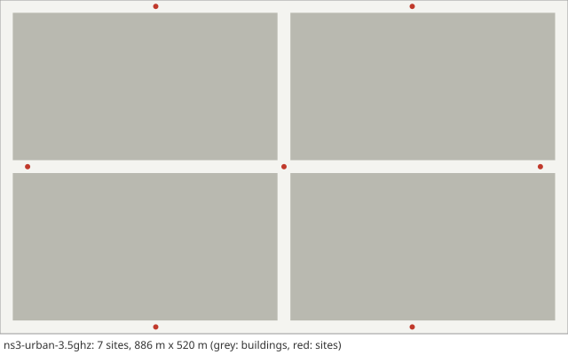

# Scenario card: `ns3-urban-3.5ghz`

*Reference scenario of the comparison with ns-3 / 5G-LENA*  
Available since version 0.2.0. Use it as `scenario: ns3-urban-3.5ghz` in a configuration file or `hl.builtin_scenario("ns3-urban-3.5ghz")` in Python.

## Purpose

An urban scenario that was also simulated with the packet-level simulator ns-3 and its 5G-LENA module: the 2 x 2-block TR 37.885 grid with seven sites (400 m apart here; the 200 m variant is part of the comparison), a 3.5 GHz carrier with 10 MHz, omnidirectional antennas, line of sight from the buildings only, shadowing drawn along each user's path, 20 vehicles at a constant 16 m/s on the street centre lines, one L1 sample every 200 ms and light traffic.  The stored ns-3 results for 24 Event-A3 settings are the reference of `handoverlab verify --ns3`.

## Layout

Seven sites at (0, 0), (+-400, 0), (+-200, +-250) m in the 2 x 2-block grid.

## Parameters

Values in **bold** differ from the HandoverLab defaults.

| Key | Value | Source |
|---|---|---|
| `layout.kind` | street_grid | TR 37.885 Annex A (urban grid) |
| `layout.blocks` | **[2, 2]** | TR 37.885 Table A-1 (minimum 3 x 3 blocks) |
| `layout.pitch_m` | [433, 250] | TR 37.885 Annex A (433 m x 250 m) |
| `layout.street_width_m` | 20 | TR 37.885 Annex A (20 m) |
| `layout.site_spacing_m` | 100 | assumption (dense small cells along the streets) |
| `layout.site_offset_m` | 9 | assumption (sites on the pavement) |
| `layout.sites` | **7 entries** | the ns-3 study (seven sites) |
| `radio.carrier_ghz` | **3.5** | the ns-3 study (3.5 GHz, 10 MHz) |
| `radio.bandwidth_mhz` | **10** | the ns-3 study |
| `radio.tx_power_dbm` | **40** | the ns-3 study (40 dBm) |
| `radio.bs_gain_db` | **0** | the ns-3 study (omnidirectional antennas) |
| `radio.ue_gain_db` | 0 | assumption |
| `radio.noise_figure_db` | **5** | the ns-3 study (5 dB) |
| `radio.isolation` | **1** | no beam isolation (omnidirectional antennas) |
| `radio.bs_height_m` | 10 | TR 38.901 Table 7.4.1-1 (UMi: 10 m) |
| `radio.ue_height_m` | 1.5 | TR 38.901 Table 7.4.1-1 (1.5 m) |
| `radio.pathloss` | umi_street_canyon | TR 38.901 Table 7.4.1-1 |
| `radio.shadow_los_db` | 4 | TR 38.901 Table 7.4.1-1 (UMi and UMa LOS: 4 dB) |
| `radio.shadow_nlos_db` | 7.82 | TR 38.901 Table 7.4.1-1 (UMi NLOS: 7.82 dB) |
| `radio.shadow_decorr_m` | 10 | TR 38.901 Table 7.5-6 (UMi: 10 m LOS, 13 m NLOS) |
| `radio.shadow_site_corr` | 0.5 | assumption (correlation between sites) |
| `radio.place_share` | **0** | ns-3 draws shadowing per link: no place-tied part |
| `radio.clutter_los` | **false** | the ns-3 study (LOS from the buildings only) |
| `radio.los_corr_m` | 50 | TR 38.901 Table 7.6.3.1-2 (LOS/NLOS state, UMi and UMa: 50 m) |
| `radio.time_var_db` | **0** | not modelled in the ns-3 study |
| `radio.time_var_tau_s` | 1 | assumption |
| `radio.l1_error_db` | **0** | not modelled in the ns-3 study |
| `radio.penetration_db` | 0 | off by default; TR 38.901 clause 7.4.3.2: 9 dB in a standard car |
| `radio.penetration_sd_db` | 0 | off by default; TR 38.901 clause 7.4.3.2: 5 dB in a standard car |
| `radio.map_res_m` | 1 | numerical setting |
| `protocol.step_s` | 0.01 | numerical setting |
| `protocol.l1_period_s` | **0.2** | the ns-3 study (one sample every 200 ms) |
| `protocol.l3_k` | 4 | TS 38.331 clause 5.5.3.2 |
| `protocol.label_period_s` | 0.2 | numerical setting |
| `protocol.report_interval_s` | **0.2** | matched to the L1 period |
| `protocol.qout_db` | -8 | TR 36.839 (Qout -8 dB) |
| `protocol.qin_db` | -6 | TR 36.839 (Qin -6 dB) |
| `protocol.qout_window_s` | 0.2 | TS 38.133 (evaluation period, 200 ms) |
| `protocol.qin_window_s` | 0.1 | TS 38.133 (evaluation period, 100 ms) |
| `protocol.n310` | 1 | TR 36.839 |
| `protocol.n311` | 1 | TR 36.839 |
| `protocol.t310_s` | 1 | TR 36.839 (1 s) |
| `protocol.prep_s` | 0.05 | TR 36.839 (50 ms) |
| `protocol.exec_s` | **0.01** | the ns-3 study |
| `protocol.reest_s` | 1 | TR 36.842 (assumption: 1 s outage) |
| `protocol.cho_recovery_s` | 0.4 | TS 38.300 clause 9.2.3.4 (recovery into a prepared cell; assumption 0.4 s) |
| `protocol.pingpong_s` | 1 | TR 36.839 (minimum time of stay, 1 s) |
| `protocol.cfg_loss_as_failure` | false | check mode only |
| `protocol.lm_load` | none | off by default: link monitoring sees the load of the data channel (calibration option) |
| `protocol.lm_load_per_ue` | 0 | off by default (calibration option) |
| `protocol.exec_can_fail` | true | TR 36.839: the execution fails when the target is below Qout |
| `protocol.rlm_holdoff_s` | 0 | off by default; TS 38.133 clause 8.1: out-of-sync evaluation of 0.2 s on a new cell |
| `traffic.services` | 5 entries | TS 23.501 Table 5.7.4-1 (5QI); thresholds are assumptions |
| `traffic.se_max` | 7.4 | assumption (spectral-efficiency cap) |
| `traffic.hotspot_share` | **0** | assumption |
| `traffic.hotspot_load` | **[0.03, 0.03]** | assumption (as normal_load) |
| `traffic.normal_load` | **[0.03, 0.03]** | assumption: light traffic of 10 packets/s per user, about 3 % load |
| `traffic.load_tau_s` | 0.2 | assumption |
| `traffic.rate_scale` | **0.001** | light traffic |
| `traffic.label_load` | 1 | assumption (all cells transmit for the label) |
| `mobility.users` | **20** | assumption |
| `mobility.profile` | **c16** | the ns-3 study (constant speed on the centre lines; c8, c16 and c30 are compared) |
| `mobility.groups` | none | profile |
| `run.duration_s` | **150** | the ns-3 study (150 s, the first 60 s not counted) |
| `run.warmup_s` | **60** | numerical setting |

## Known limitations

- Seeds are different realisations in the two simulators; only averages over settings and conditions can be compared.
- The interfering load is defined differently in the two simulators, so failure rates are reported without a pass limit.
- Only baseline handover can be compared: 5G-LENA has no conditional handover.

## Reference results

- ns-3 / 5G-LENA results for 24 Event-A3 settings on four conditions (site distance 200 / 400 m, 16 / 30 m/s), stored in handoverlab/verify/data/ns3_urban_a3.json; acceptance limits: median ratio of handover and of unnecessary-handover rates in [0.8, 1.25], rank correlation over the settings at least 0.9 (`handoverlab verify --ns3`).
- Result of version 0.2.0a1 (one seed per condition): median ratio HandoverLab / ns-3 of 0.95 for the handover rate and 1.04 for the unnecessary-handover rate, rank correlation 0.99 for both; failure rate 0.13 against 0.43 per UE-minute (rank correlation 0.54), mean serving SINR 26.2 dB against 11.5 dB.
