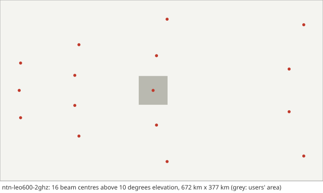

# Scenario card: `ntn-leo600-2ghz`

*A LEO satellite at 600 km with 19 earth-moving beams in the S band (NTN)*  
Available since version 2.0.0. Use it as `scenario: ntn-leo600-2ghz` in a configuration file or `hl.builtin_scenario("ntn-leo600-2ghz")` in Python.

## Purpose

The LEO scenario of the 3GPP NTN study (TR 38.821) that RAN2 prioritised for mobility: one satellite at 600 km altitude, transparent payload, 19 beams fixed in the satellite frame (they sweep over the ground with the satellite at 7.56 km/s), Set-1 satellite parameters in the S band (2 GHz, 30 MHz), frequency reuse 1, handheld users at 3 km/h in a rural area, and the large-scale channel of TR 38.811 under the baseline propagation condition of TR 38.821 (clear sky, line of sight).  The handovers come from the satellite's motion, not the users': every user crosses a beam within seconds.  Use it for NTN mobility, e.g. conditional handover with the location condition D2 of Release 18 (rule `cho_d2`).

## Layout

The users' area of 60 km x 60 km around the point at which the central beam points with 30 degrees elevation at the middle of the run, and the beam centres on the ground at that time (the drawing leaves out the three below 10 degrees elevation, far to the east).  The satellite passes west of the area, moving north.

## Parameters

Values in **bold** differ from the HandoverLab defaults.

| Key | Value | Source |
|---|---|---|
| `layout.kind` | **ntn** | TR 38.821 Table 4.2-2 and Table 7.1-1 (scenario C2: LEO 600 km, transparent payload, beams moving with the satellite); TR 38.821 clause 7.3.2.4 (RAN2 prioritises LEO with moving beams for mobility) |
| `layout.area_m` | **[60000, 60000]** | assumption (the users stay under the 19 beams for the length of the run) |
| `radio.carrier_ghz` | **2** | TR 38.821 Table 6.1.1.1-5 (S band, 2 GHz) |
| `radio.bandwidth_mhz` | **30** | TR 38.821 Table 6.1.1.1-5 (S band: 30 MHz per beam, frequency reuse 1) |
| `radio.tx_power_dbm` | 35 | assumption (small cell; TR 37.885 Table 6.1.1-2 has 43 dBm for its macro sites) |
| `radio.ue_gain_db` | 0 | TR 38.821 Table 6.1.1.1-3 (handheld UE: 0 dBi per element) |
| `radio.noise_figure_db` | 7 | TR 38.821 Table 6.1.1.1-3 (handheld UE: noise figure 7 dB, antenna temperature 290 K) |
| `radio.isolation` | **1** | TR 38.821 Table 6.1.1.1-5 (frequency reuse factor 1: every beam interferes with its full power and load) |
| `radio.time_var_db` | **0** | set to 0: the large-scale model of TR 38.811 has no further time-varying component |
| `radio.time_var_tau_s` | 1 | assumption |
| `radio.l1_error_db` | 1 | assumption (error of one L1 RSRP sample) |
| `radio.energy_p0_w` | 56 | EARTH model, micro base station (Auer et al. 2011, Table 2): 56 W |
| `radio.energy_slope` | 2.6 | EARTH model, micro base station (Auer et al. 2011, Table 2): 2.6 |
| `protocol.step_s` | 0.01 | numerical setting |
| `protocol.l1_period_s` | 0.04 | assumption (L1 sample period) |
| `protocol.l3_k` | 4 | TS 38.331 clause 5.5.3.2 |
| `protocol.label_period_s` | 0.2 | numerical setting |
| `protocol.report_interval_s` | 0.12 | TS 38.331 reportInterval (ms120) |
| `protocol.qout_db` | -8 | TR 36.839 (Qout -8 dB) |
| `protocol.qin_db` | -6 | TR 36.839 (Qin -6 dB) |
| `protocol.qout_window_s` | 0.2 | TS 38.133 (evaluation period, 200 ms) |
| `protocol.qin_window_s` | 0.1 | TS 38.133 (evaluation period, 100 ms) |
| `protocol.n310` | 1 | TR 36.839 |
| `protocol.n311` | 1 | TR 36.839 |
| `protocol.t310_s` | 1 | TR 36.839 (1 s) |
| `protocol.prep_s` | **0.07577** | TR 36.839 (50 ms) plus the maximum round-trip delay of scenario C2 (TR 38.821 Table 7.1-1: 25.77 ms) |
| `protocol.exec_s` | **0.06577** | TR 36.839 (40 ms) plus the maximum round-trip delay of scenario C2 for the random access (assumption: one round trip) |
| `protocol.reest_s` | 1 | assumption (1 s outage); TS 38.133 6.2.1.2.1 bounds the delay by 50 ms + cell identification (FR1: 200 ms known, 800 ms unknown cell, Table 6.2.1.2.1-1) + system information + PRACH; TR 36.842 Table E.1-2 uses 250 ms |
| `protocol.cho_recovery_s` | 0.4 | TS 38.300 clauses 9.2.3.1 and 9.2.7 (recovery into a CHO candidate; assumption 0.4 s) |
| `protocol.pingpong_s` | 1 | TR 36.839 (minimum time of stay, 1 s) |
| `protocol.cfg_loss_as_failure` | false | check mode only |
| `protocol.lm_load` | none | off by default: link monitoring sees the load of the data channel (calibration option) |
| `protocol.lm_load_per_ue` | 0 | off by default (calibration option) |
| `protocol.exec_can_fail` | true | TR 36.839: the execution fails when the target is below Qout |
| `protocol.rlm_holdoff_s` | 0.2 | 0.2 s since 2.0.0: an interpretation of TS 38.133 8.1.2.2 (evaluation over the last T_Evaluate_out, 200 ms in FR1) on a newly joined cell |
| `traffic.services` | 5 entries | TS 23.501 Table 5.7.4-1 (5QI); thresholds are assumptions |
| `traffic.se_max` | 7.4 | assumption (spectral-efficiency cap) |
| `traffic.hotspot_share` | 0.25 | assumption |
| `traffic.hotspot_load` | [0.55, 0.85] | assumption |
| `traffic.normal_load` | [0.05, 0.25] | assumption |
| `traffic.load_tau_s` | 0.2 | assumption |
| `traffic.rate_scale` | 1 | assumption |
| `traffic.label_load` | 1 | assumption (all cells transmit for the label) |
| `traffic.model` | fixed | fixed: constant service rates (the model of 1.0) |
| `traffic.period_s` | 0.02 | periodic model: 20 ms, as VoIP |
| `traffic.packet_bytes` | 100 | periodic model: assumption |
| `traffic.ftp_file_bytes` | 500000 | FTP model 3 (TR 36.872 Annex A.1) with 0.5 Mbyte files (TR 38.802 Table A.2.1-1; TR 38.821 Table 6.1.1.1-7) |
| `traffic.ftp_rate_hz` | 0.1 | ftp3 model: assumption (file arrival rate per user) |
| `mobility.users` | 40 | assumption |
| `mobility.profile` | **ped3** | TR 38.821 Table 6.1.1.1-3 (handheld UE); 3 km/h is an assumption |
| `mobility.groups` | none | profile |
| `run.duration_s` | **30** | numerical setting (the satellite moves 227 km in 30 s; the users stay under the 19 beams) |
| `run.warmup_s` | **2** | numerical setting |
| `ntn.altitude_km` | 600 | TR 38.821 Table 6.1.1.1-1 (LEO-600) |
| `ntn.aperture_m` | 2 | TR 38.821 Table 6.1.1.1-1 (Set-1, S band: equivalent antenna aperture 2 m; 3 dB beamwidth 4.4127 degrees) |
| `ntn.eirp_dbw_per_mhz` | 34 | TR 38.821 Table 6.1.1.1-1 (Set-1, S band, LEO-600: 34 dBW/MHz) |
| `ntn.n_beams` | 19 | TR 38.821 Table 6.1.1.1-4 (19 beams, hexagonal on the UV plane, adjacent beam spacing sqrt(3) sin(HPBW/2) from the tabled 3 dB beamwidth 4.4127 degrees: 0.06668; Table 6.1.1.1-6 gives 0.0668 as informative value) |
| `ntn.centre_elevation_deg` | 30 | TR 38.821 Table 6.1.1.1-4 (case 2: central beam boresight from the target elevation) and Table 6.1.3.2-1 (target elevation 30 degrees for LEO); not the baseline of the system-level simulations, which is 90 degrees (nadir, (0, 0) on the UV plane) for scenarios C2/D2 in Table 6.1.1.1-6 |
| `ntn.environment` | rural | TR 38.821 Table 6.1.1.1-5 (deployment scenario: rural); TR 38.811 Tables 6.6.1-1 and 6.6.2-3 (suburban and rural) |
| `ntn.atm_zenith_db` | 0.045 | TR 38.811 Eq. 6.6-8 with the atmospheric losses of the S-band LEO link budgets of TR 38.821 Table 6.1.3.3-1 (0.1 dB at 30 degrees; 0.2 dB at 12.5 degrees for GEO): 0.04-0.05 dB |
| `ntn.scintillation_db` | 2.2 | abstraction: the link-budget margin of TR 38.821 Table 6.1.3.2-1 (ionospheric scintillation loss 2.2 dB, note 1: P3 curve for 1 % of the time), applied to every link; the system-level calibration of Table 6.1.1.1-5 (note 2) sets it to zero |
| `ntn.sf_corr_m` | 37 | TR 38.811 Table 6.7.2-7a (rural, S band, LOS: shadowing correlation 37 m; NLOS 120 m, Table 6.7.2-8a) |
| `ntn.los_corr_m` | 60 | assumption: TR 38.901 Table 7.6.3.1-2 (LOS/NLOS state, RMa: 60 m); TR 38.811 gives no value (used only with ntn.los_model: probability) |
| `ntn.hpbw_deg` | none | unset: the tabled 3 dB beamwidth of TR 38.821 Tables 6.1.1.1-1/-2 (Table 6.1.1.1-4: only the 3 dB beamwidth is used) |
| `ntn.los_model` | **los** | TR 38.821 Table 6.1.1.1-5 (propagation conditions, base-line: clear sky, line of sight), kept for the performance evaluation by Table 6.1.1.1-7 (since 2.1.0; until 2.0.0 the LOS probability of TR 38.811 Table 6.6.1-1) |

Not read by this layout and radio model, so not listed: `layout.blocks`, `layout.pitch_m`, `layout.site_offset_m`, `layout.site_spacing_m`, `layout.sites`, `layout.street_width_m`, `radio.bs_gain_db`, `radio.bs_height_m`, `radio.clutter_los`, `radio.los_corr_m`, `radio.map_res_m`, `radio.pathloss`, `radio.penetration_db`, `radio.penetration_sd_db`, `radio.place_share`, `radio.shadow_decorr_m`, `radio.shadow_los_db`, `radio.shadow_nlos_db`, `radio.shadow_site_corr`, `radio.ue_height_m`.

## Known limitations

- With the central beam at 30 degrees elevation (case 2 of TR 38.821 Table 6.1.1.1-4) the regular hexagon of the UV plane is stretched on the ground: neighbouring beam centres lie 72 km along the track and 163-283 km across it, and three beams of the outer ring point at 5.7-7.1 degrees elevation (5.6-7.0 with the beamwidth of the aperture, until 2.0.0), below the 10 degrees of TR 38.821 Table 4.2-2; they serve no user of the area and only interfere.
- Frequency reuse 1 (TR 38.821 Table 6.1.1.1-5, option 1): at the beam edges the neighbouring beams interfere with full power, and most link failures are coverage failures (no beam is good enough); the options of reuse 3 and 2 are not modelled in this version.
- One satellite and its 19 beams, no wrap-around of beams and no next satellite: the run is short enough for the users to stay under the beams.
- Earth-moving beams only (scenarios C2, D2); earth-fixed beams (C1, D1), several satellites, the feeder link, Doppler and the Ka band are not modelled.
- The round-trip delay is the worst case of scenario C2 for every user, not the user's own slant range.
- One shadowing correlation distance (37 m, the LOS value; NLOS 120 m in TR 38.811); with ntn.los_model: probability the LOS state correlation is the RMa value of TR 38.901.
- The shadowing (and, with ntn.los_model: probability, the LOS state) is a process along each user's own displacement only (3 km/h): over a 30 s run the satellite moves 227 km and the elevation changes, yet the shadowing stays almost constant. TR 38.811 clause 6.5.1 considers drop-based simulations only and gives no model of its time variation.
- No wrap-around tiers: TR 38.821 clause 6.1.1.1 adds two tiers of beams around the 19 beams for frequency reuse 1; here only the 19 beams interfere.
- condEventT1 is not modelled; condEventD2 is combined with A3 with one time-to-trigger (rule cho_d2).
- The failure model is not calibrated for NTN; read failure rates relative to each other.

## Reference results

- Slant range, free-space path loss and the link budget are checked against TR 38.821 Table 6.1.3.3-1, the beamwidth of the antenna pattern against Tables 6.1.1.1-1 and -2 (handoverlab verify, group ntn).
