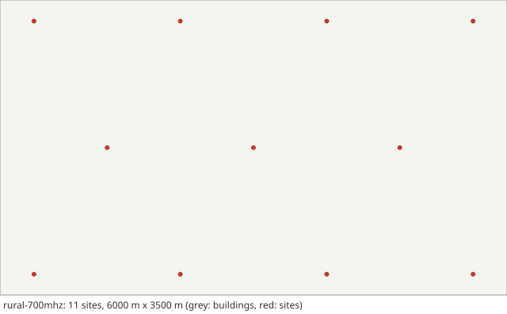

# Scenario card: `rural-700mhz`

*Rural macro cells at 700 MHz*  
Available since version 1.7.0. Use it as `scenario: rural-700mhz` in a configuration file or `hl.builtin_scenario("rural-700mhz")` in Python.

## Purpose

A rural counterpart of the urban scenarios: 11 macro sites 35 m high on a hexagonal grid with an inter-site distance of 1732 m (the RMa case of TR 38.901), the RMa path loss at 700 MHz, the link budget of the IMT-2020 Rural-eMBB evaluation, and users in cars at 120 km/h with the TR 38.901 car penetration loss.  Cells are large, so a user sees few handovers, each at high speed and at the edge of wide, partly noise-limited coverage.  Use it to see how a rule copes with coverage-limited cell edges rather than with interference from close neighbours.

## Layout

A 6000 m x 3500 m area, 11 sites on a hexagonal grid of 1732 m (rows of 4, 3 and 4 sites).  No roads or buildings: the RMa LOS probability stands for terrain and vegetation.

## Parameters

Values in **bold** differ from the HandoverLab defaults.

| Key | Value | Source |
|---|---|---|
| `layout.kind` | **open_area** | TR 38.901 Table 7.2-3 (RMa: hexagonal grid) |
| `layout.site_spacing_m` | **1732** | TR 38.901 Table 7.2-3 and ITU-R M.2412-0 Table 5c (ISD 1732 m) |
| `layout.sites` | none | regular placement along the streets |
| `layout.area_m` | **[6000, 3500]** | assumption (room for 11 sites) |
| `layout.min_site_distance_m` | **35** | TR 38.901 Table 7.2-3 (minimum BS-UT 2D distance 35 m; applied to the start and waypoints) |
| `radio.carrier_ghz` | **0.7** | ITU-R M.2412-0 Table 5c (Rural-eMBB, configuration A: 700 MHz) |
| `radio.bandwidth_mhz` | **20** | ITU-R M.2412-0 Table 5c (20 MHz for TDD) |
| `radio.tx_power_dbm` | **49** | ITU-R M.2412-0 Table 5c (49 dBm for 20 MHz) |
| `radio.bs_gain_db` | **17** | assumption: 8 dBi element (ITU-R M.2412-0 Table 5c) plus an 8-element beam (9 dB) |
| `radio.ue_gain_db` | 0 | assumption |
| `radio.noise_figure_db` | 7 | ITU-R M.2412-0 Table 5c (UE noise figure: 7 dB, the default) |
| `radio.isolation` | 0.3 | assumption (mean-to-peak gain of an interfering data beam) |
| `radio.bs_height_m` | **35** | TR 38.901 Tables 7.2-3 and 7.4.1-1 (RMa: 35 m) |
| `radio.ue_height_m` | 1.5 | ITU-R M.2412-0 Table 5 (outdoor UEs: 1.5 m), within 1.5-22.5 m of TR 38.901 Table 7.4.1-1 |
| `radio.pathloss` | **rma** | TR 38.901 Table 7.4.1-1 (RMa, W = 20 m, h = 5 m); LOS probability, Table 7.4.2-1 |
| `radio.shadow_los_db` | 4 | TR 38.901 Table 7.4.1-1 (RMa LOS below the breakpoint: 4 dB) |
| `radio.shadow_nlos_db` | **8** | TR 38.901 Table 7.4.1-1 (RMa NLOS: 8 dB) |
| `radio.shadow_los_far_db` | **6** | TR 38.901 Table 7.4.1-1 (RMa LOS beyond the breakpoint: 6 dB) |
| `radio.shadow_decorr_m` | **120** | TR 38.901 Table 7.5-6 Part-2 (RMa NLOS: 120 m) |
| `radio.shadow_site_corr` | none | unset: uncorrelated between sites, TR 38.901 clause 7.5 step 4 (radio.channel_detail simple: 0.5) |
| `radio.place_share` | 1 | assumption (blockage tied to place) |
| `radio.los_corr_m` | **60** | TR 38.901 Table 7.6.3.1-2 (RMa LOS/NLOS state: 60 m) |
| `radio.soft_los` | **true** | TR 38.901 clause 7.6.3.3 (optional soft LOS state, meant to avoid hard LOS/NLOS transitions in mobility simulations) |
| `radio.time_var_db` | 1.5 | assumption (moving blockers) |
| `radio.time_var_tau_s` | 1 | assumption |
| `radio.l1_error_db` | 1 | assumption (error of one L1 RSRP sample) |
| `radio.penetration_db` | **9** | TR 38.901 clause 7.4.3.2 (O2I car penetration loss: 9 dB) |
| `radio.penetration_sd_db` | **5** | TR 38.901 clause 7.4.3.2 (5 dB, per user) |
| `radio.energy_p0_w` | 56 | EARTH model, micro base station (Auer et al. 2011, Table 2): 56 W |
| `radio.energy_slope` | 2.6 | EARTH model, micro base station (Auer et al. 2011, Table 2): 2.6 |
| `radio.map_res_m` | **10** | numerical setting (coarser map for the large area) |
| `protocol.step_s` | 0.01 | numerical setting |
| `protocol.l1_period_s` | 0.04 | assumption (L1 sample period) |
| `protocol.l3_k` | 4 | TS 38.331 clause 5.5.3.2 |
| `protocol.label_period_s` | 0.2 | numerical setting |
| `protocol.report_interval_s` | 0.12 | TS 38.331 reportInterval (ms120) |
| `protocol.qout_db` | -8 | TR 36.839 (Qout -8 dB) |
| `protocol.qin_db` | -6 | TR 36.839 (Qin -6 dB) |
| `protocol.qout_window_s` | 0.2 | TS 38.133 (evaluation period, 200 ms) |
| `protocol.qin_window_s` | 0.1 | TS 38.133 (evaluation period, 100 ms) |
| `protocol.n310` | 1 | TR 36.839 |
| `protocol.n311` | 1 | TR 36.839 |
| `protocol.t310_s` | 1 | TR 36.839 (1 s) |
| `protocol.prep_s` | 0.05 | TR 36.839 (50 ms) |
| `protocol.exec_s` | 0.04 | TR 36.839 (40 ms) |
| `protocol.reest_s` | 1 | assumption (1 s outage); TS 38.133 6.2.1.2.1 bounds the delay by 50 ms + cell identification (FR1: 200 ms known, 800 ms unknown cell, Table 6.2.1.2.1-1) + system information + PRACH; TR 36.842 Table E.1-2 uses 250 ms |
| `protocol.cho_recovery_s` | 0.4 | TS 38.300 clauses 9.2.3.1 and 9.2.7 (recovery into a CHO candidate; assumption 0.4 s) |
| `protocol.pingpong_s` | 1 | TR 36.839 (minimum time of stay, 1 s) |
| `protocol.cfg_loss_as_failure` | false | check mode only |
| `protocol.lm_load` | none | off by default: link monitoring sees the load of the data channel (calibration option) |
| `protocol.lm_load_per_ue` | 0 | off by default (calibration option) |
| `protocol.exec_can_fail` | true | TR 36.839: the execution fails when the target is below Qout |
| `protocol.rlm_holdoff_s` | 0.2 | 0.2 s since 2.0.0: an interpretation of TS 38.133 8.1.2.2 (evaluation over the last T_Evaluate_out, 200 ms in FR1) on a newly joined cell |
| `traffic.services` | 5 entries | TS 23.501 Table 5.7.4-1 (5QI); thresholds are assumptions |
| `traffic.se_max` | 7.4 | assumption (spectral-efficiency cap) |
| `traffic.hotspot_share` | 0.25 | assumption |
| `traffic.hotspot_load` | [0.55, 0.85] | assumption |
| `traffic.normal_load` | [0.05, 0.25] | assumption |
| `traffic.load_tau_s` | 0.2 | assumption |
| `traffic.rate_scale` | 1 | assumption |
| `traffic.label_load` | 1 | assumption (all cells transmit for the label) |
| `traffic.model` | fixed | fixed: constant service rates (the model of 1.0) |
| `traffic.period_s` | 0.02 | periodic model: 20 ms, as VoIP |
| `traffic.packet_bytes` | 100 | periodic model: assumption |
| `traffic.ftp_file_bytes` | 500000 | FTP model 3 (TR 36.872 Annex A.1) with 0.5 Mbyte files (TR 38.802 Table A.2.1-1; TR 38.821 Table 6.1.1.1-7) |
| `traffic.ftp_rate_hz` | 0.1 | ftp3 model: assumption (file arrival rate per user) |
| `mobility.users` | **30** | assumption (30 users for run time; ITU-R M.2412-0 Table 5c: 10 UEs per TRxP) |
| `mobility.profile` | **v120** | ITU-R M.2412-0 Table 5c (fixed and identical speed of all UEs; outdoor users in car: 120 km/h; since 2.1.0, until 2.0.0 108-132 km/h) |
| `mobility.groups` | none | profile |
| `run.duration_s` | **300** | numerical setting |
| `run.warmup_s` | **30** | numerical setting |

Not read by this layout and radio model, so not listed: `layout.blocks`, `layout.pitch_m`, `layout.site_offset_m`, `layout.street_width_m`, `radio.clutter_los`.

## Known limitations

- Only the users in cars: TR 38.901 Table 7.2-3 and ITU-R M.2412-0 have 50 % indoor users at 3 km/h, which hardly hand over and are left out.
- 11 omnidirectional sites instead of 19 sites with 3 sectors, no wrap-around (users near the edge see fewer neighbours), about 3 users per site instead of 10 per TRxP; the minimum distance of 35 m to a site holds for the start and waypoints of a user, the straight legs between them may pass closer.
- One shadowing decorrelation distance: TR 38.901 gives 37 m for LOS and 120 m for NLOS links; here 120 m.
- Far more handovers than the cell size alone would give (A3 with 3 dB and 160 ms: about 12 per user-minute in a check run of 3 seeds with the model of 2.0.0), mostly unnecessary ones: the 8 dB shadowing with 120 m decorrelation, uncorrelated between sites (TR 38.901 clause 7.5 step 4; half correlated until 2.0.0), moves the best cell often at 120 km/h. Compare rules with each other here; do not read the absolute handover rate as that of a real rural network.
- The soft LOS state is on: at 1-2 km the RMa NLOS loss is about 20 dB above the LOS loss, and the hard switch of the LOS state (radio.soft_los: false) raises the A3 failures (3 dB, 160 ms) from 0.07 to 0.18 per user-minute and the handovers from 13.07 to 15.62 (means over 3 seeds, docs/guides/indoor-rural.md).
- Vehicles move on straight legs between random waypoints, not on roads; random waypoints are denser in the middle of the area, while ITU-R M.2412-0 Table 5c drops the users uniformly.
- Links reach about 6.4 km (from a corner site to the opposite corner), beyond the 5 km up to which TR 38.901 Table 7.4.1-1 gives the RMa NLOS formula; those far interferers use it outside its range (handoverlab warns about this).
- LOS and NLOS links share one unit shadowing realisation scaled by the LOS or NLOS standard deviation (TR 38.901 gives separate LOS and NLOS parameters, Table 7.5-6).
- The failure model is not calibrated in absolute terms; read failure rates relative to each other.

## Reference results

- Layout, heights, path loss, LOS probability, shadowing and correlation distances checked against TR 38.901 V19.5.0 (unchanged from V17.0.0), the link budget and speeds against ITU-R M.2412-0; path loss and LOS probability against values computed by hand (handoverlab verify, group pathloss); determinism and invariant checks as for every scenario.
