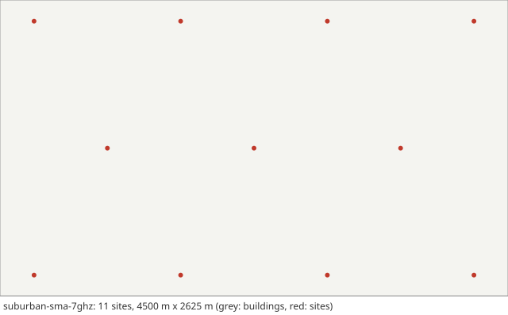

# Scenario card: `suburban-sma-7ghz`

*Suburban macro cells (SMa) at 7 GHz with indoor users*  
Available since version 2.3.0. Use it as `scenario: suburban-sma-7ghz` in a configuration file or `hl.builtin_scenario("suburban-sma-7ghz")` in Python.

## Purpose

The suburban macro scenario (SMa) that Release 19 added to TR 38.901 for 7-24 GHz: 11 macro sites 35 m high on a hexagonal grid with an inter-site distance of 1299 m, the SMa path loss and LOS probability at 7 GHz, the link budget of the 7 GHz calibration (Table 7.8-1A), and the users of Table 7.2-5: 80 % inside buildings at 3 km/h with the O2I building penetration loss of the low-loss A model, 20 % in cars at 40 km/h with the car penetration loss.  Use it for upper mid-band (FR3) macro coverage where most users are indoors and the walls, not the distance, set the cell edge.

## Layout

A 4500 m x 2625 m area, 11 sites on a hexagonal grid of 1299 m (rows of 4, 3 and 4 sites).  No roads or buildings are drawn: the SMa LOS probability stands for the houses and the vegetation, the O2I loss for the building around an indoor user.

## Parameters

Values in **bold** differ from the HandoverLab defaults.

| Key | Value | Source |
|---|---|---|
| `layout.kind` | **open_area** | TR 38.901 Table 7.2-5 (SMa: hexagonal grid, 19 macro sites, 3 sectors per site) |
| `layout.site_spacing_m` | **1299** | TR 38.901 Table 7.2-5 (ISD 1299 m and 1732 m; note 2: 1200-1800 m) |
| `layout.sites` | none | regular placement along the streets |
| `layout.area_m` | **[4500, 2625]** | assumption (room for 11 sites, as on rural-700mhz) |
| `layout.min_site_distance_m` | **35** | TR 38.901 Table 7.2-5 (minimum BS-UT 2D distance 35 m; applied to the start and waypoints) |
| `radio.carrier_ghz` | **7** | TR 38.901 Table 7.8-1A (large-scale calibration of SMa at 7 GHz) |
| `radio.bandwidth_mhz` | **20** | TR 38.901 Table 7.8-1A (20 MHz) |
| `radio.tx_power_dbm` | **49** | TR 38.901 Table 7.8-1A (49 dBm for SMa) |
| `radio.bs_gain_db` | **18** | assumption: the (M, N, P) = (10, 1, 1) column of TR 38.901 Table 7.8-1A with the 8 dBi element of Table 7.3-1: 8 + 10 log10(10) dB |
| `radio.ue_gain_db` | 0 | assumption |
| `radio.noise_figure_db` | **9** | TR 38.901 Table 7.8-1 (UT noise figure 9 dB; Table 7.8-1A keeps it) |
| `radio.isolation` | 0.3 | assumption (mean-to-peak gain of an interfering data beam) |
| `radio.bs_height_m` | **35** | TR 38.901 Table 7.2-5 (SMa: 35 m) |
| `radio.ue_height_m` | 1.5 | TR 38.901 Table 7.2-5 (1.5 m outdoor and on the ground floor) |
| `radio.pathloss` | **sma** | TR 38.901 V19.5.0 Table 7.4.1-1 (SMa, h = 10 m, W = 10 m, 0.5-37 GHz); LOS probability, Table 7.4.2-1 |
| `radio.shadow_los_db` | 4 | TR 38.901 Table 7.4.1-1 (SMa LOS below the breakpoint: 4 dB) |
| `radio.shadow_nlos_db` | **8** | TR 38.901 Table 7.4.1-1 (SMa NLOS: 8 dB) |
| `radio.shadow_los_far_db` | **6** | TR 38.901 Table 7.4.1-1 (SMa LOS from the breakpoint on: 6 dB) |
| `radio.shadow_decorr_m` | **50** | TR 38.901 Table 7.5-6 Part-4 (SMa SF correlation distance: 40 m LOS, 50 m NLOS and O2I; 50 m is used for all) |
| `radio.shadow_site_corr` | none | unset: uncorrelated between sites, TR 38.901 clause 7.5 step 4 (radio.channel_detail simple: 0.5) |
| `radio.place_share` | 1 | assumption (blockage tied to place) |
| `radio.los_corr_m` | 50 | TR 38.901 Table 7.6.3.1-2 (LOS/NLOS state, SMa: 50 m) |
| `radio.time_var_db` | 1.5 | assumption (moving blockers) |
| `radio.time_var_tau_s` | 1 | assumption |
| `radio.l1_error_db` | 1 | assumption (error of one L1 RSRP sample) |
| `radio.penetration_db` | **9** | TR 38.901 clause 7.4.3.2 and Table 7.8-1A (non-metallic car window: 9 dB), users in cars only |
| `radio.penetration_sd_db` | **5** | TR 38.901 clause 7.4.3.2 (5 dB) |
| `radio.o2i_model` | **low_a** | TR 38.901 Table 7.8-1A (O2I penetration loss: for SMa, low-loss A model) and Table 7.4.3-2 |
| `radio.energy_p0_w` | 56 | EARTH model, micro base station (Auer et al. 2011, Table 2): 56 W |
| `radio.energy_slope` | 2.6 | EARTH model, micro base station (Auer et al. 2011, Table 2): 2.6 |
| `radio.map_res_m` | **10** | numerical setting (coarse map for the large area) |
| `protocol.step_s` | 0.01 | numerical setting |
| `protocol.l1_period_s` | 0.04 | assumption (L1 sample period) |
| `protocol.l3_k` | 4 | TS 38.331 clause 5.5.3.2 |
| `protocol.label_period_s` | 0.2 | numerical setting |
| `protocol.report_interval_s` | 0.12 | TS 38.331 reportInterval (ms120) |
| `protocol.qout_db` | -8 | TR 36.839 (Qout -8 dB) |
| `protocol.qin_db` | -6 | TR 36.839 (Qin -6 dB) |
| `protocol.qout_window_s` | 0.2 | TS 38.133 (evaluation period, 200 ms) |
| `protocol.qin_window_s` | 0.1 | TS 38.133 (evaluation period, 100 ms) |
| `protocol.n310` | 1 | TR 36.839 |
| `protocol.n311` | 1 | TR 36.839 |
| `protocol.t310_s` | 1 | TR 36.839 (1 s) |
| `protocol.prep_s` | 0.05 | TR 36.839 (50 ms) |
| `protocol.exec_s` | 0.04 | TR 36.839 (40 ms) |
| `protocol.reest_s` | 1 | assumption (1 s outage); TS 38.133 6.2.1.2.1 bounds the delay by 50 ms + cell identification (FR1: 200 ms known, 800 ms unknown cell, Table 6.2.1.2.1-1) + system information + PRACH; TR 36.842 Table E.1-2 uses 250 ms |
| `protocol.cho_recovery_s` | 0.4 | TS 38.300 clauses 9.2.3.1 and 9.2.7 (recovery into a CHO candidate; assumption 0.4 s) |
| `protocol.pingpong_s` | 1 | TR 36.839 (minimum time of stay, 1 s) |
| `protocol.cfg_loss_as_failure` | false | check mode only |
| `protocol.lm_load` | none | off by default: link monitoring sees the load of the data channel (calibration option) |
| `protocol.lm_load_per_ue` | 0 | off by default (calibration option) |
| `protocol.exec_can_fail` | true | TR 36.839: the execution fails when the target is below Qout |
| `protocol.rlm_holdoff_s` | 0.2 | 0.2 s since 2.0.0: an interpretation of TS 38.133 8.1.2.2 (evaluation over the last T_Evaluate_out, 200 ms in FR1) on a newly joined cell |
| `traffic.services` | 5 entries | TS 23.501 Table 5.7.4-1 (5QI); thresholds are assumptions |
| `traffic.se_max` | 7.4 | assumption (spectral-efficiency cap) |
| `traffic.hotspot_share` | 0.25 | assumption |
| `traffic.hotspot_load` | [0.55, 0.85] | assumption |
| `traffic.normal_load` | [0.05, 0.25] | assumption |
| `traffic.load_tau_s` | 0.2 | assumption |
| `traffic.rate_scale` | 1 | assumption |
| `traffic.label_load` | 1 | assumption (all cells transmit for the label) |
| `traffic.model` | fixed | fixed: constant service rates (the model of 1.0) |
| `traffic.period_s` | 0.02 | periodic model: 20 ms, as VoIP |
| `traffic.packet_bytes` | 100 | periodic model: assumption |
| `traffic.ftp_file_bytes` | 500000 | FTP model 3 (TR 36.872 Annex A.1) with 0.5 Mbyte files (TR 38.802 Table A.2.1-1; TR 38.821 Table 6.1.1.1-7) |
| `traffic.ftp_rate_hz` | 0.1 | ftp3 model: assumption (file arrival rate per user) |
| `mobility.users` | **50** | assumption |
| `mobility.profile` | v60 | TR 37.885 clause 6.1.2 (urban option A: 60 km/h in all lanes) and Table A-1 (2 lanes of 3.5 m per direction): profile v60 (since 2.0.0) |
| `mobility.groups` | **2 entries** | TR 38.901 Table 7.2-5 (indoor UT ratio 80 %; indoor UTs 3 km/h, outdoor UTs in cars 40 km/h) |
| `run.duration_s` | **300** | numerical setting |
| `run.warmup_s` | **30** | numerical setting |

Not read by this layout and radio model, so not listed: `layout.blocks`, `layout.pitch_m`, `layout.site_offset_m`, `layout.street_width_m`, `radio.clutter_los`.

## Known limitations

- No sectors and no wrap-around: 11 sites with the antenna abstraction (one gain per link) instead of the 19 three-sector sites of Table 7.2-5; users near the edge of the area see fewer neighbours.
- An indoor user keeps the LOS state, the breakpoint distance and the shadowing (standard deviation and field) of its own position: TR 38.901 takes the LOS probability at d2D-out, the path loss at d3D-out + d3D-in and an O2I shadowing of 8 dB (Table 7.5-6 Part-4). The size of this abstraction is measured by handoverlab verify (group scenarios, S4).
- One UT height (1.5 m) for every user: Table 7.2-5 puts indoor users on 1-2 floors (residential) or 1-5 floors (commercial).
- Indoor users walk between random waypoints at 3 km/h across the area; buildings are not drawn.
- Received-power level only: no fast fading.
- The failure model is not calibrated in absolute terms; read failure rates relative to each other.

## Reference results

- Values checked against the text of TR 38.901 V19.5.0 (Tables 7.2-5, 7.4.1-1, 7.4.2-1, 7.4.3-1, 7.4.3-2, 7.5-6 Part-4, 7.6.3.1-2, 7.8-1A); formulas, O2I loss and coupling gain are checked by handoverlab verify (group scenarios). Since 2.4.0 the 7 GHz large-scale calibration of TR 38.901 clause 7.8.1 (Table 7.8-1A) checks the SMa drop (19 three-sector sites, ISD 1299 m and 1732 m) against the companies of R1-2506406 (handoverlab verify, group calibration; docs/calibration-3gpp.md); this card is a smaller handover scenario and is not that calibration drop.
