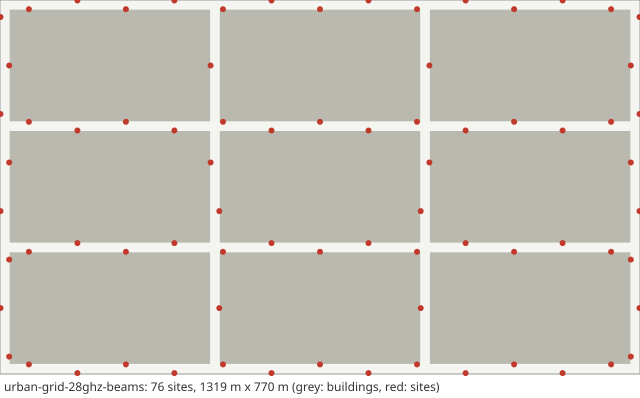

# Scenario card: `urban-grid-28ghz-beams`

*Small cells with SSB beams and beam failure recovery in the TR 37.885 urban grid at 28 GHz (FR2)*  
Available since version 1.10.0. Use it as `scenario: urban-grid-28ghz-beams` in a configuration file or `hl.builtin_scenario("urban-grid-28ghz-beams")` in Python.

## Purpose

The `urban-grid-10ghz` world moved to 28 GHz (FR2-1) with explicit SSB beams instead of the antenna abstraction: every site carries three sectors (cells), each a 4 x 8 panel with the element of TR 38.901 Table 7.3-1 sending 8 SSB beams.  The serving beam follows periodic L1-RSRP beam reports; beam failure detection, candidate beam detection and the L1-RSRP measurements use the FR2 evaluation periods of TS 38.133 (receive-beam sweeping factor N = 8), and a detected beam failure is recovered by random access or ends in a radio-link failure (random-access problem). Use it to study beam management and its interplay with handover at FR2.

## Layout

Three by three blocks (433 m x 250 m between street centre lines, 20 m streets), 76 sites with three sectors each (228 cells).

## Parameters

Values in **bold** differ from the HandoverLab defaults.

| Key | Value | Source |
|---|---|---|
| `layout.kind` | street_grid | TR 37.885 Annex A (urban grid) |
| `layout.blocks` | [3, 3] | TR 37.885 Table A-1 (minimum 3 x 3 blocks) |
| `layout.pitch_m` | [433, 250] | TR 37.885 Annex A (433 m x 250 m) |
| `layout.street_width_m` | 20 | TR 37.885 Annex A (20 m) |
| `layout.site_spacing_m` | 100 | assumption (dense small cells along the streets; TR 37.885 Table 6.1.3-2 has 500 m macro sites in the urban grid) |
| `layout.site_offset_m` | 9 | assumption (sites on the pavement) |
| `layout.sites` | none | regular placement along the streets |
| `radio.carrier_ghz` | **28** | FR2-1 (24.25-52.6 GHz, TS 38.104 Table 5.1-1); 28 GHz is an assumption |
| `radio.bandwidth_mhz` | **400** | assumption (400 MHz FR2 channel at 120 kHz subcarrier spacing) |
| `radio.tx_power_dbm` | 35 | assumption (small cell; TR 37.885 Table 6.1.1-2 has 43 dBm for its macro sites) |
| `radio.ue_gain_db` | 0 | assumption |
| `radio.noise_figure_db` | **10** | ITU-R M.2412-0 Table 5b (UE noise figure at 30 GHz: 10 dB, high-performance UE) |
| `radio.bs_height_m` | 10 | TR 38.901 Table 7.4.1-1 (UMi: 10 m) |
| `radio.ue_height_m` | **1.6** | TR 37.885 clause 6.1.2 (urban option A: 100 % vehicle type 2, antenna height 1.6 m; since 2.1.0, until 2.0.0 1.5 m) |
| `radio.pathloss` | umi_street_canyon | TR 38.901 Table 7.4.1-1 |
| `radio.shadow_los_db` | 4 | TR 38.901 Table 7.4.1-1 (UMi and UMa LOS: 4 dB) |
| `radio.shadow_nlos_db` | 7.82 | TR 38.901 Table 7.4.1-1 (UMi NLOS: 7.82 dB) |
| `radio.shadow_decorr_m` | 10 | TR 38.901 Table 7.5-6 Part-1 (UMi: 10 m LOS, 13 m NLOS; the LOS value is used for both, see the limitations) |
| `radio.shadow_site_corr` | none | unset: uncorrelated between sites, TR 38.901 clause 7.5 step 4 (radio.channel_detail simple: 0.5) |
| `radio.place_share` | 1 | assumption (blockage tied to place) |
| `radio.clutter_los` | true | TR 38.901 clause 7.6.3.3 (spatially consistent LOS state), applied on top of the building geometry |
| `radio.los_corr_m` | 50 | TR 38.901 Table 7.6.3.1-2 (LOS/NLOS state, UMi and UMa: 50 m) |
| `radio.time_var_db` | 1.5 | assumption (moving blockers) |
| `radio.time_var_tau_s` | 1 | assumption |
| `radio.l1_error_db` | 1 | assumption (error of one L1 RSRP sample) |
| `radio.penetration_db` | 0 | off by default; TR 38.901 clause 7.4.3.2: 9 dB in a standard car |
| `radio.penetration_sd_db` | 0 | off by default; TR 38.901 clause 7.4.3.2: 5 dB in a standard car |
| `radio.energy_p0_w` | 56 | EARTH model, micro base station (Auer et al. 2011, Table 2): 56 W |
| `radio.energy_slope` | 2.6 | EARTH model, micro base station (Auer et al. 2011, Table 2): 2.6 |
| `radio.map_res_m` | 1 | numerical setting |
| `radio.scs_khz` | **120** | unset: 30 kHz up to 7.125 GHz, 120 kHz above (assumption) |
| `radio.beams.sectors` | 3 | default of the beam model (user guide) |
| `radio.beams.sector_az0_deg` | 30 | default of the beam model (user guide) |
| `radio.beams.n_ssb` | 8 | default of the beam model (user guide) |
| `radio.beams.panel` | [4, 8] | default of the beam model (user guide) |
| `radio.beams.tilt_deg` | 100 | default of the beam model (user guide) |
| `radio.beams.beam_span_deg` | none | default of the beam model (user guide) |
| `radio.beams.ssb_avg` | none | default of the beam model (user guide) |
| `radio.beams.ssb_thresh_dbm` | none | default of the beam model (user guide) |
| `radio.beams.report_s` | 0.04 | default of the beam model (user guide) |
| `radio.beams.switch_db` | 2 | default of the beam model (user guide) |
| `radio.beams.tci_delay_s` | 0.01 | default of the beam model (user guide) |
| `radio.beams.rx_sweep_n` | none | default of the beam model (user guide) |
| `radio.beams.bfd` | true | default of the beam model (user guide) |
| `radio.beams.bfi_max` | 3 | default of the beam model (user guide) |
| `radio.beams.bfd_timer` | 4 | default of the beam model (user guide) |
| `radio.beams.bfr_timer_s` | 0.1 | default of the beam model (user guide) |
| `radio.beams.rsrp_thresh_ssb_dbm` | -115 | default of the beam model (user guide) |
| `radio.beams.ra_attempt_s` | 0.01 | default of the beam model (user guide) |
| `radio.beams.preamble_max` | 10 | default of the beam model (user guide) |
| `radio.beams.rlm_rs` | tci | default of the beam model (user guide) |
| `protocol.step_s` | 0.01 | numerical setting |
| `protocol.l1_period_s` | 0.04 | assumption (L1 sample period) |
| `protocol.l3_k` | 4 | TS 38.331 clause 5.5.3.2 |
| `protocol.label_period_s` | 0.2 | numerical setting |
| `protocol.report_interval_s` | 0.12 | TS 38.331 reportInterval (ms120) |
| `protocol.qout_db` | -8 | TR 36.839 (Qout -8 dB) |
| `protocol.qin_db` | -6 | TR 36.839 (Qin -6 dB) |
| `protocol.qout_window_s` | 0.2 | TS 38.133 (evaluation period, 200 ms) |
| `protocol.qin_window_s` | 0.1 | TS 38.133 (evaluation period, 100 ms) |
| `protocol.n310` | 1 | TR 36.839 |
| `protocol.n311` | 1 | TR 36.839 |
| `protocol.t310_s` | 1 | TR 36.839 (1 s) |
| `protocol.prep_s` | 0.05 | TR 36.839 (50 ms) |
| `protocol.exec_s` | 0.04 | TR 36.839 (40 ms) |
| `protocol.reest_s` | 1 | assumption (1 s outage); TS 38.133 6.2.1.2.1 bounds the delay by 50 ms + cell identification (FR1: 200 ms known, 800 ms unknown cell, Table 6.2.1.2.1-1) + system information + PRACH; TR 36.842 Table E.1-2 uses 250 ms |
| `protocol.cho_recovery_s` | 0.4 | TS 38.300 clauses 9.2.3.1 and 9.2.7 (recovery into a CHO candidate; assumption 0.4 s) |
| `protocol.pingpong_s` | 1 | TR 36.839 (minimum time of stay, 1 s) |
| `protocol.cfg_loss_as_failure` | false | check mode only |
| `protocol.lm_load` | none | off by default: link monitoring sees the load of the data channel (calibration option) |
| `protocol.lm_load_per_ue` | 0 | off by default (calibration option) |
| `protocol.exec_can_fail` | true | TR 36.839: the execution fails when the target is below Qout |
| `protocol.rlm_holdoff_s` | 0.2 | 0.2 s since 2.0.0: an interpretation of TS 38.133 8.1.2.2 (evaluation over the last T_Evaluate_out, 200 ms in FR1) on a newly joined cell |
| `protocol.rlm_eval` | **ts38133** | TS 38.133 Tables 8.1.2.2-1/-2 (FR2: N = 8) |
| `traffic.services` | 5 entries | TS 23.501 Table 5.7.4-1 (5QI); thresholds are assumptions |
| `traffic.se_max` | 7.4 | assumption (spectral-efficiency cap) |
| `traffic.hotspot_share` | 0.25 | assumption |
| `traffic.hotspot_load` | [0.55, 0.85] | assumption |
| `traffic.normal_load` | [0.05, 0.25] | assumption |
| `traffic.load_tau_s` | 0.2 | assumption |
| `traffic.rate_scale` | 1 | assumption |
| `traffic.label_load` | 1 | assumption (all cells transmit for the label) |
| `traffic.model` | fixed | fixed: constant service rates (the model of 1.0) |
| `traffic.period_s` | 0.02 | periodic model: 20 ms, as VoIP |
| `traffic.packet_bytes` | 100 | periodic model: assumption |
| `traffic.ftp_file_bytes` | 500000 | FTP model 3 (TR 36.872 Annex A.1) with 0.5 Mbyte files (TR 38.802 Table A.2.1-1; TR 38.821 Table 6.1.1.1-7) |
| `traffic.ftp_rate_hz` | 0.1 | ftp3 model: assumption (file arrival rate per user) |
| `mobility.users` | 40 | assumption |
| `mobility.profile` | v60 | TR 37.885 clause 6.1.2 (urban option A: 60 km/h in all lanes) and Table A-1 (2 lanes of 3.5 m per direction): profile v60 (since 2.0.0) |
| `mobility.groups` | none | profile |
| `run.duration_s` | 120 | numerical setting |
| `run.warmup_s` | 20 | numerical setting |

Not read by this layout and radio model, so not listed: `radio.bs_gain_db`, `radio.isolation`.

## Known limitations

- No fast fading and no UE beamforming (the UE's receive-beam sweeping enters only through the factor N of TS 38.133).
- Evaluation periods are modelled as exponential averages whose time constant is the TS 38.133 period, a conservative reading of minimum requirements.
- Changed in 1.11.0: until 1.10.0 the UE noise figure was 7 dB (the default), below the 10 dB of ITU-R M.2412-0 at 30 GHz.
- Small cells on UMi along the streets, as in urban-grid-10ghz: TR 37.885 itself has 500 m macro sites with UMa in the urban grid (Tables 6.1.3-2 and 6.2.1-2).
- The absolute failure level is not calibrated. It was checked against ns-3 only on `ns3-urban-3.5ghz`: with equal run lengths the ns-3 comparison setting gives 0.5-1.3 times ns-3's failure level, depending on the set, and passed the pre-registered checks on none of three fresh sets (corrected in 2.6.0, docs/calibration.md); read failure rates relative to each other.
- The LOS state of a link is LOS only if the buildings leave it clear and the spatially consistent LOS variable of TR 38.901 clause 7.6.3.3 is below the LOS probability of Table 7.4.2-1; the share of LOS links is therefore lower than Table 7.4.2-1 gives (which `handoverlab verify` compares only for the links clear of buildings).
- One shadowing decorrelation distance, the UMi LOS value of 10 m, also for the NLOS links (TR 38.901 Table 7.5-6 Part-1: UMi LOS 10 m, NLOS 13 m); LOS and NLOS links share one unit shadowing realisation scaled by the LOS or NLOS standard deviation, so the shadowing keeps its sign when a link changes state (TR 38.901 gives separate LOS and NLOS parameters, Table 7.5-6).
- A vehicle keeps a lane offset drawn at the start, on either side of the street centre line, through turns: it may drive in a lane of the opposite direction (TR 37.885 Table A-1 has 2 lanes in each direction).
- The number of vehicles is set for run time: TR 37.885 clause 6.1.2 places vehicles with a gap of max(2 m, exponential with mean speed x 2 s), which gives hundreds of vehicles in the grid; the interference load of HandoverLab does not depend on the number of users.
- 228 cells with 8 beams each: a run takes several times longer than `urban-grid-10ghz`.

## Reference results

- The beam and requirement formulas are checked against hand values in `handoverlab verify` (group `extended`).
