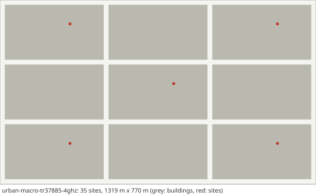

# Scenario card: `urban-macro-tr37885-4ghz`

*The TR 37.885 urban grid with macro sites (500 m hexagonal layout, 4 GHz)*  
Available since version 2.3.0. Use it as `scenario: urban-macro-tr37885-4ghz` in a configuration file or `hl.builtin_scenario("urban-macro-tr37885-4ghz")` in Python.

## Purpose

The urban case of the 3GPP NR V2X evaluation (TR 37.885) as specified below 6 GHz, for the base-station-to-vehicle link: the urban grid of 433 m x 250 m blocks with 2 + 2 lanes of 3.5 m, macro sites 25 m high on a hexagonal layout with an inter-site distance of 500 m (TR 36.885 Figure A.1.3-1, which TR 37.885 uses), the UMa path loss at 4 GHz with the LOS state drawn from the LOS probability (the sites stand above the rooftops, so the buildings of the grid do not decide it) and the effective environment height of 0.25 m, and every vehicle at 60 km/h.  Use it next to the small-cell grid cards when results should follow the 3GPP urban V2X assumptions.

## Layout

The minimum area of TR 37.885 Table A-1, 3 x 3 blocks (1319 m x 770 m with the streets), and the 35 sites of the 500 m hexagonal lattice that lie within 1000 m of it.  The lattice is placed relative to the blocks as drawn in TR 36.885 Figure A.1.3-1 (columns 433 m apart along the 433 m side of the blocks, sites 500 m apart along the 250 m side, alternate columns shifted by 250 m; a site about 282 m and 160 m from the corner of its block).  The figure has no numbers: the position of the lattice is read from the drawing and is approximate.

## Parameters

Values in **bold** differ from the HandoverLab defaults.

| Key | Value | Source |
|---|---|---|
| `layout.kind` | street_grid | TR 37.885 Annex A, Table A-1 (urban: 2 lanes of 3.5 m in each direction, road grid 433 m x 250 m) |
| `layout.blocks` | [3, 3] | TR 37.885 Table A-1 (minimum simulation area 1299 m x 750 m: 3 x 3 blocks) |
| `layout.pitch_m` | [433, 250] | TR 37.885 Annex A (433 m x 250 m) |
| `layout.street_width_m` | 20 | TR 37.885 Annex A (20 m) |
| `layout.site_spacing_m` | 100 | assumption (dense small cells along the streets; TR 37.885 Table 6.1.3-2 has 500 m macro sites in the urban grid) |
| `layout.site_offset_m` | 9 | assumption (sites on the pavement) |
| `layout.sites` | **35 entries** | TR 37.885 Table 6.1.3-1 (urban, below 6 GHz: macro only, BS placement as Figure A.1.3-1 of TR 36.885, inter macro 500 m) and TR 36.885 clause A.1.3 (urban: ISD 500 m with the wrap-around model of Figure A.1.3-1); the lattice sites within 1000 m of the grid replace the wrap-around (see the limitations) |
| `radio.carrier_ghz` | **4** | TR 37.885 Table 6.1.1-1 (urban grid, macro to/from vehicle: 4 GHz) |
| `radio.bandwidth_mhz` | **20** | TR 37.885 Table 6.1.1-1 (simulation bandwidth 20 or 40 MHz, DL+UL) |
| `radio.tx_power_dbm` | **49** | TR 37.885 Table 6.1.1-1 (macro BS: 49 dBm; the system bandwidth is taken equal to the simulation bandwidth, so the PA power is not scaled down) |
| `radio.bs_gain_db` | **26.1** | assumption, as on highway-tr37885-4ghz: one polarisation of the 8 x 8 array of TR 37.885 Table 6.1.4-3 (4 GHz) with 8 dBi elements (Table 6.1.4-2): 8 + 10 log10(64) dB |
| `radio.ue_gain_db` | **6** | assumption, as on highway-tr37885-4ghz: vehicle type 2, option 1, rooftop baseline (1, 2, 2, 1, 1) of TR 37.885 Table 6.1.4-9 with 3 dBi elements (Table 6.1.4-8): 3 + 10 log10(2) dB |
| `radio.noise_figure_db` | **9** | TR 37.885 Table 6.1.1-1 (UE receiver noise figure 9 dB) |
| `radio.isolation` | 0.3 | assumption (mean-to-peak gain of an interfering data beam) |
| `radio.bs_height_m` | **25** | TR 37.885 Table 6.1.4-1 (urban grid, macro BS: 25 m) |
| `radio.ue_height_m` | **1.6** | TR 37.885 clause 6.1.2 (vehicle type 2: antenna height 1.6 m) |
| `radio.pathloss` | **uma** | TR 37.885 Table 6.2.1-2 (urban, below 6 GHz, V2B/B2V: TR 38.901 UMa LOS and NLOS) |
| `radio.shadow_los_db` | 4 | TR 37.885 clause 6.2.2 (shadowing of the TR 38.901 model) and TR 38.901 Table 7.4.1-1 (UMa LOS: 4 dB) |
| `radio.shadow_nlos_db` | **6** | TR 38.901 Table 7.4.1-1 (UMa NLOS: 6 dB) |
| `radio.shadow_decorr_m` | **50** | TR 38.901 Table 7.5-6 Part-1 (UMa SF correlation distance: 37 m LOS, 50 m NLOS; the NLOS value is used for both, see the limitations) |
| `radio.shadow_site_corr` | none | unset: uncorrelated between sites, TR 38.901 clause 7.5 step 4 (radio.channel_detail simple: 0.5) |
| `radio.place_share` | 1 | assumption (blockage tied to place) |
| `radio.clutter_los` | true | TR 38.901 clause 7.6.3.3 (spatially consistent LOS state), applied on top of the building geometry |
| `radio.los_corr_m` | 50 | TR 38.901 Table 7.6.3.1-2 (LOS/NLOS state, UMa: 50 m) |
| `radio.time_var_db` | **0** | set to 0: TR 37.885 clause 6.2.1 adds a vehicle blockage loss (NLOSv) to V2V links only |
| `radio.time_var_tau_s` | 1 | assumption |
| `radio.l1_error_db` | 1 | assumption (error of one L1 RSRP sample) |
| `radio.penetration_db` | 0 | off by default; TR 38.901 clause 7.4.3.2: 9 dB in a standard car |
| `radio.penetration_sd_db` | 0 | off by default; TR 38.901 clause 7.4.3.2: 5 dB in a standard car |
| `radio.building_los` | **false** | TR 37.885 clause 6.2.1 (urban V2B links: LOS/NLOS propagation type derived from the probability formula, spatially consistent per TR 38.901 clause 7.6.3.3); the macro sites stand above the rooftops (TR 38.901 clause 6.2, item (2): UMa BSs mounted above the rooftop levels of the surrounding buildings) |
| `radio.env_height_m` | **0.25** | TR 37.885 clause 6.2.1 (the effective environment height hE to 0.25 m) |
| `radio.energy_p0_w` | 56 | EARTH model, micro base station (Auer et al. 2011, Table 2): 56 W |
| `radio.energy_slope` | 2.6 | EARTH model, micro base station (Auer et al. 2011, Table 2): 2.6 |
| `radio.map_res_m` | **2** | numerical setting (2 m map for 35 sites) |
| `protocol.step_s` | 0.01 | numerical setting |
| `protocol.l1_period_s` | 0.04 | assumption (L1 sample period) |
| `protocol.l3_k` | 4 | TS 38.331 clause 5.5.3.2 |
| `protocol.label_period_s` | 0.2 | numerical setting |
| `protocol.report_interval_s` | 0.12 | TS 38.331 reportInterval (ms120) |
| `protocol.qout_db` | -8 | TR 36.839 (Qout -8 dB) |
| `protocol.qin_db` | -6 | TR 36.839 (Qin -6 dB) |
| `protocol.qout_window_s` | 0.2 | TS 38.133 (evaluation period, 200 ms) |
| `protocol.qin_window_s` | 0.1 | TS 38.133 (evaluation period, 100 ms) |
| `protocol.n310` | 1 | TR 36.839 |
| `protocol.n311` | 1 | TR 36.839 |
| `protocol.t310_s` | 1 | TR 36.839 (1 s) |
| `protocol.prep_s` | 0.05 | TR 36.839 (50 ms) |
| `protocol.exec_s` | 0.04 | TR 36.839 (40 ms) |
| `protocol.reest_s` | 1 | assumption (1 s outage); TS 38.133 6.2.1.2.1 bounds the delay by 50 ms + cell identification (FR1: 200 ms known, 800 ms unknown cell, Table 6.2.1.2.1-1) + system information + PRACH; TR 36.842 Table E.1-2 uses 250 ms |
| `protocol.cho_recovery_s` | 0.4 | TS 38.300 clauses 9.2.3.1 and 9.2.7 (recovery into a CHO candidate; assumption 0.4 s) |
| `protocol.pingpong_s` | 1 | TR 36.839 (minimum time of stay, 1 s) |
| `protocol.cfg_loss_as_failure` | false | check mode only |
| `protocol.lm_load` | none | off by default: link monitoring sees the load of the data channel (calibration option) |
| `protocol.lm_load_per_ue` | 0 | off by default (calibration option) |
| `protocol.exec_can_fail` | true | TR 36.839: the execution fails when the target is below Qout |
| `protocol.rlm_holdoff_s` | 0.2 | 0.2 s since 2.0.0: an interpretation of TS 38.133 8.1.2.2 (evaluation over the last T_Evaluate_out, 200 ms in FR1) on a newly joined cell |
| `traffic.services` | 5 entries | TS 23.501 Table 5.7.4-1 (5QI); thresholds are assumptions |
| `traffic.se_max` | 7.4 | assumption (spectral-efficiency cap) |
| `traffic.hotspot_share` | 0.25 | assumption |
| `traffic.hotspot_load` | [0.55, 0.85] | assumption |
| `traffic.normal_load` | [0.05, 0.25] | assumption |
| `traffic.load_tau_s` | 0.2 | assumption |
| `traffic.rate_scale` | 1 | assumption |
| `traffic.label_load` | 1 | assumption (all cells transmit for the label) |
| `traffic.model` | fixed | fixed: constant service rates (the model of 1.0) |
| `traffic.period_s` | 0.02 | periodic model: 20 ms, as VoIP |
| `traffic.packet_bytes` | 100 | periodic model: assumption |
| `traffic.ftp_file_bytes` | 500000 | FTP model 3 (TR 36.872 Annex A.1) with 0.5 Mbyte files (TR 38.802 Table A.2.1-1; TR 38.821 Table 6.1.1.1-7) |
| `traffic.ftp_rate_hz` | 0.1 | ftp3 model: assumption (file arrival rate per user) |
| `mobility.users` | **100** | assumption: a sample of the vehicles (TR 37.885 clause 6.1.2 gives about 38 m per vehicle and lane at 60 km/h, some 870 vehicles on this grid); handover metrics are per user and the cell load comes from the traffic model |
| `mobility.profile` | v60 | TR 37.885 clause 6.1.2, urban option A (all vehicles type 2, 60 km/h in all lanes; straight 0.5, left 0.25, right 0.25 at an intersection) and Table A-1 (lane centres 1.75 m and 5.25 m) |
| `mobility.groups` | none | profile |
| `run.duration_s` | 120 | numerical setting |
| `run.warmup_s` | 20 | numerical setting |

## Known limitations

- No wrap-around: TR 36.885 Figure A.1.3-1 wraps tiles of 7 sites and 14 blocks around the area; here the vehicles stay on 3 x 3 blocks and every site of the 500 m lattice within 1000 m of them is simulated, so each vehicle has at least two rings of sites around it.
- The position of the hexagonal lattice relative to the blocks is read from TR 36.885 Figure A.1.3-1, which has no numbers (about +-10 m).
- One antenna gain per link (the antenna abstraction), no sectors and no beam pattern: TR 37.885 leaves the TXRU mapping to the proponents.
- One shadowing correlation distance (50 m, UMa NLOS) for LOS and NLOS links (TR 38.901 Table 7.5-6: 37 m for LOS).
- Vehicles are placed independently, not by the gap model of TR 37.885 clause 6.1.2, and their number is a sample (100) of the about 870 vehicles of the grid.
- The coupling gain to the strongest site lies 0.3-1.2 dB below an independent computation around the median (handoverlab verify, group scenarios, U4: failed as registered in 2.3.0; the LOS share close to the sites is a little below the probability, cause open).
- Received-power level only: no fast fading, no Doppler, no sidelink.
- The failure model is not calibrated in absolute terms; read failure rates relative to each other.

## Reference results

- Values checked against the texts of TR 37.885 V15.3.0, TR 36.885 V14.0.0 and TR 38.901 V19.5.0; geometry, the LOS state and the coupling gain are checked by handoverlab verify (group scenarios).
