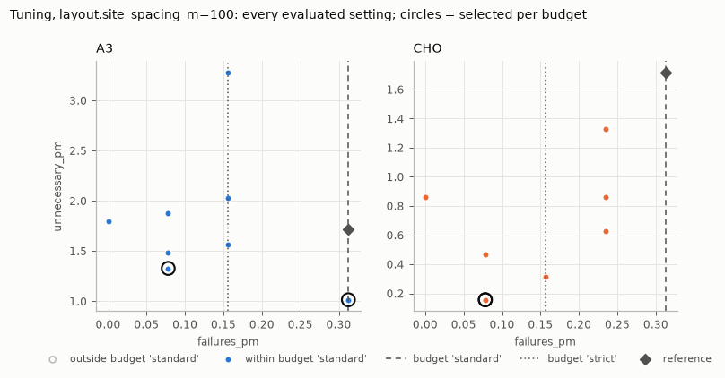
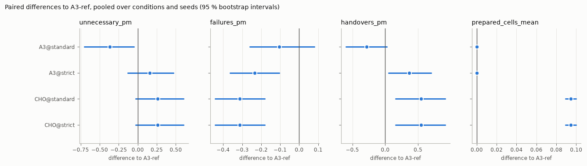

# Tutorial 4: reading the report

`handoverlab report results/study-smoke` (or `study --report`) writes `report/report.md`,
`report/report.html` (self-contained, figures embedded), `report/summary.json` with every number,
and the figures as PNG files. This tutorial reads the report of the study from
[Tutorial 3](tuning-study.md) section by section. Its numbers come from 6 test seeds of a 20-second
scenario: they illustrate how to read a report, not how A3 and CHO compare.

## Provenance

```text
HandoverLab 0.4.0a1 (model 1), Python 3.12.10, NumPy 2.4.6, SciPy 1.18.0, Windows-2022Server-10.0.20348-SP0.
Study file hash `c4f0ef781591085e`.
Jobs: tune1 8, tune2 8, test 12; 80 rule runs simulated, the rest reused; 127 s of job time; 1 session(s).
```

The study-file hash identifies the resolved study (`study.lock.json`); the model version changes
whenever identical inputs would give different results. Quote both when you report results, and
keep the study directory: `handoverlab verify --results` can repeat stored runs on another machine
and compare their event-log fingerprints.

## Tuning: gates first

The gate table lists every gate that did not pass, then counts the passed ones:

| gate | status | group | method | budget | detail |
|---|---|---|---|---|---|
| budget_binding | warn | layout.site_spacing_m=150 | - | standard | the reference rule has only 1 failure on the tuning runs (minimum 3); ... |
| budget_binding | warn | layout.site_spacing_m=150 | - | strict | ... |

Read the gates before any result. A `BLOCK` means no test ran. A `warn` limits what a result can
mean: here, at 150 m, the failure budget rests on one reference failure, so "within the failure
budget" is a weak statement at that site spacing. The *Grid extensions* table lists every grid that
the policy `extend` widened (here A3's offset from 6 to 8 dB).

## Tuning: what was selected

For every tuning group the report gives the reference rule, the budgets and the selected setting
per method and budget, with how many of the 8 settings met the budget:

| method | budget | selected setting | unnecessary_pm | failures_pm | prepared cells | within budget | budget met |
|---|---|---|---|---|---|---|---|
| A3 | standard | off_db=6, ttt_s=0.08 | 1.484 | 0.234 | 0.000 | 6 / 8 | yes |
| A3 | strict | off_db=6, ttt_s=0.04 | 1.563 | 0.078 | 0.000 | 4 / 8 | yes |
| CHO | standard | o_exec_db=4, ttt_exec_s=0.04 | 1.875 | 0.000 | 0.096 | 5 / 8 | yes |
| CHO | strict | o_exec_db=4, ttt_exec_s=0.04 | 1.875 | 0.000 | 0.096 | 5 / 8 | yes |



The figure shows every evaluated setting: failure rate (the constraint) against unnecessary-handover
rate (the objective). Filled points are within the first budget (dashed line), the circles are the
selected settings, the diamond is the reference rule. Two things to look for:

- **Is the trade-off real?** If all points sit left of the budget lines, the budget does not
  constrain the choice (the `budget_binding` gate says so).
- **Is the winner isolated?** If many filled points have nearly the same objective, the tie-breaks
  decide (the `flat_optimum` gate). Here CHO met both budgets with the same setting, so
  `CHO@standard` and `CHO@strict` are identical in the test stage.

Every evaluated setting and its means are in `tables/tuning` and `tuned/<group>.json`, so the
selection can be redone or checked.

## Test results: means

| rule | unnecessary_pm | failures_pm | handovers_pm | prepared_cells_mean |
|---|---|---|---|---|
| A3-ref | 1.823 [0.888, 2.757] | 0.339 [0.141, 0.536] | 17.214 [15.267, 19.160] | 0.000 [0.000, 0.000] |
| A3@standard | 1.458 [0.676, 2.240] | 0.234 [0.085, 0.384] | 16.927 [14.899, 18.955] | 0.000 [0.000, 0.000] |
| CHO@standard | 2.083 [0.950, 3.217] | 0.026 [-0.031, 0.083] | 17.760 [15.955, 19.566] | 0.095 [0.088, 0.101] |

Means over the 12 test runs (2 conditions x 6 seeds) with 95 % t intervals, then the same per
condition. These intervals describe the spread between worlds; they are wide because worlds differ
a lot. They are *not* the right basis for comparing rules, because every rule ran on the same worlds.

## Test results: paired comparisons

The comparisons use the differences run by run (rule minus baseline on the same condition and
seed), which removes the differences between worlds:

| rule | pairs | mean | baseline | difference | t interval | bootstrap interval | change % | p | p (Holm) |
|---|---|---|---|---|---|---|---|---|---|
| A3@standard | 12 | 1.458 | 1.823 | -0.3646 | [-0.7510, 0.0218] | [-0.7031, -0.0521] | -20.0 | 0.0430 | 0.1719 |
| CHO@standard | 12 | 2.083 | 1.823 | 0.2604 | [-0.0971, 0.6179] | [-0.0260, 0.5990] | 14.3 | 0.2109 | 0.6328 |

(unnecessary handovers per UE-minute; some columns left out.)

- **difference** with its **t interval** and **bootstrap interval**: the size of the effect and
  its uncertainty. Report these first.
- **change %** and the ratio interval: the same relative to the baseline mean.
- **p**: the exact Wilcoxon signed-rank test on the paired differences (zero differences dropped).
  **p (Holm)** is adjusted for all comparisons of the same metric: use it when you look at several
  rules at once.
- **non-zero**: how many of the pairs differ at all. With per-run rates built from a handful of
  events, many pairs are tied.

Reading the rows above: tuned A3 had 0.36 fewer unnecessary handovers per UE-minute than the
reference A3 on average, but the t interval includes zero and after the Holm adjustment p = 0.17:
with 12 pairs this is not a demonstrated difference. CHO's difference has the opposite sign and is
not significant either. For failures (not shown) CHO@standard had 0.31 fewer failures per UE-minute
than the reference with p (Holm) = 0.03.



The figure shows the mean paired difference with its bootstrap interval for each metric. An
interval that crosses zero is not a demonstrated difference.

## A checklist

1. Gates: any `BLOCK`? Which warnings, and do they touch the comparison you care about?
2. Budgets: did every method meet them? Is the trade-off constrained?
3. Selected settings: interior points of the grids? Any grid extensions?
4. Paired differences with intervals, per condition as well as pooled. Is the sign the same in
   every condition?
5. Holm-adjusted p-values when several rules or metrics are compared.
6. Enough pairs: `handoverlab.stats.seeds_needed(sd, half_width)` tells how many seeds a given
   interval width needs, from the spread of a pilot study like this one.
