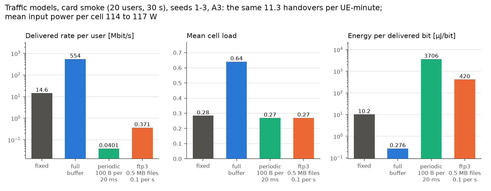

# HandoverLab user guide

This guide covers version 2.10.1. It explains the ideas behind a run, the built-in
scenarios, the configuration keys, the command line, the Python API, how to write and check your own
handover rule, event logs at their three levels and their fingerprints, the verification checks,
what the metrics mean, and how to run a whole study: equal-budget tuning with automatic gates
(including widening a grid), paired tests, stored and resumable results, the status view, and
reports. Step-by-step introductions are in the [tutorials](tutorials/first-run.md); the
[dashboard](guides/dashboard.md) has its own page.

## 1. Concepts

**World.** A scenario plus a seed fixes a *world*: the site layout, the radio map (line of sight,
path loss, shadowing), the trajectories of all users, their service classes and the background
load of every cell. Everything random comes from independent NumPy streams derived from the seed
(`handoverlab.seeds`).

**Rules run on the same world.** `simulate()` builds one world per seed and runs every handover
rule on it with *identical* radio samples. The protocol engine draws no random numbers, so two rules
on the same seed differ only through their decisions. Compare rules seed by seed (paired), not by
their overall averages alone.

**Ground truth and observations.** Outcome labels use the true received powers. A rule sees only
what a network can observe: filtered measurements, the serving cell, reported position, speed and
heading, and the nominal site plan.

**Time base.** The engine advances all users together in steps of `protocol.step_s` (10 ms). L1
samples are taken every `protocol.l1_period_s` (40 ms) and pass through the L3 filter; handover
decisions are made at these measurement instants.

## 2. Scenarios

### Street grid (`layout.kind = "street_grid"`)

The urban grid of 3GPP TR 37.885 Annex A: street centre lines every 433 m (x) and 250 m (y), streets
20 m wide, building blocks in between. `layout.blocks` sets the number of blocks; the default
`[3, 3]` is the minimum area of TR 37.885 Table A-1. Sites stand on the pavement every
`layout.site_spacing_m` metres along every street, `layout.site_offset_m` from the centre line,
alternately on the two sides. A link is in line of sight if the segment between site and user
crosses no building and, with `radio.clutter_los`, if the spatially consistent LOS state of TR 38.901
(clause 7.6.3.3; a random field with `radio.los_corr_m` correlation) says so. Both are properties of
the place: every user passing a spot sees the same blockage.

Users follow the street centre lines (with a lateral offset per user) and choose straight, left or
right at each intersection with probabilities 0.5 / 0.25 / 0.25.

### Open area (`layout.kind = "open_area"`)

The rectangle of the same grid size without buildings and with a hexagonal site grid. The LOS state
is drawn as a process along each user's path (nothing repeats by place), and users move between
random waypoints. With `radio.place_share = 0` all shadowing also moves with the user.

### Highway (`layout.kind = "highway"`, since 1.0.0rc3)

The straight multi-lane road of the TR 37.885 highway case along the x axis: `layout.lanes` lanes
(default 3) of `layout.lane_width_m` (4 m) per direction over `layout.road_length_m` (2000 m),
eastbound south of the centre line and westbound north of it, no buildings. Roadside sites stand
every `layout.site_spacing_m` metres along the road, `layout.site_offset_m` beyond the road edge,
alternately on the two sides. As in the open area, the LOS state is a process along each user's
path. Vehicles keep their lane (the lateral range of their speed group is the displacement from the
lane centre, at most half a lane) and their speed; at the end of the road a vehicle turns into the
same lane of the other direction. The profiles `hwy` (70-140 km/h), `hwy70` (about 70 km/h) and
`hwy140` (126-140 km/h) are meant for it. See the how-to [highway and vehicular
scenarios](guides/highway.md).

### Indoor (`layout.kind = "indoor"`, since 1.7.0)

The indoor office of TR 38.901 Table 7.2-2: a hall of 120 m x 50 m (`layout.area_m`) centred on
the origin, without walls, with ceiling sites on a rectangular grid every `layout.site_spacing_m`
metres (20 m gives the 12 sites of the standard). As in the open area, the LOS state is a process
along each user's path; use it with `radio.pathloss: inh_office`, whose LOS probability stands for
the walls and furniture. Users move between random waypoints at least 2 m from the walls; the
profile `ped3` (about 3 km/h) is meant for it. `layout.area_m` (since 1.7.0) also sets the size
of the open area, for example for large rural cells. See the how-to [indoor and rural
scenarios](guides/indoor-rural.md).

### Soft LOS state (`radio.soft_los`, since 1.7.0)

By default the LOS state of a link switches hard between LOS and NLOS along a user's path. With
`radio.soft_los: true` HandoverLab uses the optional soft LOS state of TR 38.901 clause 7.6.3.3
(V17.0.0, Eq. 7.6-18 and 7.6-19): `LOS_soft = 1/2 + arctan(sqrt(soft_los_d_m / lambda) (G + F(d))) / pi`
with the wavelength `lambda`, `F(d) = sqrt(2) erf^-1(2 Pr_LOS(d) - 1)` and `G` the same spatially
consistent Gaussian process that sets the hard state, so the soft state turns into the hard one for
a very large `soft_los_d_m`. The channel `H = H_LOS LOS_soft + H_NLOS sqrt(1 - LOS_soft^2)` becomes,
at the received-power level of HandoverLab, the power mixture `LOS_soft^2 P_LOS + (1 - LOS_soft^2) P_NLOS`,
each with its own path loss and shadowing standard deviation on the same shadowing field. On the
street grid the buildings still block hard; the soft state applies to the clutter LOS state of the
links that the buildings leave clear. With `radio.place_share < 1` on the grid, the part of the
shadowing that moves with the user takes the standard deviation of the dominant state.

### LOS-state process (`radio.los_process`, since 2.9.0)

TR 38.901 V19.5.0 clause 7.6.3.3 determines the LOS state by comparing a realisation of a spatially
consistent random variable with the distance-dependent LOS probability (LOS if it is less), and gives
the correlation distance for the LOS state in Table 7.6.3.1-2 (UMi, UMa and SMa 50 m, RMa 60 m,
indoor 10 m); clause 7.4.4 says that the cluster-specific random variables of the spatial consistency procedure are
correlated following the exponential function of Eq. (7.4-5); HandoverLab applies it to the LOS variable too. The text does not say whether the
correlation distance belongs to the random variable or to the binary state. By default (`gaussian`)
HandoverLab gives it to the variable: a Gaussian field with the correlation exp(-d / `los_corr_m`) is
compared with the inverse normal of Pr_LOS. The binary state then decorrelates faster than the field
(at d = `los_corr_m` and Pr_LOS = 1/2 its correlation is (2 / pi) arcsin(e^-1), about 0.24, instead of
e^-1, about 0.37) and changes more often along a path.

`radio.los_process: poisson_lines` (optional, off by default) gives the correlation
exp(-d / `los_corr_m`) to the state itself:

* street grid: every site gets an isotropic Poisson line process over the map (on average
  pi R / `los_corr_m` lines through the disc of radius R that holds the map, with uniform directions and
  offsets). Two points at distance d lie in one cell of the lines with the probability
  exp(-d / `los_corr_m`), and every cell has its own independent uniform variable, which is compared with
  Pr_LOS. As with the Gaussian field, it decides the links that the buildings leave clear;
* open area, highway and indoor (the LOS state as a process along each user's path): the variable is kept
  from one step to the next, or redrawn as a new independent value with the probability
  1 - exp(-v dt / `los_corr_m`), the one-dimensional analogue.

The LOS share still follows Pr_LOS, and the state still switches hard, now at the cell edges (or the
redraws) only. With `soft_los` the variable G of Eq. (7.6-18) is constant within a cell: the soft state
changes smoothly with Pr_LOS inside a cell and jumps at its edges. The option needs a LOS state drawn
from the LOS probability, so it is refused with the NTN layout (its own LOS model), `radio.map_file`,
`radio.los_model: los` and, on the street grid, `radio.clutter_los: false`. Its random numbers come
from a stream of their own (`los`), so every other draw of a run is the one of `gaussian`; with the
default every result of 2.8.0 is unchanged.

### Blockage model A (`radio.blockage`, since 2.10.0)

`radio.blockage: a` (optional, off by default) adds blockage model A of TR 38.901 V19.5.0 clause 7.6.4.1:

* one self-blocking region in the UT local coordinate system (Eq. 7.6-20, Table 7.6.4.1-1): `blockage_mode`
  `portrait` (phi' 260 deg, width 120 deg, theta' 100 deg, height 80 deg) or `landscape` (40, 160, 110, 75 deg);
  power arriving inside it loses 30 dB. The local system is the global one turned by the user's heading (phi' =
  0 along the direction of travel, no tilt), an assumption;
* K_block = 4 non-self-blocking regions around the user (Eq. 7.6-21, Table 7.6.4.1-2 for UMi and UMa: centre
  uniform in [0, 360] deg, width uniform in [5, 15] deg, theta_k = 90 deg, y_k = 5 deg, r = 10 m), attenuating by
  the knife-edge terms of Eq. 7.6-22 to 7.6-27 with the signs of Table 7.6.4.1-3;
* blocker centres and widths consistent in space and time, R(dx, dt) = exp(-(|dx| / d_corr + |dt| / t_corr))
  (Eq. 7.6-28), d_corr 10 m (indoor users 5 m, Table 7.6.4.1-4) and t_corr = d_corr / v with v =
  `blocker_speed_kmh` (3 km/h, pedestrians; the clause leaves v open).

The clause attenuates every cluster; HandoverLab has no clusters. The LOS ray (K_R / (K_R + 1) of the power at
the median K of 9 dB) is attenuated exactly at its arrival direction; the diffuse power over the expected
arrival spectrum of the link (wrapped Gaussian of the median ASA, Laplacian of the median ZSA, Table 7.5-6
Part-1), the small regions combined as if they did not overlap. This is an approximation of the per-cluster
model. The factor acts on all beams of a site and is updated once per L1 period. UMa and UMi street canyon
only, one carrier, not with `radio.map_file`, `radio.fast_fading` or the NTN layout; own random stream
(`blockage`), so every other draw of a run is unchanged. Limits: the arrival spreads are the table medians
without the scaling of the diffuse part of LOS links; users of an `indoor: true` group get the outdoor
spreads and the outdoor arrival zenith. Memory: since 2.10.1 the model works on blocks of at most 20 000 links
x 64 values (on the FR2 card about 0.6 GB while the run steps instead of 2.1 GB, and a process peak of 0.87 GB set
by the world build; see [performance](performance.md)).

In the comparison with real data (FR2 walking card, [real data](real-data.md#re-test-with-the-2100-options))
about 37 % of the LOS links lose more than 3 dB (median loss of those about 16 dB), as intended, but the serving SINR moves only about 0.4 dB: the
user is served by an unblocked cell and the interferers are blocked as often. It passes 1 of 3 rows like the
card without it, with no failures; the FR2 SINR stays about 6 dB above the measurements.

### Settings closer to deployed networks (documented values, not defaults)

These settings use existing keys only; none of them is a default. They were compared with measured data in
[Comparison with real network data](real-data.md).

**Sector antennas of TR 38.901 Table 7.8-1.** The cards with the antenna abstraction (an omni site with
`bs_gain_db`) can be run with three sector antennas as in the large-scale calibration of TR 38.901
(Table 7.8-1: 3 sectors per site at 30, 150 and 270 degrees, (M, N, P) = (10, 1, 1) elements of
Table 7.3-1, electrical downtilt 102 degrees for UMa):

```yaml
radio:
  beams: {sectors: 3, sector_az0_deg: 30, n_ssb: 1, panel: [10, 1], tilt_deg: 102}
```

Every site then has three cells; one SSB beam per cell is the sector beam, and the cell RSRP is measured per
resource element (see [Beams and several carriers](#beams-and-several-carriers-since-1100)).

With one wide SSB beam per sector, beam failure detection (on by default with `radio.beams`) has no other beam
to recover to, and in the comparison with real data it raised the failure rate several times. Two
configurations were tested against it (results in [Comparison with real network data](real-data.md)):

* **Several SSB beams per sector.** At 4 GHz (SS/PBCH block Case C, unpaired spectrum) TS 38.213 clause 4.1
  allows 8 SS/PBCH blocks per half frame, and TR 38.802 Table A.2.5-2 takes (M, N) = (8, 8) elements as the
  4 GHz baseline for beam-management evaluations:

    ```yaml
    radio:
      beams: {sectors: 3, sector_az0_deg: 30, n_ssb: 8, panel: [8, 8], tilt_deg: 102}
    ```

    The gNB moves the serving beam to the best reported SSB beam, beam failure detection watches the serving
    beam's SSB (TS 38.213 clause 6 takes, without configured resources, the periodic CSI-RS of the PDCCH TCI
    state; HandoverLab uses the serving SSB beam in its place) and recovery picks the
    best candidate beam. HandoverLab models one polarisation and a vertical spacing of half a wavelength
    (the table: two polarisations, 0.8 wavelength).
* **No beam failure recovery** (`bfd: false` in `radio.beams`): TS 38.321 clause 5.17 says the MAC entity
  "may be configured" with it; without it a weak link fails through radio link monitoring (T310) only.

In that comparison the sector setting of Table 7.8-1 without beam failure recovery stayed within twice the
default's failure rate (below it with the LOS-state process; walking users fail more often) and passed more
rows; the 8-beam setting still failed about three times as often at
15-25 km/h and gave a SINR distribution well above the measured one. With the SS-SINR model (`ssb_sinr: ssb`, see
[Beams and several carriers](#beams-and-several-carriers-since-1100)) the Table 7.8-1 sectors without recovery
and with `radio.los_process: poisson_lines` matched the most rows among the settings within twice the
default's failure rate (1.2-1.4 times it at 15-50 km/h). The 8-beam setting stays about 6 dB optimistic in
SINR. Likely cause: no angular spread in the beam gain (the explicit TR 38.901 7.5 procedure gives a 5.85 dB
median best-beam loss; see
[Angular spread at the beams](#angular-spread-at-the-beams-radiobeamsangular_spread-since-2100)); the
registered cause test was not confirmed: the option lowers the SINR by about 5 dB, but raises the failures
4-8 times, so the gap stays open.

**In-vehicle penetration loss** (documented in 2.10.0; keys since 1.2.0). TR 38.901 V19.5.0 clause 7.4.3.2,
Eq. (7.4-4): PL = PL_b + N(mu, sigma_P^2) with mu = 9 dB and sigma_P = 5 dB, "UT-specifically generated";
optionally mu = 20 dB for metallized car windows; applicable for at least 0.6-60 GHz:

```yaml
radio:
  penetration_db: 9         # 20 for metallized windows
  penetration_sd_db: 5
```

HandoverLab draws the loss once per user and applies it to all its links, steps and carriers (not to users
of an `indoor: true` speed group, which get the building loss instead). Every non-indoor user gets it, so
walking users outdoors need a run of their own. In the comparison with real data it changed no judged row and
no failure or handover count (the network is interference-limited and the loss is the same on every link of
a user); it lowers the received power by about 8.7 dB, towards the drive-test values (reported, not judged).

**Event A3 settings as operators configure them.** TS 38.331 clause 5.5.4.4 enters Event A3 when
Mn + Ofn + Ocn - Hys > Mp + Ofp + Ocp + Off. On one carrier (one measurement object, so Ofn = Ofp and they cancel) and without a cell individual
offset (Ocn and Ocp are zero when not configured, same clause), the threshold is Off + Hys, so the rule
`a3` takes `off_db` = a3-Offset + hysteresis. Published measured values:

| Setting | `off_db` | `ttt_s` | Source |
|---|---|---|---|
| LTE | 4 (Off 3 + Hys 1) | not given (range 0.04-1.28) | Deng et al., ACM IMC 2018, section 4, Fig. 5 (dominant AT&T a3-Offset and hysteresis) |
| NR | 8 (Off + Hys) | 0.64 | Ghoshal et al., arXiv:2511.03116 (preprint), section VII-A, Fig. 19a (most common tuple of two US operators) |

The L3 filter coefficient keeps `protocol.l3_k` 4, the default of TS 38.331 (filterCoefficientRSRP
DEFAULT fc4); neither study reports a measured value, and neither reports cell individual offsets.

### Beams and several carriers (since 1.10.0)

Two optional models replace the antenna abstraction (`bs_gain_db`, `isolation`) and add carriers.
Both are off by default; without them every result of 1.x is unchanged.

**SSB beams** (`radio.beams`): every site carries `sectors` cells; each cell is a panel of
`panel = [M, N]` elements with the element of TR 38.901 Table 7.3-1 and sends `n_ssb` SSB beams with
DFT weights (at most L_max: 4 up to 3 GHz, 8 in FR1, 64 in FR2). The cell quality comes from the
beams (TS 38.331 5.5.3.3, `ssb_avg`, `ssb_thresh_dbm`). The gNB moves the serving beam (TCI state)
after periodic L1-RSRP reports (`report_s`, `switch_db`, `tci_delay_s`). Beam failure detection
and recovery follow TS 38.213 clause 6, TS 38.321 clause 5.17 and TS 38.133 clause 8.5 (the SSB of the
serving beam as BFD-RS, which TS 38.133 8.5.1 allows): an
indication every max(2 ms, T_SSB) when the serving beam's quality, averaged over the BFD evaluation
period, is below Qout_LR (Qout + 4 dB since 2.1.0, TS 38.133 Tables 8.5.2.1-1 and 8.1.2.1-1; 2.0.0: Qout); `bfi_max` (beamFailureInstanceMaxCount) indications within
`bfd_timer` (beamFailureDetectionTimer) periods start random access: contention-free on a
candidate beam above `rsrp_thresh_ssb_dbm` while `bfr_timer_s` runs, else contention-based; after
`preamble_max` failed attempts the random-access problem is a radio-link failure. Radio-link
monitoring uses the serving beam (`rlm_rs: tci`) or the best N_RLM beams (`rlm_rs: beams`; up to 8
in FR2). A cell interferes with the mean gain of its beams towards the user, scaled by its load.
`am_db` (since 2.3.0, default `30`) is A_m of the element pattern, its front-to-back ratio; a larger
value lowers the back lobe (the high-speed train guide uses it).

`ssb_sinr` (since 2.9.0, default `data`): by default link monitoring and beam failure detection see the
serving beam's power over that data-channel interference. `ssb` takes the SS-SINR of TS 38.215 clause 5.1.5,
whose interference is measured on the resource elements carrying the SSS: a share `ssb_overlap` (default 1) of
them meets the neighbours' SSBs of the serving beam's index, sent whatever the load and through each
neighbour's beam of that index (TS 38.213 clause 4.1 gives every cell of a band the same candidate SS/PBCH
block positions; aligned frames, the same transmitted SSBs and the same beam codebook in every cell are
assumed); the rest sees the data-channel interference. With `ssb_overlap: 0` the result is that of `data`. One
carrier with beams, the isotropic UE, `rlm_rs: tci` and no `protocol.lm_load` / `lm_load_per_ue` only. Beam
failure detection then also uses the SS-SINR of the serving beam's SSB, which matches an SSB configured as the
BFD reference signal.

```yaml
scenario:
  base: urban-grid-10ghz
  radio:
    carrier_ghz: 28.0
    bandwidth_mhz: 400.0
    beams: {sectors: 3, n_ssb: 8, panel: [4, 8], tilt_deg: 100.0}
  protocol: {rlm_eval: ts38133}
```

**Several carriers** (`radio.layers`): each entry adds a carrier with its own sites (`sites`,
`sites_file`, `site_spacing_m`, `site_offset_m`) or, with `cosited: true`, the sites of the first
layer with the same LOS states, shadowing and blockers (TR 38.901 clause 7.6.5). Unset values come
from `radio`. Only cells of one carrier interfere with each other. Measurements are then SS-RSRP
per resource element, so that cells of different bandwidths compare correctly. With
`protocol.meas_periods: ts38133` the UE measures the other carriers in the gaps of
`protocol.gap_pattern` (TS 38.133 Table 9.1.2-1) with the inter-frequency periods of TS 38.133
9.3.5 (FR1 320 ms, FR2 1.6 s with gap pattern 0) and receives no data during a gap. The rule
`a3a5` hands over with Event A3 within a carrier and Event A5 towards another one. The scenario
cards `urban-grid-28ghz-beams` and `dense-urban-2layer` (ITU-R M.2412 two-layer dense urban) use
these models; see also the guide [Beams and several carriers](guides/beams-layers.md).

### Angular spread at the beams (`radio.beams.angular_spread`, since 2.10.0)

By default a beam's gain towards a user is the gain of the TR 38.901 clause 7.3 pattern in the one geometric
direction from the cell to the user. In the channel of TR 38.901 V19.5.0 clause 7.5 the power leaves the site
over clusters and rays (steps 5-7), and every ray is weighted by the field pattern in its own departure
direction (step 11), so a narrow beam loses part of its peak gain when the angular spread is wider than the
beam. `angular_spread: tr38901` (in `radio.beams`, off by default) takes every beam gain towards a user --
serving, measured and interfering beams, and so the beam-mean interference gain and the SS-SINR of
`ssb_sinr: ssb` -- as the expected gain over the departure power angular spectrum of the link:

* NLOS: wrapped Gaussian in azimuth with rms ASD, Laplacian in zenith with rms ZSD (step 7, Table 7.5-6 note 5)
  around the geometric zenith plus the ZOD offset mu_offset,ZOD (Eq. 7.5-19; Tables 7.5-7 for UMa and 7.5-8 for
  UMi - Street Canyon);
* LOS: a LOS ray in the geometric direction with K_R / (K_R + 1) of the power (Eq. 7.5-7, 7.5-8) at the median
  K of 9 dB (Table 7.5-6 Part-1), plus the diffuse part with the spreads ASD / sqrt(1 - P_LOS) and
  ZSD / sqrt(1 - P_LOS), P_LOS = K_R / (K_R + 1), so that the rms of the whole spectrum is the table's value;
* ASD and ZSD of every user-site link drawn once per LOS state from the log-normals of Table 7.5-6 Part-1 and
  Tables 7.5-7 / 7.5-8, limited to 104 and 52 degrees (step 4); their cross-correlations and spatial
  consistency are not modelled. The LOS state is the one of the path loss (with `soft_los` its power weight
  mixes the two gains).

The expectation uses 16 x 16 quadrature nodes and is separable: the zenith nodes act on the vertical array
factor, the azimuth nodes on the element times the horizontal array factor. UMa and UMi street canyon only
(the tables), not with `radio.map_file` or the NTN layout; own random stream (`spread`), so every other draw of
a run is unchanged. Limit: layers with `cosited: true` draw their own ASD and ZSD, where TR 38.901 clause 7.6.5
keeps the large-scale parameters of a link the same on all frequencies.

```yaml
radio:
  beams: {sectors: 3, sector_az0_deg: 30, n_ssb: 8, panel: [8, 8], tilt_deg: 102, angular_spread: tr38901}
```

It is an approximation. Against a Monte Carlo of the explicit clause 7.5 procedure (UMa, 4 GHz, the (8, 8) and
(10, 1) panels) the median differences are -0.53 to +0.06 dB, but only 67-86 % of the points lie within
1.5 dB, where the registered check asked for 90 % (the weak beams far below the peak differ most). The explicit
procedure gives a median loss of the best beam of 5.85 dB for the (8, 8) panel in UMa NLOS (0.4 dB in LOS), the
size of the multi-beam optimism of 2.9.0. In the comparison with real data
([real data](real-data.md#re-test-with-the-2100-options)) the option with 8 SSB beams lowers the median of the
primary NR SS-SINR rows by 5.2 dB, but the failures per km rise 4-8 times (11.1 and 7.4 per km at 15-25 and
30-50 km/h, default 1.5 and 1.7); it passes 1 of 10 judged rows (4 with the LOS-state process, which still
fails the failure check), and with the Table 7.8-1 sectors it costs two rows. Not a default: a faithful model
would apply the beams to the per-ray channel, not to an expected gain.

### Measurement detail of the TS 38.133 periods (`protocol.meas_detail`, since 2.10.0)

With `protocol.meas_periods: ts38133` every cell's L1 result is the average over its measurement period.
`protocol.meas_detail` (default `2x`, the chain up to 2.9.0) set to `3gpp` follows the text at two points:

* the first period result of a cell starts its L3 filter, F_0 = M_1 (TS 38.331 clause 5.5.3.2: "F0 is set to
  M1 when the first measurement result from the physical layer is received"); with `2x` it enters with the
  filter coefficient on top of the first raw L1 sample. Before the first period ends, the first raw sample
  stands in as with `2x`;
* with `radio.beams`, every beam is averaged in linear power over the period, and the cell quality of TS 38.331
  clause 5.5.3.3 is derived from these averages when the period ends: the order of the measurement model of
  TS 38.300 clause 9.2.4 (beam-specific layer 1 filtering, beam consolidation, layer 3 filtering). With `2x`
  the cell quality of every 40 ms sample is averaged instead, which biases it upwards where beams are of
  similar strength.

Without `meas_periods: ts38133` the key has no effect: the default chain (`sample`) already follows both
clauses. In the comparison with real data `meas_periods: ts38133` was run with `2x`; for those settings the two
points change no number (the first acts inside the warm-up, the second needs more than one SSB beam per cell),
so `3gpp` itself was not run on the data. `ts38133` cut the ping-pongs by about a third, raised the failures
per km 1.6-1.9 times (2.84 and 2.66 per km against 1.48 and 1.70) and passed 1 of 10 judged rows (default 2);
no improvement. The CHO and LTM report time-to-trigger (`ttt_prep_s`) and the condEventA3 leaving condition of
`cho_d2` are still evaluated as before (at measurement instants; no separate hysteresis), open limits.

### Sites from a file

`layout.sites_file` (since 1.0.0rc3) names a CSV file with a header row and the columns `x` and
`y` in metres (other columns are ignored; a relative path is taken from the current directory). It
is read when the scenario is loaded and fills `layout.sites`, so the coordinates are part of the
resolved scenario, of result files and of study job IDs. It works with every layout kind.

### Built-in scenarios

Fifteen named scenarios are ready to use. Each has a *scenario card*: purpose, layout drawing, every
parameter with its source, known limitations and the reference results it was checked against
([scenario cards](scenarios/smoke.md)).

| Name | Content |
|---|---|
| [`smoke`](scenarios/smoke.md) | 2 x 2-block grid, 150 m sites, 20 users, 30 s: runs in seconds; checks and first steps |
| [`urban-grid-10ghz`](scenarios/urban-grid-10ghz.md) | the defaults: 3 x 3-block grid, 100 m sites, 10 GHz, 40 users, 120 s |
| [`open-area-10ghz`](scenarios/open-area-10ghz.md) | same rectangle without buildings, hexagonal sites, nothing tied to place |
| [`ns3-urban-3.5ghz`](scenarios/ns3-urban-3.5ghz.md) | the set-up of the comparison with ns-3 / 5G-LENA: seven sites, 3.5 GHz, light load |
| [`fr3-urban-15ghz`](scenarios/fr3-urban-15ghz.md) | the default grid in the upper mid-band (FR3): 15 GHz, 400 MHz, 3.5 dB more beam gain (since 1.0.0rc2) |
| [`highway-tr37885-4ghz`](scenarios/highway-tr37885-4ghz.md) | the TR 37.885 highway below 6 GHz: 3 + 3 lanes with wrap-around, sites on one side 1732 m apart (TR 36.885 option 1), RMa LOS at 4 GHz, every vehicle at 140 km/h (since 1.11.0) |
| [`highway-tr37885-30ghz`](scenarios/highway-tr37885-30ghz.md) | the TR 37.885 highway above 6 GHz: the road through 19 hexagonal sites x 3 sectors, ISD 500 m (option 2), UMa LOS at 30 GHz, SSB beams, 140 km/h (since 1.11.0) |
| [`indoor-office-4ghz`](scenarios/indoor-office-4ghz.md) | the TR 38.901 indoor office: 120 m x 50 m hall, 12 ceiling sites 20 m apart, InH path loss at 4 GHz, pedestrians at 3 km/h (since 1.7.0) |
| [`rural-700mhz`](scenarios/rural-700mhz.md) | rural macro cells: 11 sites 35 m high, 1732 m apart, RMa path loss at 700 MHz, vehicles at 120 km/h (since 1.7.0) |
| [`urban-grid-28ghz-beams`](scenarios/urban-grid-28ghz-beams.md) | the urban grid at 28 GHz (FR2) with three sectors per site, 8 SSB beams per sector, beam management and beam failure recovery (since 1.10.0) |
| [`ntn-leo600-2ghz`](scenarios/ntn-leo600-2ghz.md) | a LEO satellite at 600 km with 19 earth-moving beams in the S band, handheld users, the channel of TR 38.811 and the parameters of TR 38.821 (since 2.0.0) |
| [`dense-urban-2layer`](scenarios/dense-urban-2layer.md) | ITU-R M.2412 dense urban, two layers: 4 GHz macro (ISD 200 m, 3 sectors) and 30 GHz micro sites, SSB beams, inter-frequency measurements in gaps, in-car users at 30 km/h (since 1.10.0) |
| [`urban-macro-tr37885-4ghz`](scenarios/urban-macro-tr37885-4ghz.md) | the TR 37.885 urban grid with macro sites: 433 m x 250 m blocks, sites 25 m high on a 500 m hexagonal layout, UMa path loss at 4 GHz, vehicles at 60 km/h (since 2.3.0) |
| [`suburban-sma-7ghz`](scenarios/suburban-sma-7ghz.md) | suburban macro cells (SMa) at 7 GHz: 11 sites 35 m high, 1299 m apart, 80 % of the users indoors with the O2I loss of the low-loss A model, 20 % in cars at 40 km/h (since 2.3.0) |
| [`hst-fr2-28ghz`](scenarios/hst-fr2-28ghz.md) | the FR2 high-speed train of TR 38.854: one roof-mounted CPE at 350 km/h, remote radio heads every 700 m beside the track, RMa LOS at 28 GHz, no inter-cell interference (since 2.3.0) |

Use one by name (`scenario: smoke`) or as the base of your own values
(`scenario: {base: smoke, mobility: {users: 40}}`); in Python `hl.builtin_scenario("smoke")`.
`handoverlab scenarios` lists them and `handoverlab scenarios smoke` prints a card. The card
`highway-10ghz` (1.0.0rc3 to 1.10.0) was removed in 2.0.0 (see [moving from 1.x to 2.0](migration-2.0.md)).

## 3. Configuration

An experiment file has four top-level keys, `scenario`, `seeds`, `rules` and `output`, plus the
optional `schema` (see [stability](stability.md)). Every key is
checked; an unknown key or a value of the wrong type stops the run with a message that names the
key (for example `unknown key 'scenario.layout.blokcs'`). YAML (`.yaml`, `.yml`), TOML (`.toml`) and
JSON (`.json`) files are accepted, and `hl.load_config()` also takes a dictionary.

```yaml
scenario:
  layout: {kind: street_grid, blocks: [3, 3], site_spacing_m: 100.0}
  radio: {carrier_ghz: 10.0, pathloss: umi_street_canyon}
  mobility: {users: 40, profile: v60}
  run: {duration_s: 120.0, warmup_s: 20.0}
seeds: [1, 2, 3]            # or {first: 1, last: 10}
rules:
  - {rule: a3, name: A3-3dB, off_db: 3.0, ttt_s: 0.16}
  - {rule: cho, name: CHO, o_prep_db: -2.0, o_exec_db: 3.0, ttt_exec_s: 0.08, n_max: 4}
output: results/metrics.csv
```

### Scenario keys and defaults

| Section | Key | Default | Meaning |
|---|---|---|---|
| `layout` | `kind` | `street_grid` | `street_grid`, `open_area`, `highway`, `indoor` (TR 38.901 indoor office, since 1.7.0) or `ntn` (one LEO satellite, since 2.0.0) |
| | `blocks` | `[3, 3]` | number of blocks in x and y |
| | `pitch_m` | `[433, 250]` | distance between street centre lines [m] |
| | `street_width_m` | `20` | street width [m] |
| | `site_spacing_m` | `100` | site spacing along the streets / hexagonal spacing [m] |
| | `site_offset_m` | `9` | site distance from the street centre line (highway: from the road edge) [m] |
| | `sites` | none | explicit site list `[[x, y], ...]` [m] |
| | `lanes`, `lane_width_m` | `3`, `4` | highway: lanes per direction and their width [m] (since 1.0.0rc3) |
| | `road_length_m` | `2000` | highway: length of the road [m] (since 1.0.0rc3) |
| | `sites_file` | none | CSV file with columns `x`, `y` that fills `sites` (since 1.0.0rc3) |
| | `area_m` | none | open area and indoor: width and height of the rectangle [m]; unset: the grid size (open area), 120 x 50 (indoor) (since 1.7.0) |
| | `min_site_distance_m` | `0` | open area and indoor: minimum distance of a user's start and waypoints from every site [m] (since 1.7.0; RMa: 35) |
| | `wrap` | `false` | highway: wrap-around of TR 37.885 Table A-1 (since 1.11.0; see the [highway guide](guides/highway.md)) |
| | `highway_sites` | `roadside` | highway: `roadside`, `one_side` (TR 36.885 option 1) or `hex19` (19 hexagonal sites, option 2) (since 1.11.0) |
| `radio` | `carrier_ghz` | `10` | carrier frequency (0.5-100 GHz) |
| | `bandwidth_mhz` | `200` | carrier bandwidth |
| | `tx_power_dbm` | `35` | transmit power per site |
| | `bs_gain_db`, `ue_gain_db` | `20`, `0` | beam gain towards a served or measuring user; UE gain |
| | `noise_figure_db` | `7` | UE noise figure |
| | `isolation` | `0.3` | mean-to-peak gain of an interfering data beam (1 = no beam isolation) |
| | `bs_height_m`, `ue_height_m` | `10`, `1.5` | antenna heights; with `channel_detail: 3gpp` they must lie in the applicability ranges of TR 38.901 Table 7.4.1-1 (UMa, UMi: 1.5 m <= h_UT <= 22.5 m; RMa: 10-150 m and 1-10 m) |
| | `pathloss` | `umi_street_canyon` | or `uma`, `rma` (0.5-30 GHz), `inh_office` (TR 38.901 Table 7.4.1-1; the last two since 1.7.0; LOS probability of the mixed office), `inh_office_open` (since 2.1.0: InH-Office with the LOS probability of the open office, as ITU-R M.2412-0 Table A1-9), `sma` (since 2.3.0: suburban macro of TR 38.901 V19.5.0, 0.5-37 GHz; [guide](guides/suburban-o2i.md)) |
| | `shadow_los_db`, `shadow_nlos_db` | `4`, `7.82` | shadowing standard deviation |
| | `shadow_los_far_db` | none | optional (1.7.0): standard deviation of LOS links beyond the breakpoint distance (RMa: `6`) |
| | `shadow_decorr_m` | `10` | shadowing decorrelation distance |
| | `shadow_site_corr` | none | correlation of the shadowing between sites; unset (since 2.1.0): 0 with `channel_detail: 3gpp` (TR 38.901 clause 7.5 step 4), 0.5 with `simple` (the value of 2.0.0 and 1.x) |
| | `place_share` | `1` | share of shadowing variance tied to place (rest moves with the user) |
| | `clutter_los` | `true` | spatially consistent LOS state on top of the buildings |
| | `building_los` | `true` | street grid: a link through a building block is NLOS; `false` (since 2.3.0): sites above the rooftops, the LOS state comes from the LOS probability alone (TR 37.885 clause 6.2.1, urban base-station-to-vehicle links); needs `clutter_los: true` |
| | `los_corr_m` | `50` | correlation distance of the LOS state |
| | `los_process` | `gaussian` | (2.9.0) `gaussian`: a Gaussian field with the correlation exp(-d / `los_corr_m`) compared with the LOS probability (TR 38.901 clause 7.6.3.3); `poisson_lines` (optional): the LOS state itself has that correlation (Poisson line cells on the street grid, random redraws along a user's path elsewhere); not with NTN, `map_file`, `los_model: los` or `clutter_los: false` (see below) |
| | `blockage`, `blockage_mode`, `blocker_speed_kmh` | none, `portrait`, `3` | (2.10.0) optional: `a` -- blockage model A of TR 38.901 clause 7.6.4.1 (self-blocking region of Table 7.6.4.1-1 in `portrait` or `landscape` mode, 4 non-self-blocking regions of Table 7.6.4.1-2, Eq. 7.6-28 with t_corr = d_corr / v at the blockers' speed); the LOS ray exactly, the diffuse power over the expected arrival spectrum; UMa and UMi only, one carrier, not with `map_file`, `fast_fading` or NTN (see [Blockage model A](#blockage-model-a-radioblockage-since-2100)) |
| | `breakpoint_c_mps` | `3.0e8` | speed of light in the breakpoint distances (TR 38.901 Table 7.4.1-1 notes 1 and 5; since 2.0.0, 1.x: 299792458) |
| | `pl_min_distance_m` | `10` | smallest 2D distance the RMa, UMa and UMi formulas are evaluated at (their applicability range; since 2.0.0, 1.x: 0) |
| | `env_height_m` | none | UMa and UMi: one effective environment height h_E for every link in the breakpoint distance (since 2.3.0; TR 37.885 clause 6.2.1: `0.25` for base-station-to-vehicle links); unset: TR 38.901 Table 7.4.1-1 note 1 |
| | `vegetation` | `0` | SMa: vegetation density r_veg of the LOS probability of TR 38.901 Table 7.4.2-1: `0` (none), `0.1` (sparse) or `0.2` (dense) (since 2.3.0) |
| | `channel_detail` | `3gpp` | since 2.1.0: `3gpp` -- place-tied shadowing and LOS fields with the exponential autocorrelation exp(-d / d_cor) of TR 38.901 Eq. (7.4-5), shadowing uncorrelated between sites, UMa with C'(h_UT) and the random effective environment height (h_UT >= 13 m), height and co-sited-layer checks, the tabled NTN beamwidth; `simple` -- the model of 2.0.0 and 1.x (part of `LEGACY_1X`) |
| | `map_file` | none | radio map from a file: path gain of every site and pixel from a ray tracer or measurements (TR 38.901 clause 8; since 1.12.0; see [your own radio map](guides/radio-maps.md)); `map_sha256` is filled on loading |
| | `los_model` | `probability` | `los`: every link LOS (TR 37.885 Table 6.2.1-2, highway); not on the street grid (since 1.11.0) |
| | `soft_los`, `soft_los_d_m` | `false`, `20` | optional (1.7.0): soft LOS state of TR 38.901 clause 7.6.3.3 instead of a hard switch (see below) |
| | `time_var_db`, `time_var_tau_s` | `1.5`, `1` | time-varying component (moving blockers) |
| | `l1_error_db` | `1` | error of one L1 RSRP sample |
| | `energy_p0_w`, `energy_slope`, `energy_ntrx` | `56`, `2.6`, `2` | cell power for the energy metrics (1.5.0; `energy_ntrx` since 2.1.0): EARTH model of a micro base station, Auer et al. 2011 Eq. 1 and Table 2 |
| | `fast_fading`, `delay_spread_ns`, `fading_k_db` | `null`, `100`, `null` | (2.2.0) TDL fast fading of TR 38.901 clause 7.7.2 (`tdl-a` .. `tdl-e`), its RMS delay spread and an optional K-factor; radio-link monitoring and the rate then use effective SINRs ([guide](guides/fading.md)) |
| | `penetration_db`, `penetration_sd_db` | `0`, `0` | optional (1.2.0): penetration loss of each user on all its links, drawn once per user (TR 38.901 clause 7.4.3.2: `9`, `5` for a user in a standard car, mean `20` with metallized windows; documented in 2.10.0, see [Settings closer to deployed networks](#settings-closer-to-deployed-networks-documented-values-not-defaults)); since 2.3.0 not for indoor users |
| | `o2i_model`, `o2i_d_in_max_m` | `low`, none | (2.3.0) O2I building penetration loss of the users of an `indoor: true` speed group (TR 38.901 clause 7.4.3.1): `low`, `high`, `low_a` (SMa) or `mixed` (half low, half high); upper end of the uniform variables of d2D-in (unset: 25 m UMa/UMi, 10 m RMa, SMa 10 m residential / 25 m commercial) ([guide](guides/suburban-o2i.md)) |
| | `map_res_m` | `1` | radio-map resolution (street grid) |
| | `scs_khz` | none | optional (1.10.0): subcarrier spacing for SS-RSRP per resource element; unset: 30 kHz up to 7.125 GHz, 120 kHz above |
| | `beams` | none | optional (1.10.0): sectors with SSB beams, beam management and beam failure recovery (see [Beams and several carriers](#beams-and-several-carriers-since-1100)); `beams.angular_spread` (2.10.0, default `none`): `tr38901` the expected beam gains over the departure power angular spectrum of TR 38.901 clause 7.5, UMa and UMi only (see [Angular spread at the beams](#angular-spread-at-the-beams-radiobeamsangular_spread-since-2100)) |
| | `layers` | none | optional (1.10.0): further carriers with their own cells, e.g. a 28 GHz small-cell layer under a 3.5 GHz macro layer; since 1.11.0 a layer may set its own `shadow_los_db`, `shadow_nlos_db`, `shadow_decorr_m` and `los_corr_m` |
| `protocol` | `step_s` | `0.01` | simulation step |
| | `l1_period_s` | `0.04` | L1 sample period (multiple of `step_s`) |
| | `l3_k` | `4` | L3 filter coefficient k (TS 38.331) |
| | `label_period_s` | `0.2` | sampling of the outcome-label quantities |
| | `report_interval_s` | `0.12` | periodic reporting interval (CHO) |
| | `qout_db`, `qin_db` | `-8`, `-6` | out-of-sync / in-sync SINR thresholds |
| | `qout_window_s`, `qin_window_s` | `0.2`, `0.1` | their evaluation windows |
| | `n310`, `n311`, `t310_s` | `1`, `1`, `1` | radio-link failure counters and timer |
| | `prep_s`, `exec_s` | `0.05`, `0.04` | preparation delay; execution interruption |
| | `reest_s`, `cho_recovery_s` | `1`, `0.4` | outage of a re-establishment; of a recovery into a prepared cell |
| | `pingpong_s` | `1` | ping-pong window |
| | `cfg_loss_as_failure` | `false` | check mode: a lost conditional configuration fails like a lost handover command |
| | `lm_load`, `lm_load_per_ue` | `null`, `0` | optional (1.1.0): interferer load at link monitoring, plus a part per user served by the interfering cell; `null` and `0` keep the load of the data channel ([calibration](calibration.md)) |
| | `exec_can_fail` | `true` | `false`: the execution always joins the target (ideal random access) |
| | `rrc_detail` | `3gpp` | since 2.1.0: `3gpp` -- the procedures as audited against TS 38.331 / TS 38.133 / TS 38.300 (RLM counters and indication interval, DAPS source monitoring, LTM candidates kept, CHO at TTT expiry, outcome classes, RRC messages one by one, ...); `simple` -- the engine of 2.0.0 (part of `LEGACY_1X`) |
| | `scheduler`, `harq_max_tx`, `harq_rtt_slots`, `l2s_loss_db` | `null`, `4`, `8`, `1.0` | (2.2.0) slot scheduler `rr` or `pf` with MCS table 1 and the TBS of TS 38.214, HARQ with 8 processes and chase combining; null keeps the rate model ([guide](guides/scheduler.md)) |
| | `buffers`, `forwarding`, `early_forwarding`, `xn_delay_s`, `discard_timer_s`, `sdu_bytes` | `null`, `true`, `false`, `0.005`, `null`, `null` | (2.3.0) downlink PDCP / RLC buffers of one bearer per user with RLC mode `am` or `um`, data forwarding at handover (TS 38.300 9.2.3.2.3; CHO and LTM late unless `early_forwarding`), Xn delay, PDCP discard timer (null: infinity) and the SDU size of the SDU counts; null keeps the model without buffers ([guide](guides/buffers.md)) |
| | `rlm_holdoff_s` | `0.2` | no out-of-sync on a newly joined cell for this time, as radio-link monitoring restarts there (an interpretation of TS 38.133 8.1.2.2; since 1.3.0, default since 2.0.0; 1.x: `0`) |
| | `cmd_during_t310` | `receive` | (1.9.0; default since 2.0.0, 1.x: `lost`) a handover or cell switch command that reaches the UE while T310 runs is received at the first step with link-monitoring SINR >= Qout and stops T310 (TS 38.331 5.3.5.5.2); since 2.0.0 a CHO or LTM candidate configuration is received the same way, without stopping T310 (5.3.5.13) |
| | `t304_s` | `1.0` | T304 (1.9.0; default since 2.0.0, 1.x: none): the execution fails only when T304 expires; the UE joins at the first step with target SINR >= Qout (TS 38.331 5.3.5.8.3) |
| | `meas_periods` | `sample` | `ts38133` (1.10.0): every cell's L1 result is the average over its measurement period of TS 38.133 (intra-frequency Tables 9.2.5.2-1/-2, inter-frequency within gaps Tables 9.3.5-1/-2) and enters the L3 filter once per period |
| | `meas_detail` | `2x` | (2.10.0) with `meas_periods: ts38133`: `2x` the chain up to 2.9.0; `3gpp` -- the first period result starts the L3 filter (F_0 = M_1, TS 38.331 5.5.3.2) and with beams every beam is averaged over the period before the cell quality is derived (TS 38.300 9.2.4, TS 38.331 5.5.3.3); no effect with `sample` (see [Measurement detail](#measurement-detail-of-the-ts-38133-periods-protocolmeas_detail-since-2100)) |
| | `ssb_period_s` | `0.02` | SSB and SMTC periodicity T_SSB used by the TS 38.133 formulas (1.10.0) |
| | `gap_pattern` | `0` | measurement gap pattern id of TS 38.133 Table 9.1.2-1 (0: MGL 6 ms, MGRP 40 ms) (1.10.0) |
| | `fr2_power_class` | `3` | FR2 UE power class: sets M_meas of TS 38.133 9.2.5.1 and 9.3.4 (1.10.0) |
| | `rlm_eval` | `fixed` | `ts38133` (1.10.0): Qout / Qin windows from TS 38.133 Tables 8.1.2.2-1/-2 for the serving cell's frequency range (FR2: 1.6 s / 0.8 s at T_SSB 20 ms) instead of `qout_window_s` / `qin_window_s` |
| | `dc` | `null` | (2.3.0) dual connectivity, NR-DC of TS 37.340: `{scg_layer, add_thresh_dbm, add_ttt_s, change_off_db, change_ttt_s, release_thresh_dbm, release_ttt_s, prep_s, exec_s, on_mcg_ho}` with defaults first layer, `-110`, `0.16`, `3`, `0.16`, `-120`, `0.16`, `protocol.prep_s`, `protocol.exec_s`, `keep`: an SCG on the cells of one layer next to the MCG ([guide](guides/dual-connectivity.md)) |
| | `ns3_oos_rx`, `ns3_ins_rx`, `ns3_ctrl_hz`, `ns3_ctrl_per_ue_hz` | `null`, `100`, `206`, `16.5` | (2.7.0) link monitoring as ns-3 / 5G-LENA v5.1 implements it, not 3GPP: out-of-sync after `ns3_oos_rx` consecutive control receptions below Qout, in-sync after `ns3_ins_rx` above Qin while T310 runs, at `ns3_ctrl_hz` + `ns3_ctrl_per_ue_hz` x (users of the cell) receptions per second; `null`: the 3GPP model; base engine only; DAPS source-link monitoring is not applied with it; used by `NS3_LIKE_SETTING`, not validated ([calibration](calibration.md#the-ns-3-like-setting-270)) |
| | `rlm_interference`, `rlm_rs_type`, `rlm_ssb_overlap`, `rlm_bg_se` | `static`, `ssb`, `1`, `2` | (2.8.0) optional, off by default: `dynamic` takes the link-monitoring SINR over the RLM-RS resource elements (TS 38.215 5.1.5, 5.1.6; TS 38.133 A.6.5.1.1 NOTE 3) with every neighbour's activity of the step: background FTP bursts (time-varying interference, TR 36.814 A.2.1.3; Poisson arrivals, Table A.2.1.3.1-1, TR 36.872 A.1.1) of `traffic.ftp_file_bytes` at a resource utilisation equal to the cell's background load, sent at `rlm_bg_se` bit/s/Hz (an assumption), plus the share used by the simulated users; `rlm_rs_type` (SSB or CSI-RS, TS 38.133 8.1.1): `csi-rs` -- the CSI-RS sees that activity; `ssb` -- a share `rlm_ssb_overlap` of the SSB meets the neighbours' SSBs, sent whatever the load (1: a synchronous network with the same SSB positions; 3GPP does not say whether neighbour SSBs overlap, TS 38.133 7.7.1); replaces `lm_load` (needs `lm_load: null`, `lm_load_per_ue: 0`); base engine only; a sensitivity option, not validated ([calibration](calibration.md#dynamic-interference-on-link-monitoring)) |
| `traffic` | `services` | 5 classes | list of `{key, fiveqi, gbr, t_min_s, theta_q_db, share, rate_mbps}` |
| | `se_max` | `7.4` | spectral-efficiency cap [bit/s/Hz] |
| | `hotspot_share`, `hotspot_load`, `normal_load` | `0.25`, `[0.55, 0.85]`, `[0.05, 0.25]` | background load |
| | `load_tau_s`, `rate_scale`, `label_load` | `0.2`, `1`, `1` | load smoothing; rate multiplier; load assumed by the label |
| | `model` | `fixed` | traffic model (1.4.0): `fixed` (constant service rates), `full_buffer`, `periodic`, `ftp3`; see `examples/traffic_models.py` |
| | `period_s`, `packet_bytes` | `0.02`, `100` | `periodic`: one packet every period |
| | `ftp_file_bytes`, `ftp_rate_hz` | `500000`, `0.1` | `ftp3`: file size (FTP model 3, 0.5 Mbyte as TR 38.821 Table 6.1.1.1-7) and file arrivals per user and second |
| `mobility` | `users` | `40` | number of users |
| | `profile` | `v60` | `v60` (since 2.0.0, the default: 60 km/h in one of two 3.5 m lanes, TR 37.885), `ped`, `veh8`, `veh16` (the 1.x default), `veh30`, `mix`, `c8`, `c16`, `c30`, `ped3`, `veh120` (about 3 and 120 km/h, +-10 %); `p3`, `v30`, `v120` (since 2.1.0: exactly 3, 30, 120 km/h, the fixed speeds of ITU-R M.2412-0 Tables 5a-5c); highway: `hwy`, `hwy70`, `hwy140`, `v140`, `v70` (exactly 140 or 70 km/h with up to 0.5 m lateral offset, since 1.11.0), `v140c`, `v70c` (since 2.1.0: the same on the lane centre) |
| | `groups` | none | own speed groups `[{share, v_min, v_max, lateral_m: [lo, hi]}, ...]`; `lanes_m` (2.0.0) lane centres; `indoor: true` (2.3.0) users inside buildings, with the O2I building penetration loss of `radio.o2i_model` |
| `run` | `duration_s`, `warmup_s` | `120`, `20` | run length; initial part not counted |
| | `backend` | `numpy` | `numba`: compiled kernels of the step loop (since 1.11.0) and of the slot scheduler (since 2.4.0), bit-identical results, needs `pip install handoverlab[fast]` (see [performance](performance.md)); not part of the job IDs |
| `ntn` | `altitude_km`, `aperture_m`, `eirp_dbw_per_mhz`, `n_beams`, `centre_elevation_deg`, `environment`, `atm_zenith_db`, `scintillation_db`, `sf_corr_m`, `los_corr_m` | `600`, `2`, `34`, `19`, `30`, `rural`, `0.045`, `2.2`, `37`, `60` | the satellite of `layout.kind: ntn` (since 2.0.0; TR 38.821 LEO-600 Set-1 S band; see the [NTN guide](guides/ntn.md)) |
| | `hpbw_deg` | none | 3 dB beamwidth of the satellite beams [deg], which sets the beam spacing sqrt(3) sin(HPBW / 2) and scales the Bessel pattern (TR 38.821 Table 6.1.1.1-4); unset: the tabled width of TR 38.821 Tables 6.1.1.1-1 and -2 (4.4127 deg for 2 m, 8.8320 deg for 1 m) with `radio.channel_detail: 3gpp` and a 2 GHz carrier (the tables are for the S band), otherwise the width of the aperture's Bessel pattern (since 2.1.0) |
| | `los_model` | `probability` | `probability`: LOS state from the LOS probability of TR 38.811 Table 6.6.1-1 (NLOS links with clutter loss and NLOS shadowing); `los`: every link LOS, the baseline condition of TR 38.821 Table 6.1.1.1-5 (since 2.1.0) |



*The four traffic models on one card: the handovers are the same (11.3 per UE-minute), while rate, load and energy per bit differ (0.28 uJ per bit with full buffer, 3706 uJ with periodic packets).*

In Python, `Scenario.with_overrides({"layout.site_spacing_m": 50})` returns a changed copy.
`Scenario.to_dict()` leaves out the keys added after 1.0.0rc2 while they have their default value,
so that results and study job IDs of scenarios that do not use them are unchanged;
`to_dict(full=True)` lists every key.

### Built-in rules

| Key | Family | Parameters |
|---|---|---|
| `a3` | baseline | `off_db` (3.0), `ttt_s` (0.16), `name` |
| `cho` | conditional | `o_prep_db` (-2.0), `o_exec_db` (3.0), `ttt_exec_s` (0.08), `ttt_prep_s` (0.0), `n_max` (4, at most 8), `rel_hys_db` (3.0), `immediate` (false), `name` |
| `cho_d2` | conditional | `d_thresh1_m` (25000), `d_thresh2_m` (25000), `hys_m` (1000), `o_prep_db` (-2.0), `o_exec_db` (0.0), `ttt_exec_s` (0.08), `ttt_prep_s` (0.0), `n_max` (4), `rel_hys_db` (3.0), `ttt_d2_s` (0.0; timeToTrigger of condEventD2, since 2.1.0), `name` (since 2.0.0): CHO with condEventD2 of TS 38.331 together with A3; on fixed cells Event D1 |
| `daps` | daps | `off_db` (3.0), `ttt_s` (0.16), `interruption_s` (0.0), `fallback` (true), `source_data` (true), `name` |
| `ltm` | ltm | `o_prep_db` (-3.0), `o_switch_db` (2.0), `ttt_switch_s` (0.08), `ttt_prep_s` (0.0), `n_max` (4, at most 8), `rel_hys_db` (3.0), `cmd_delay_s` (0.01), `exec_s` (0.02), `recovery` (true), `name` |
| `cltm` | cltm | as `ltm` without `cmd_delay_s`: `o_prep_db` (-3.0), `o_switch_db` (2.0), `ttt_switch_s` (0.08), `ttt_prep_s` (0.0), `n_max` (4), `rel_hys_db` (3.0), `exec_s` (0.02), `recovery` (true), `name` |
| `a3_bandit` | baseline | `arms_db` ([1, 2, 3, 4, 5]), `ttt_s` (0.16), `epsilon` (0.1), `epoch` (10), `w_unnecessary` (1.0), `w_failure` (2.0), `name` |
| `a3a5` | baseline | `off_db` (3.0), `ttt_s` (0.16), `a5_thresh1_dbm` (-110), `a5_thresh2_dbm` (-105), `a5_hys_db` (1.0), `a5_ttt_s` (0.32), `a3_inter` (false), `a5_down_thresh1_dbm`, `a5_down_thresh2_dbm` (none: as above), `name` (since 1.10.0): Event A3 within a carrier, Event A5 towards other carriers |
| `dqn` | baseline | `offsets_db` ([0, 1, 2, 3, 4, 5]), `ttt_s` (0.16), `mode` ("train" or "test"), `weights` (none), `hidden` (32), `lr` (0.001), `gamma` (0.9), `epsilon` (0.1), `batch` (32), `buffer` (5000), `train_every` (4), `target_every` (100), `w_unnecessary` (1.0), `w_failure` (2.0), `name` (since 1.11.0; needs `pip install handoverlab[torch]`; see the [learning-rule guide](guides/learning-rule.md)) |
| `a3_mro` | baseline | `off_db` (3.0), `ttt_s` (0.16), `step_db` (1.0; 0.5 before 2.1.0), `window_s` (10.0), `min_db` (-4.0), `max_db` (4.0), `min_events` (1), `count_pingpong` (true), `pingpong_s` (none: `protocol.pingpong_s`), `count_unnecessary` (false), `name` (since 1.7.0) |
| `a3_pred` | baseline | `off_db` (2.0), `ttt_s` (0.32), `case` ("A": prediction window ahead, or "B": measurement skipping), `predictor` ("hold": sample and hold, "ridge" with `weights`, or an object with `predict()`), `weights` (none), `pw_s` (0.32, case A), `skip` (1, case B), `filter_option` (1, 2 or 3, case B), `act` (true), `top_k` (4), `etd_s` (0.08), `event_pw_s` (none: `pw_s`), `record` (none), `name` (since 2.4.0; TR 38.744 measurement prediction; needs only NumPy (no Numba kernel); see the [AI/ML mobility guide](guides/ai-mobility.md)) |

`daps`, `ltm` and `a3_bandit` were added in 1.0.0rc2; they leave the results of `a3` and `cho`
unchanged.

### Procedures

The family of a rule selects the procedure the engine runs around its decisions:

- **baseline** (`kind` `ho` in the event log): Event A3 held for the time-to-trigger, measurement
  report, preparation (`prep_s`), handover command, execution (`exec_s`, an interruption), join of
  the target if its SINR is at least Qout.
- **conditional** (`cho`, TS 38.300 clause 9.2.3.4): prepared cells with execution conditions that
  the UE evaluates itself; faster recovery into a prepared cell after a failure (9.2.3.1, 9.2.7).
- **daps** (`daps`, Rel-16 DAPS handover, TS 38.300 clause 9.2.3.2): triggered like a baseline
  handover, but the source keeps carrying data during the execution, so the execution counts
  `interruption_s` (default 0) instead of `exec_s` in `interruption_exec_s_pm`, and the user keeps
  its rate. The source link is monitored during the execution; if the target cannot be joined before
  T304 expires and no radio-link failure of the source was detected, the UE falls back to the source
  (TS 38.331 clauses 5.3.10.1, 5.3.5.8.3; since 2.1.0, before: if the source SINR was at least Qout).
  No DAPS from FR2 to FR2 and none for NTN (TS 38.300). The attempt ends as `too_early` with the cause
  `daps_fallback`, without a failure or a re-establishment. `too_early_pm` therefore includes
  fallbacks for DAPS, `failures_pm` does not. With `fallback: false, source_data: false` the rule
  gives exactly the results of `a3`.
- **ltm** (`ltm`, Rel-18 L1/L2-triggered mobility, TS 38.300 clause 9.2.3.5): candidate cells are
  configured like the prepared cells of a conditional handover (L3 reports with `o_prep_db`, at most
  `n_max`); the network then switches the UE to a candidate whose *unfiltered L1* measurement beats
  the serving cell by `o_switch_db` for `ttt_switch_s`. The cell switch command (MAC CE) reaches
  the UE after `cmd_delay_s` (while T310 runs it is received when the link reaches Qout); the
  execution (RACH-less, with early timing advance) takes `exec_s`, 20 ms more between FR1 and FR2;
  the other candidates stay configured after a switch (TS 38.331 5.3.5.18.6). Preparation counts (`preparations_pm`, `unused_preparations_pm`, ...)
  count candidate configurations; `recoveries_pm` counts failures recovered into a candidate.
- **cltm** (`cltm`, conditional LTM, Rel-19 work on LTM; since 1.6.0): candidates as for `ltm`, but
  the UE evaluates the L1 switch condition itself and executes as soon as it holds, without a cell
  switch command. There is no command that could arrive late (`commands_pm` is 0), as in
  conditional handover, and the switch is decided on fast L1 measurements, as in LTM.

See the how-to [DAPS handover and L1/L2-triggered mobility](guides/daps-ltm.md) and, for the
learning rule, [a learning-based rule](guides/learning-rule.md); for `a3_mro`, [mobility robustness
optimisation](guides/mro.md).

## 4. Command line

```text
handoverlab run CONFIG [-o OUT] [--seeds S ...] [--events FILE] [--event-level summary|full] [--debug] [-q]
handoverlab verify [--only GROUP ...] [--full] [--ns3 [--ns3-seeds N] [--ns3-comparison | --ns3-like]] [--results FILE [--sample N]] [--json OUT] [-q]
handoverlab scenarios [NAME] [--markdown] [--svg FILE] [--docs DIR]
handoverlab study STUDY [-o DIR] [--workers N] [--tuning-only] [--dry-run] [--status] [--report] [-q]
handoverlab report DIR [-o OUT] [--format md html] [--no-figures]
handoverlab status STUDY|DIR [-o DIR] [--workers N]
handoverlab gui [--port N] [--address A] [--headless]
handoverlab ns3 export STUDY --out DIR [--program FILE] [--force]
handoverlab ns3 import RESULTS.zip|DIR --out REF.json
handoverlab ns3 compare STUDY REF.json [--comparison | --ns3-like] [--workers N] [-o OUT] [--level LO HI] [--rank-min R] [-q]
handoverlab rules
handoverlab init [PATH] [--force]
handoverlab --version
```

`run` writes one row per seed and rule. A `.csv` output has the columns `seed`, `rule`, `family`,
`fingerprint` (of the event log), `n_events`, the rule parameters (`param.*`) and all metrics; a
`.json` output also stores the resolved scenario, the rule key, the timing of every run and the
versions of Python, NumPy and SciPy. `--events` writes the event logs as one table (see section 8):
Parquet for a `.parquet` name if `pyarrow` is installed (`pip install handoverlab[parquet]`), CSV
otherwise; with `--event-level full` the procedure traces go to a second table next to it
(`events.csv` -> `events-trace.csv`). `--debug` checks the engine invariants while running
(section 9).

`verify` runs the verification checks and prints PASS, FAIL or NOTE for each (section 9).
`scenarios` lists the built-in scenarios or prints one card. `study` runs or resumes a study,
`status` shows what is left of it and how long that will take, and `report` writes its report
(section 10). `gui` starts the browser dashboard ([dashboard](guides/dashboard.md); needs
`pip install handoverlab[gui]`). `ns3` exports a study to ns-3 / 5G-LENA as a ready-to-run package, imports
its results and compares HandoverLab with them ([ns-3 bridge](guides/ns3-bridge.md)). `python -m handoverlab` works as well. The full option lists are
in the [command-line reference](reference/cli.md).

## 5. Python API

```python
import handoverlab as hl

sc = hl.Scenario()                                     # all defaults
exp = hl.load_config("examples/street_grid.yaml")       # or a dict
results = hl.run_experiment(exp)                        # list of RunResult
world = hl.build_world(sc, seed=1)                      # one world ...
results = hl.run_world(world, [{"rule": "a3"}, {"rule": "cho"}], log_events="summary")   # ... many rules
results[0].metrics["unnecessary_pm"], results[0].events[:3]
results[0].fingerprint                                  # SHA-256 of the event log, always set
hl.simulate(sc, [{"rule": "a3"}], seeds=[1], debug=True)   # with invariant checks
hl.write_events(results, "events.parquet")              # event table (CSV without pyarrow)
full = hl.run_world(world, [{"rule": "a3"}], log_events="full")[0]
full.trace[:3]                                          # procedure trace (section 8)
hl.run_world(world, [{"rule": "a3"}, {"rule": "cho"}], batch=False)   # engines one by one (same results, slower)
```

`run_world` advances the engines of all rules of a world in one step loop (`EngineBatch`); the
results are bit-identical to running them one by one, which `batch=False` does. Engines in debug
mode always run one by one.

## 6. Writing a handover rule

A rule subclasses `BaselineRule` (A3-based handover), `ConditionalRule` (CHO), `DAPSRule` (DAPS
handover) or `LTMRule` (L1/L2-triggered mobility) and implements a few hooks. The engine calls the
hooks; the rule never calls the engine. Each hook receives an `Observation` with arrays over users
(U) and cells (M): `meas_dbm`, `gap_db` (neighbour minus serving), `serving`, `connected`, `x`,
`y`, `speed`, `heading`, `t`, and (since 1.0.0rc2) `l1_dbm`, the unfiltered L1 samples of the
same instant.

```python
import numpy as np
import handoverlab as hl

@hl.register_rule("a3_speed")
class SpeedScaledA3(hl.BaselineRule):
    """Event A3 whose time-to-trigger shrinks with the reported speed."""

    def __init__(self, off_db=3.0, ttt_s=0.32, v_ref=8.0, name="A3-speed"):
        super().__init__(name)
        self.off_db, self.ttt_s, self.v_ref = off_db, ttt_s, v_ref

    def params(self):
        return dict(off_db=self.off_db, ttt_s=self.ttt_s, v_ref=self.v_ref)

    def a3_offsets(self, obs):                 # scalar or (U, M)
        return self.off_db

    def time_to_trigger(self, obs):            # scalar or (U,)
        return self.ttt_s * np.minimum(1.0, self.v_ref / np.maximum(obs.speed, 1e-6))

results = hl.simulate(hl.Scenario(), [{"rule": "a3"}, {"rule": "a3_speed", "v_ref": 10.0}], seeds=[1])
```

A `ConditionalRule` sets `report_offset_db`, `ttt_prep_s`, `ttt_exec_s`, `n_max`,
`release_hys_db` and `immediate` in its constructor and implements `prep_offsets(obs)` and
`exec_offsets(obs)` (scalar or (U, M)). A rule that learns from outcomes sets `learns = True` and
receives `on_outcome(OutcomeRecord)` and `on_link_failure(FailureRecord)`; `memory_key(obs)` lets it
attach its own key to each preparation. Randomness must come from `ctx.rng` (given to `reset(ctx)`),
never from NumPy's global state.

A `DAPSRule` has the hooks of `BaselineRule` and sets `interruption_s`, `fallback` and
`source_data`. An `LTMRule` sets `report_offset_db`, `ttt_prep_s`, `n_max`, `release_hys_db`,
`ttt_switch_s`, `cmd_delay_s`, `exec_s` and `recovery` and implements `prep_offsets(obs)`
(candidate configuration, on L3 measurements) and `switch_offsets(obs)` (cell switch, on
`obs.l1_dbm`), each a scalar or (U, M).

Rules in an installed package are found through the entry-point group `handoverlab.rules`:

```toml
[project.entry-points."handoverlab.rules"]
a3_speed = "my_rules:SpeedScaledA3"
```

### Checking a rule: the contract test kit

`handoverlab.testing.check_rule` runs a rule on the `smoke` scenario and checks the contract of the
rule interface. Put it in the tests of your plug-in package:

```python
from handoverlab.testing import check_rule
from my_rules import SpeedScaledA3

def test_contract():
    check_rule(SpeedScaledA3, params={"off_db": 3.0, "ttt_s": 0.32, "v_ref": 8.0},
               reduces_to=("a3", {"off_db": 3.0, "ttt_s": 0.32}, {"v_ref": 1e9}))
```

| Check | Meaning |
|---|---|
| `construct` | the rule is built from `params`; `params()` is JSON-serialisable and reports them; the family is valid |
| `recreate` | `cls(**rule.params())` reports the same parameters, so stored results can be repeated |
| `debug run` | a run in debug mode raises nothing: hook values have valid shapes and no NaN, the observation is not written to, all invariants hold |
| `deterministic` | two runs give identical event logs and metrics |
| `global random state` | NumPy's and Python's global random state are untouched (use `ctx.rng`) |
| `independent` | next to another rule on the same world the rule gives the same event log as alone |
| `reduces_to` | optional: with the given parameter changes the rule gives the event log of a built-in rule |

`check_rule` raises `AssertionError` that lists every failed check; with
`raise_on_failure=False` it returns the report instead.

## 7. Metrics

Rates are per UE-minute of the measured part of the run (suffix `_pm`); counts start with `n_`. The
full catalogue with units is `handoverlab.engine.METRICS`, listed in the
[metric reference](reference/metrics.md); the names are stable (see [stability](stability.md)).

**Outcome of an attempt** (exactly one per attempt; `n_attempts` equals their sum):

- `too_late`: the command or configuration was lost, or the link failed while the handover was in
  preparation, and the UE re-established in another cell than its serving cell;
- `too_early`: the execution failed, or the link failed in the target before the evaluation window
  closed, and the UE re-established in the source; for DAPS handover also an execution that fell back
  to the source (cause `daps_fallback`, not counted as a failure);
- `wrong_cell`: the same, but the UE re-established in a cell other than source and target;
- `coverage` (since 2.1.0): a failure of the attempt after which the UE re-established in its serving
  cell (the target after a handover); TS 38.300 15.5.2.2.2 defines no mobility class for it;
- `unnecessary`: completed, the source link would not have failed during the window, and the stay
  was shorter than `t_min_s` of the user's service or the mean SINR gain over the window was below
  `theta_q_db`;
- `useful`: completed and not unnecessary;
- `censored`: the run ended before the outcome was known.

These are the classes of TS 38.300 V18.11.0 clause 15.5.2.2.2 with `protocol.rrc_detail: 3gpp`; with
`simple` (2.0.0) a re-establishment in the target counted as too early and a lost command as too late in
any cell. The evaluation window opens when the handover completes and closes after `t_min_s` of the
user's service class (2 to 7 s) or at the next execution: it plays the part of the network's
threshold such as Tstore_UE_cntxt (TS 38.300 15.5.2.2.2 and 15.5.2.5: one value configured by OAM, compared
with the UE's timeConnFailure, the time since the execution of the last RRCReconfiguration with
reconfigurationWithSync, TS 38.331 5.3.10.5), but is set per service and counted from completion.

**Failures by cause** (`failures_pm` is their sum): `command_lost`, `rlf_in_preparation`,
`rlf_without_handover` (re-established in another cell), `coverage_rlf` (in the same cell),
`execution_failure`, `rlf_after_handover`.

**Other metrics**: `handovers_pm`, `pingpong_pm`, `prepared_cells_mean`, `preparations_pm`,
`unused_preparations_pm`, `lost_configurations_pm`, `recoveries_pm`, `interruption_s_pm`,
`outage_pct`, `rate_mbps`, `delivered_share`, `sinr_db`, `spectral_eff`, `mean_load`.

## 8. Event logs and fingerprints

A run keeps as much of its history as its *event-log level* asks for:

| Level | Kept | Typical use |
|---|---|---|
| `off` (default) | metrics and the fingerprint of the event log | tuning, large studies |
| `summary` | the event log: one row per handover attempt and per failure without a handover | test stages, causes of failures |
| `full` | the event log and the procedure trace | debugging a rule, following users, the dashboard map |

Set it with `log_events="off" | "summary" | "full"` in `simulate` and `run_world` (`True` means
`summary`), with `--events FILE --event-level summary|full` on the command line, or with
`events: off | summary | full` in a study file (`true` means `summary`). The level never changes a
result or a fingerprint. The event-log columns and units are in
`handoverlab.eventlog.EVENT_COLUMNS`:

| Column | Meaning |
|---|---|
| `seed`, `rule` | the run (in tables) |
| `t_attempt`, `t_exec`, `t_end` | start of the attempt, start of the execution (-1 if none), time of the outcome [s] |
| `ue`, `kind` | user; `ho` baseline handover, `cho` conditional handover, `daps` DAPS handover, `ltm` L1/L2-triggered mobility, `cltm` conditional LTM, `rlf` failure without handover |
| `src`, `tgt` | source cell; target cell (for `rlf`: cell of the re-establishment) |
| `outcome`, `cause` | outcome label (section 7) and failure cause |
| `dwell`, `gain_db` | stay in the target observed in the evaluation window [s] (capped at `t_min_s`; it ends at the next execution start or the failure), not the full time of stay of TR 36.839 5.2.2; mean SINR gain over the evaluation window [dB] |
| `n_prepared`, `o_exec` | prepared cells at the attempt; execution or A3 offset (-99 if none) [dB] |
| `x`, `y` | position at `t_end` [m] |

`hl.write_events(results, path)` writes the logs of many runs as one table (Parquet with typed
columns if `pyarrow` is installed and the name ends in `.parquet`, else CSV) and
`hl.read_events(path)` reads it back.

The **trace** (level `full`, `RunResult.trace`) has one row per procedure event with the columns
`t`, `ue`, `event`, `src` (serving cell before the event), `cell`, `value` and `note`:

| Event | Meaning |
|---|---|
| `serve` | initial serving cell at the first step |
| `report` | baseline handover: measurement report towards `cell` (`value`: A3 offset) |
| `prepare`, `release` | conditional handover: preparation of `cell` requested (`value`: execution offset), or released |
| `config`, `config_lost` | the conditional configuration of `cell` reached the UE, or was lost |
| `exec` | execution starts: the UE leaves `src` for `cell` |
| `attach`, `reestablish` | the UE is connected to `cell` after a handover or a re-establishment (`value`: SINR in dB) |
| `switch` | LTM: cell switch command towards `cell` sent (`value`: switch offset) |
| `fallback` | DAPS: the target could not be joined; the UE stays in `src` (`value`: source SINR) |
| `failure` | mobility failure; `cell` is the cell chosen for re-establishment, `note` the cause |

`hl.eventlog.serving_cells(trace, n_users, times)` turns a trace into the serving cell of every
user at the given times (-1 while not connected); `write_trace` and `read_trace` store traces as
tables like the event logs.

The **fingerprint** of a log is the SHA-256 of its canonical CSV form (`hl.fingerprint(events)`).
Every run computes it, also when the log is not kept, and it is written into every result row. Two
runs with the same fingerprint have identical event logs. Use it to check that a study gives the
same events on another machine: `handoverlab verify --results results.json --sample 5` repeats
five stored runs and compares fingerprints and metrics.

## 9. Verification and debug mode

`handoverlab verify` runs these check groups (about two minutes) and prints a report:

| Group | Checks |
|---|---|
| `pathloss` | TR 38.901 path loss, breakpoint and LOS probability against values computed by hand |
| `radio` | shadowing standard deviation and correlation, LOS share against the LOS probability, time-varying part, L1 error, L3 filter |
| `invariants` | built-in rules in debug mode on a stressed scenario, conservation of all counts, determinism, independence of rules, global random state |
| `equivalences` | CHO with immediate execution = A3; a plug-in that reduces to A3 = A3 |
| `fingerprints` | golden event-log fingerprints of eight short reference runs |

`--only GROUP ...` selects groups, `--full` uses more seeds and longer runs, `--ns3` runs the
comparison with stored ns-3 / 5G-LENA results (a few minutes; alone, unless `--only` names groups), `--results FILE` recomputes a stored
study, `--json OUT` writes the report. The exit status is 0 if no check failed. On another NumPy or
SciPy build than the reference, golden fingerprints may differ in single events; the report says so
and then requires only the counts to agree. Details and the results of this version:
[verification.md](verification.md).

**Debug mode** (`debug=True` in `simulate`, `run_world` and `Engine`; `handoverlab run --debug`;
or the environment variable `HANDOVERLAB_DEBUG=1`) checks the invariants of the engine at every
step: valid connection states and serving cells, T310 only while connected, no attempt towards the
serving cell, an execution always belongs to an attempt, finite SINR, one outcome per attempt,
event-log times in order, valid shapes and no NaN in the values a rule returns, and a read-only
observation for the rule. A violation raises `hl.InvariantError` naming the time, the users and the
rule. Debug mode changes no result and roughly doubles the run time. The conservation checks at the
end of a run (attempts = sum of outcomes, failures = sum of causes, every attempt has one outcome,
preparations = lost + cancelled + used + unused + open) always run.

## 10. Studies

A *study* compares handover rules in a controlled way: every rule with free parameters is tuned on
its own seeds with the same number of evaluated settings, a fixed rule selects one setting per
failure budget, automatic gates check that the tuning means something, and the tuned rules are
then compared on separate test seeds with paired statistics. One file describes the whole study,
one command runs it, and re-running it resumes where it stopped.

```bash
handoverlab study examples/study_smoke.yaml --dry-run     # what would run
handoverlab study examples/study_smoke.yaml --workers 2   # run or resume
handoverlab status results/study-smoke                    # finished, failed, remaining jobs, time left
handoverlab report results/study-smoke                    # report.md, report.html, figures
```

### The study file

```yaml
name: study-smoke
scenario: {base: smoke, mobility: {users: 12, profile: veh30}}
conditions:                         # full factorial over dotted scenario keys (optional)
  layout.site_spacing_m: [100.0, 150.0]
seeds:
  tuning: [901, 902]                # never used in a test
  test: {first: 1, last: 6}
tuning:
  settings: 8                       # evaluated settings per method: the same for every method
  random: 5                         # of which drawn at random; the rest refine around the best
  reference: {rule: a3, name: A3-ref, off_db: 3.0, ttt_s: 0.16}
  budgets: {standard: 1.0, strict: 0.5}   # shares of the reference failure rate
  group_by: [layout.site_spacing_m] # tune per site spacing (default: per condition)
  gates: {grid_edge: block}         # warn | block | off per gate
methods:
  A3:
    rule: a3
    grid: {off_db: [0, 1, 2, 3, 4, 5, 6], ttt_s: [0.0, 0.04, 0.08, 0.16, 0.32]}
    natural_bounds: {ttt_s: lower}  # 0 s is a floor, not an edge of the search
  CHO:
    rule: cho
    fixed: {o_prep_db: -2.0, n_max: 4}
    grid: {o_exec_db: [0, 1, 2, 3, 4, 5], ttt_exec_s: [0.0, 0.04, 0.08, 0.16, 0.32]}
compare:
  baseline: A3-ref                  # a method, METHOD@BUDGET or the reference
  metrics: [unnecessary_pm, failures_pm, handovers_pm, prepared_cells_mean]
output: results/study-smoke
```

A complete example, with four tuning seeds and the grid-edge policy `extend`, is [examples/study_smoke.yaml](https://github.com/mjs19971997/handoverlab/blob/main/examples/study_smoke.yaml). Every key is
checked; an unknown key or a parameter that the rule does not have stops the study with a message
that names it.

| Key | Meaning |
|---|---|
| `name`, `description` | name of the study (default: the file name) and a line for the report |
| `scenario` | as in an experiment file: a built-in name, `{base: NAME, ...}` or a full scenario |
| `conditions` | dotted scenario keys with lists of values; the study runs their full factorial |
| `seeds.tuning`, `seeds.test` | lists or `{first, last}`; tuning seeds are needed only for tuned methods |
| `tuning.settings` | evaluated settings per method and tuning group (default 12) |
| `tuning.random` | settings of the first, random round (default two thirds of `settings`) |
| `tuning.reference` | the rule whose failure rate sets the budgets (default A3 3 dB / 160 ms) |
| `tuning.budgets` | failure budgets as shares of the reference failure rate (default `{standard: 1.0}`) |
| `tuning.tolerance` | settings within this share of the lowest objective count as equal (0.05) |
| `tuning.group_by` | condition keys to tune per value of (default: all condition keys) |
| `tuning.gates` | policy per gate: `warn`, `block` or `off` (defaults below) |
| `tuning.binding_share`, `min_reference_failures`, `flat_share` | thresholds of the gates (0.9, 5, 0.5) |
| `tuning.objective`, `constraint`, `tie_breaks` | metrics of the selection rule (`unnecessary_pm`, `failures_pm`, `[prepared_cells_mean, failures_pm]`) |
| `tuning.extend_steps`, `max_extensions` | with `gates: {grid_edge: extend}`: values added at the edge per extension (2) and the most extension rounds (2) |
| `methods.NAME.rule` | registered rule key (built-in or plug-in) |
| `methods.NAME.grid` | parameter -> list of values; a method without a grid is not tuned |
| `methods.NAME.fixed` | parameters that stay fixed |
| `methods.NAME.natural_bounds` | grid ends that are physical limits, not search limits: `lower`, `upper` or `both` |
| `methods.NAME.settings` | an own budget (the `equal_budget` gate then blocks the study) |
| `compare.baseline` | the rule every other rule is compared with (default: the first test rule) |
| `compare.metrics`, `level`, `bootstrap`, `budget` | metrics of the report, interval level (0.95), bootstrap resamples (2000), restriction to one budget |
| `events` | event-log level of the test stage: `off` (default), `summary` (`events/<run>.parquet`) or `full` (also `events/<run>-trace.parquet`) |
| `output`, `workers` | study directory (default `results/<name>`) and worker processes |

### Stages

1. **`tune1`**: every condition and tuning seed with the reference rule and the first settings of
   every tuned method, drawn at random from its grid without repetition (seeded by the method name).
2. **`tune2`**: the rest of the budget, per tuning group: settings one grid step around the best
   setting of round 1 (under the first budget), then two steps, then, if the neighbourhood is used
   up, further random settings. Every method thus evaluates exactly `settings` settings, or its
   whole grid if that is smaller.
3. **Selection and gates** (below). A blocking gate stops the study here: `handoverlab study` exits
   with status 3 and names every failed gate; `tuned/gates.json` holds the full report.
4. **`test`**: every condition and test seed with the reference, every tuned method with its
   selected setting per budget (named `METHOD@BUDGET`) and every untuned method.

### Selection rule

The failure budget of a tuning group is a share of the mean failure rate of the reference rule on
the tuning runs of that group. Among the settings whose mean failure rate does not exceed the
budget, those within 5 % of the lowest unnecessary-handover rate count as equal; among them the
lowest preparation overhead (`prepared_cells_mean`) wins, then the lowest failure rate, then the
lowest unnecessary-handover rate, then the order of evaluation. If no setting meets the budget,
the setting with the lowest failure rate is used and flagged by the `budget_met` gate. The rule is
fixed before any result is seen; every evaluated setting and its means are stored
(`tuned/<group>.json`, `tables/tuning`), so the selection can be redone.

### Gates

| Gate | Fails when | Default |
|---|---|---|
| `grid_edge` | the selected value of a numeric parameter is the smallest or largest of its grid and that end is not a declared natural bound (per method, budget and group); policy `extend` widens the grid and tunes again (below) | block |
| `budget_binding` | more than 90 % of the settings of every method meet the budget, or the reference rule has fewer than 5 failures on the tuning runs: the budget does not constrain the trade-off | warn |
| `budget_met` | no setting of a method meets the budget | warn |
| `equal_budget` | methods evaluated different numbers of settings (except where a grid is smaller than the budget), or declared different budgets | block |
| `seed_overlap` | a tuning seed is also a test seed; checked before anything runs | block |
| `flat_optimum` | more than half of the settings within the budget lie within 5 % of the best: the tie-breaks decide | warn |

A setting on the edge of its grid means that the search may have stopped too early, and a baseline
tuned that way can make another rule look better than it is. With `block` the study stops before
any test run with a message such as `grid_edge (layout.site_spacing_m=100, A3, budget standard):
off_db = 6 is the largest grid value`. Extend the grid (or declare a natural bound) and run the
study again; finished jobs are reused.

**Policy `extend`.** With `gates: {grid_edge: extend}` the study widens the grid itself: at every
edge where a selected value sits, `extend_steps` new values are added with the spacing of the last
two grid values (`off_db: [.., 5, 6]` gains 7 and 8; a grid of non-negative values is never
extended below zero), and then *every* method is tuned again with the same budget on the widened
grids, so the budgets stay equal. Rule runs that were already simulated are reused. This repeats
until no selected value sits on an edge or `max_extensions` extension rounds were made; then a
remaining edge blocks like `block`, and so does an edge that cannot be widened (the message says
why). Every extension is recorded with its date in `amendments.json` and `AMENDMENTS.md` of the
study directory, applied again when the study is resumed, and listed in the report.

### Results, resumption and workers

```text
results/<study>/
  manifest.json            versions, platform, sessions (start, end, workers, jobs run), changes of the study file
  study.lock.json          the resolved study (every value explicit) and its SHA-256
  plan.json                job IDs of every stage of the current plan
  jobs/<stage>/<job>.json  one record per job: metrics, fingerprints, parameters, timing, peak memory
  failed/<job>.txt         traceback of a failed job (removed when it succeeds)
  events/<run>.parquet     event logs of the test stage (events: summary or full)
  events/<run>-trace.parquet  procedure traces of the test stage (events: full)
  tuned/<group>.json       every evaluated setting, the selection per budget, the gates of a group
  tuned/gates.json         the gate report of the whole study
  amendments.json          grid extensions made by the policy extend (and AMENDMENTS.md)
  tables/runs.parquet      one row per job and rule (CSV without pyarrow)
  tables/tuning.parquet    one row per evaluated setting
  report/                  report.md, report.html, summary.json, figures/
```

A *job* is one world (condition and seed) with its rules; its ID is a hash of its content (the
resolved scenario, the seed, the rules and the model version). A job record is written atomically:
it is complete or absent. Re-running a study skips every job whose record exists, so a study can be
stopped at any time and continued, also with another worker count. Changing the study file changes
only the IDs of the jobs it affects; the others are reused. A rule run (scenario, seed, rule and
parameters) that is already stored in the study, such as the reference rule or a setting that two
budgets select, is reused instead of simulated again, and if nothing is left to simulate the world
is not built at all. Tables are rebuilt from the job records after every run. A failed job leaves
its traceback in `failed/` and stops the study after its stage; the next run retries it.

`--workers N` runs N jobs in parallel, one per process, with BLAS and OpenMP threads limited to one
per process. The default leaves cores free: the logical CPUs minus four (half of them on machines
with fewer than eight). Jobs start longest first. Neither the worker count nor the order changes a
result: two runs of the same study give identical event-log fingerprints.

`handoverlab status STUDY` (a study file or directory) lists, per stage, the planned, finished,
failed and remaining jobs and the rule runs still to simulate; stages that depend on earlier
results are counted from the study file until they can be planned. It also estimates the time
left from the finished jobs of the study (world-build time and engine time per rule run, scaled by
users and simulated seconds), spread over the workers of the last session or `--workers N`:

```text
study study-smoke in results/study-smoke
  last session (1) 2026-10-23T04:53:13+00:00: stopped after tuning
  grids extended 4 time(s) by the grid_edge policy 'extend' (see AMENDMENTS.md)
  stage    jobs   done  failed  to run  rule runs
  tune1       8      8       0       0          0
  tune2       8      8       0       0          0
  test       12      0       0      12         48
  gates: pass (0 blocking, 1 warnings)
  time left: about 44 s with 2 workers (88 s CPU; measured on 68 jobs: world 2.5 s, 5.07 s per rule run of 1000 user-seconds)
```

The estimate is a guide: other conditions or rules can be slower or faster, and a busy machine is
slower.

Parquet tables need `pyarrow` (`pip install handoverlab[parquet]`); without it the tables are CSV
files with the same columns. `handoverlab.studies.read_table` reads either into a list of
dictionaries; pandas reads both directly.

### Report

`handoverlab report DIR` writes `report.md`, `report.html` (self-contained, figures embedded),
`summary.json` with every number, and the figures as PNG files (with matplotlib:
`pip install handoverlab[report]`). The report contains the provenance (versions, sessions, jobs,
simulated and reused rule runs), the tuning (budgets, selected settings, the gate table and a figure
of every evaluated setting per group), the means of every rule with t intervals (pooled and per
condition), and the paired comparisons with the baseline (section 11). `study --report` writes it
when the study is complete.

### Python

```python
from handoverlab.studies import GateError, load_study, run_study, write_report

if __name__ == "__main__":               # needed for worker processes on Windows and macOS
    study = load_study("examples/study_smoke.yaml")
    try:
        res = run_study(study, workers=2, progress=print)
        write_report(res.root)
    except GateError as e:
        print(e.lines)                   # every blocking gate
```

## 11. Paired statistics

`handoverlab.stats` holds the statistics of the report. Rules compared on the same condition and
seed share the world and the radio samples, so the unit is one run and two rules are compared
through their paired differences (rule minus baseline).

| Function | What it does |
|---|---|
| `paired_differences(a, b)` | `a - b` for paired runs |
| `t_interval(d, level)` | two-sided t interval of the mean difference |
| `bootstrap_ci(a, b, stat, n_boot, level, seed)` | percentile bootstrap of the mean difference (`"mean_diff"`) or of the ratio of the means (`"ratio"`); pairs are resampled together with a seeded generator |
| `wilcoxon_signed_rank(d, method)` | two-sided signed-rank test: zero differences dropped, mid-ranks for ties; `"exact"` builds the null distribution for the ranks present (valid with ties), `"approx"` is the normal approximation with tie and continuity corrections, `"auto"` is exact up to 500 non-zero differences |
| `holm(p)` | Holm's step-down adjustment of a family of p-values |
| `paired_summary(a, b)` | all of the above for one comparison |
| `noninferior(d, margin)` | the upper end of the one-sided interval lies below a margin |
| `seeds_needed(sd, half_width)` | paired runs for a t interval of the given half-width |
| `rnd(x, nd)` | decimal rounding half away from zero for printing (0.0975 -> 0.098) |

Per-run rates are ratios of small counts with many ties and zeros, which is why the exact rank test
is the default. In the report, the pooled comparisons of one metric form one Holm family and the
per-condition comparisons of one metric (all rules and conditions) another. With few seeds the
intervals are wide; the report shows them next to every estimate.

## 12. Limitations

- Received-power level by default: no link-level physical layer, no HARQ, no beam management (one
  beam gain and one isolation factor), no packet-level protocol stack; fast fading with effective
  SINRs and a slot scheduler with MCS and HARQ are options since 2.2.0 ([fading](guides/fading.md),
  [scheduler](guides/scheduler.md)).
- The failure model uses the SINR thresholds and timers of TR 36.839 with the procedures of TS 38.331 and
  TS 38.133 (see [standard compliance](standard-compliance.md)). Its absolute level is not calibrated.
  It was checked against ns-3 / 5G-LENA on four fresh sets of ns-3 runs: over equal run lengths the ns-3
  comparison setting (`handoverlab.verify.ns3.COMPARISON_SETTING`, not a default) gives 0.5-1.3 times
  ns-3's level depending on the set and passes the pre-registered checks on 1 of them (V4), and
  the default link-monitoring model gives 0.17-0.32 (corrected in 2.6.0), so failure rates are best read
  relative to each other. The ns-3-like setting (2.7.0, `handoverlab.verify.ns3.NS3_LIKE_SETTING`, not a
  default) imitates ns-3's failure detection; on V4 it is right at long time-to-trigger, gives far too few
  failures at short time-to-trigger and fails the handover-rate check, so it is not validated. The dynamic
  interference on link monitoring (2.8.0, `protocol.rlm_interference: dynamic`, not a default, a sensitivity option, not validated) depends on
  choices 3GPP leaves open: in sample it gives from far below ns-3's failure level (CSI-RS, light traffic) to
  2.8-15 times it (aligned SSBs), and on `urban-grid-10ghz` it keeps the order of A3 and CHO in failures, handovers, outage and rate (A3 3 dB / 160 ms, seeds 201-210) but changes
  their failure gap by up to 12 times; report results for the RLM configuration you assume
  ([calibration](calibration.md#dynamic-interference-on-link-monitoring)).
- The radio map of a large grid takes some time and memory to build (for the default 3 x 3 grid at
  100 m spacing, 76 sites and 0.2 million street pixels: about 17 s on a modest machine, see
  [performance.md](performance.md)). Use a larger `site_spacing_m`, a coarser `map_res_m` or fewer
  blocks for quick experiments.
- Results are bit-identical for the same seed, version and machine. Across NumPy/SciPy builds or
  platforms, averaged quantities can differ in the last bits and, rarely, a single threshold event can
  move; event-log fingerprints show whether this happened.
- Compared with ns-3 / 5G-LENA, handover and unnecessary-handover rates agree (median ratios 0.95 and
  1.06 over 24 A3 settings, version 2.1.0), failure rates do not: 0.03 against 0.43 per UE-minute (see the
  validation section of [verification.md](verification.md)). Compare failure rates between rules
  within HandoverLab, not with absolute values from other simulators or from the field. The ns-3
  comparison setting (2.5.0; `handoverlab verify --ns3 --ns3-comparison`) brings the level closer but is
  not validated: over equal run lengths it gives 0.52, 1.31 (with the order of failures across cells
  failing, rank 0.62) and 0.64 of ns-3's level on the fresh sets N3, V1 and V3, and the default
  link-monitoring model 0.18, 0.32 and 0.17. 2.5.0 had reported a pass on V1 (level 0.97, rank 0.88)
  from an analysis with unequal run lengths ([correction in 2.6.0](calibration.md#correction-in-260-equal-run-lengths)).
  On the fourth fresh set, V4 (2.7.0), the comparison setting gives 0.73 and passes (1 of 4 fresh sets);
  the defaults give 0.27
  ([V4](calibration.md#v4-the-ns-3-like-setting-on-a-fresh-set)).
- Tuning gates check the search, not the model: a study that passes every gate can still answer the
  wrong question if the scenario does not fit it.
